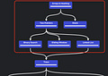

# Classic ML и DL

Черновая выгрузка из Miro. Номера и время сохранены как на доске; повторные номера не исправлены.
Порядок модулей: номер, затем положение сверху вниз и слева направо. Внутри модуля: сверху вниз, слева направо; развилки смотрите по связям.
Таблицы, рисунки и изображения без текста требуют просмотра в Miro. Полнота визуально не подтверждена: нужны крупные PNG.

[Все объекты и Miro ID](objects.csv) · [Связи между блоками](structure.md)

Содержание:

- 1. Математика — ~1-5 часов
- 2. Python — ~50 часов (номер повторяется на доске)
- 2. SQL — ~5.5 часа (номер повторяется на доске)
- 3. Библиотек Python — ~3 часа (номер повторяется на доске)
- 3. Git + Terminal — ~2-3 часа (номер повторяется на доске)
- 4. Алгоритмы и Структуры данных — ~30 часа
- 5. Classic ML — ~60 часов
- 6. Основы Deep Learning и трансформеров — ~12 часов
- 7. Теория вероятностей — ~2 часа (номер повторяется на доске)
- 7. Статистика и A/B тесты — ~17.5 часа (номер повторяется на доске)
- 8. Deploy — ~6 часов
- 9. ML System Design — ~10 часов
- 10. Создание легенды, резюме и самопрезентации — 20-40 часов

## 1. Математика

Время: ~1-5 часов

Miro ID: модуль `3458764691140220291`, номер `3458764691140220314`, время `3458764691140220313`.

### Линейная алгебра и Мат. анализ (куратор скажет, что выбрать)

Miro ID: `3458764691140220293`.

**Линейная алгебра и Мат. анализ**

**(куратор скажет, что выбрать)**

[Оригинал в Miro](https://miro.com/app/board/uXjVHVS-s1M=/?moveToWidget=3458764691140220293)

### Если уже когда-то знал, но забыл и надо повторить: видео на 25 минут

Miro ID: `3458764691140220294`.

Если уже когда-то знал, но забыл и надо повторить:  
[видео](https://www.youtube.com/watch?v=Nrq74MRHHJs) на 25 минут

Проверка ссылок:

- <https://www.youtube.com/watch?v=Nrq74MRHHJs> — Страница отвечает (HTTP 200); воспроизведение видео и ограничения входа не проверены

[Оригинал в Miro](https://miro.com/app/board/uXjVHVS-s1M=/?moveToWidget=3458764691140220294)

### Если если нужно учить с нуля: 1. видео на 25 минут 2. первые 6 глав этого плейлиста (линал) 3. и первые 6 глав этого плейлиста (матан)

Miro ID: `3458764691140220295`.

Если если нужно учить с нуля:  
1. [видео](https://www.youtube.com/watch?v=Nrq74MRHHJs) на 25 минут

2. первые 6 глав [этого плейлиста](https://www.youtube.com/playlist?list=PLZHQObOWTQDPD3MizzM2xVFitgF8hE_ab) (линал)

3. и первые 6 глав [этого плейлиста](https://www.youtube.com/playlist?list=PLZHQObOWTQDMsr9K-rj53DwVRMYO3t5Yr) (матан)

Проверка ссылок:

- <https://www.youtube.com/watch?v=Nrq74MRHHJs> — Страница отвечает (HTTP 200); воспроизведение видео и ограничения входа не проверены
- <https://www.youtube.com/playlist?list=PLZHQObOWTQDPD3MizzM2xVFitgF8hE_ab> — Страница отвечает (HTTP 200); воспроизведение видео и ограничения входа не проверены
- <https://www.youtube.com/playlist?list=PLZHQObOWTQDMsr9K-rj53DwVRMYO3t5Yr> — Страница отвечает (HTTP 200); воспроизведение видео и ограничения входа не проверены

[Оригинал в Miro](https://miro.com/app/board/uXjVHVS-s1M=/?moveToWidget=3458764691140220295)

## 2. Python

Время: ~50 часов

Miro ID: модуль `3458764691140220298`, номер `3458764691140220312`, время `3458764691140220300`.

### Бесплатный курс со степика . В данном курсе вас познакомят с базой питона, дадут много практики и задач для понимания: переменные, списки, словари, циклы, условия, функции Смотрим 

Miro ID: `3458764691140220299`.

Бесплатный [курс со степика](https://stepik.org/course/100707/promo). В данном курсе вас познакомят с базой питона, дадут много практики и задач для понимания: переменные, списки, словари, циклы, условия, функции

Смотрим всё, кроме:

- Булевы подвиги

- Треугольник Паскаля

- Весь блок "Движемся дальше, вглубь"

Проверка ссылок:

- <https://stepik.org/course/100707/promo> — URL отвечает (HTTP 200); доступ к платному содержимому не проверялся

[Оригинал в Miro](https://miro.com/app/board/uXjVHVS-s1M=/?moveToWidget=3458764691140220299)

### PYTHON ООП

Miro ID: `3458764691140220301`.

**PYTHON ООП**

[Оригинал в Miro](https://miro.com/app/board/uXjVHVS-s1M=/?moveToWidget=3458764691140220301)

### Если есть лишние 3000р, то покупаем продолжение базового курса , где разбирается ООП Если нет, то смотрим весь этот плейлист и ручками переписываем весь код, который там дается, чт

Miro ID: `3458764691140220303`.

Если есть лишние 3000р, то покупаем [продолжение базового курса](https://stepik.org/course/116336/promo?referral=WzExNjMzNiw0OTEzNTQwMTUsMTc0MjQ3Nzk4Mi44MDQ5OTQ4XQ%3A1tvG7a%3AK3rMecG2wXD7AncXYbF_lBMGcbg), где разбирается ООП

Если нет, то смотрим весь [этот плейлист](https://www.youtube.com/playlist?list=PLA0M1Bcd0w8zPwP7t-FgwONhZOHt9rz9E) и ручками переписываем весь код, который там дается, чтобы восполнить практику (это все лекции с платного курса, отличие только в том, что вы не получите дополнительных задач со степика)

Смотрим:

1. Весь модуль "Первые шаги ООП"

2. Весь модуль "Режимы доступа, свойства, дескрипторы"

3. Модуль магически методы классов. Уроки: 1,2,3,8,9  
4. Наследование и полиморфизм. Уроки: 1-4

5. Исключения и менеджеры контекста. Весь модуль

Проверка ссылок:

- <https://stepik.org/course/116336/promo?referral=WzExNjMzNiw0OTEzNTQwMTUsMTc0MjQ3Nzk4Mi44MDQ5OTQ4XQ%3A1tvG7a%3AK3rMecG2wXD7AncXYbF_lBMGcbg> — URL отвечает (HTTP 200); доступ к платному содержимому не проверялся
- <https://www.youtube.com/playlist?list=PLA0M1Bcd0w8zPwP7t-FgwONhZOHt9rz9E> — Страница отвечает (HTTP 200); воспроизведение видео и ограничения входа не проверены

[Оригинал в Miro](https://miro.com/app/board/uXjVHVS-s1M=/?moveToWidget=3458764691140220303)

## 2. SQL

Время: ~5.5 часа

Miro ID: модуль `3458764691140220034`, номер `3458764691140220317`, время `3458764691140220318`.

### SQL Academy - хороший и наглядный курс по SQL с разными практическими заданиями. Проходите до модуля 5 включительно.

Miro ID: `3458764691140220035`.

[SQL Academy](https://sql-academy.org/ru) - хороший и наглядный курс по SQL с разными практическими заданиями. Проходите до модуля 5 включительно.

Проверка ссылок:

- <https://sql-academy.org/ru> — URL отвечает (HTTP 200); доступ к платному содержимому не проверялся

[Оригинал в Miro](https://miro.com/app/board/uXjVHVS-s1M=/?moveToWidget=3458764691140220035)

## 3. Библиотек Python

Время: ~3 часа

Miro ID: модуль `3458764691140220192`, номер `3458764691140220325`, время `3458764691140220324`.

### БИБЛИОТЕКИ PYTHON

Miro ID: `3458764691140220198`.

**БИБЛИОТЕКИ PYTHON**

[Оригинал в Miro](https://miro.com/app/board/uXjVHVS-s1M=/?moveToWidget=3458764691140220198)

### NUMPY

Miro ID: `3458764691140220196`.

**NUMPY**

[Оригинал в Miro](https://miro.com/app/board/uXjVHVS-s1M=/?moveToWidget=3458764691140220196)

### PANDAS

Miro ID: `3458764691140220200`.

**PANDAS**

[Оригинал в Miro](https://miro.com/app/board/uXjVHVS-s1M=/?moveToWidget=3458764691140220200)

### Смотрим видео на 1.5 часа и переписываем весь код ручками

Miro ID: `3458764691140220195`.

Смотрим [видео](https://www.youtube.com/watch?v=2uvysYbKdjM&list=WL&index=9) на 1.5 часа и переписываем весь код ручками

Проверка ссылок:

- <https://www.youtube.com/watch?v=2uvysYbKdjM&list=WL&index=9> — Страница отвечает (HTTP 200); воспроизведение видео и ограничения входа не проверены

[Оригинал в Miro](https://miro.com/app/board/uXjVHVS-s1M=/?moveToWidget=3458764691140220195)

### Смотрим видео на 1 час и переписываем весь код ручками

Miro ID: `3458764691140220194`.

Смотрим [видео](https://www.youtube.com/watch?v=GB9ByFAIAH4&t=2759s) на 1 час и переписываем весь код ручками

Проверка ссылок:

- <https://www.youtube.com/watch?v=GB9ByFAIAH4&t=2759s> — Страница отвечает (HTTP 200); воспроизведение видео и ограничения входа не проверены

[Оригинал в Miro](https://miro.com/app/board/uXjVHVS-s1M=/?moveToWidget=3458764691140220194)

## 3. Git + Terminal

Время: ~2-3 часа

Miro ID: модуль `3458764691140220290`, номер `3458764691140220316`, время `3458764691140220315`.

### Док с основными командами в терминале Linux и как с ними взаимодействовать

Miro ID: `3458764691140220307`.

[Док с основными командами](https://docs.google.com/document/d/1nj3aLp-AmdfJgqb09wrRu24qKDTaTJ6EPkUWnXdvlXg/edit?tab=t.0#heading=h.jgxs2s7g8e6i) в терминале Linux и как с ними взаимодействовать

Проверка ссылок:

- <https://docs.google.com/document/d/1nj3aLp-AmdfJgqb09wrRu24qKDTaTJ6EPkUWnXdvlXg/edit?tab=t.0#heading=h.jgxs2s7g8e6i> — Нужна авторизация (HTTP 401)

[Оригинал в Miro](https://miro.com/app/board/uXjVHVS-s1M=/?moveToWidget=3458764691140220307)

### 1. Статья про git 2. Полезные материалы по работе с ним 3. Игра с практикой 1 4. Игра с практикой 2 Которые дадут понимание того, как он работает и какие первые шаги нужно будет сд

Miro ID: `3458764691140220306`.

1. [Статья про git](https://habr.com/ru/articles/588801/)

2. [Полезные материалы по работе с ним](https://drive.google.com/file/d/1FCLBMVea5Kf2BclV4GDQ2BHP5PpncGhC/view?usp=sharing)

3. [Игра с практикой 1](https://learngitbranching.js.org/)

4. [Игра с практикой 2](https://ohmygit.org/)

Которые дадут понимание того, как он работает и какие первые шаги нужно будет сделать, когда начнёшь использовать его в работе

Проверка ссылок:

- <https://habr.com/ru/articles/588801/> — URL отвечает (HTTP 200); доступ к платному содержимому не проверялся
- <https://drive.google.com/file/d/1FCLBMVea5Kf2BclV4GDQ2BHP5PpncGhC/view?usp=sharing> — Нужна авторизация (HTTP 401)
- <https://learngitbranching.js.org/> — URL отвечает (HTTP 200); доступ к платному содержимому не проверялся
- <https://ohmygit.org/> — URL отвечает (HTTP 200); доступ к платному содержимому не проверялся

[Оригинал в Miro](https://miro.com/app/board/uXjVHVS-s1M=/?moveToWidget=3458764691140220306)

### Или можно выполнить практическое задание: - Зарегистрироваться на гитхабе - Создай репозиторий - Создать там несколько python файлов - Сделать коммит - Сделать изменения в файлах -

Miro ID: `3458764691140220309`.

Или можно выполнить практическое задание:

- Зарегистрироваться на гитхабе

- Создай репозиторий

- Создать там несколько python файлов

- Сделать коммит

- Сделать изменения в файлах

- Сделать новый коммит

- Создать новую ветку

- Сделать изменения в новой ветке

- Влить изменения в метку main

[Оригинал в Miro](https://miro.com/app/board/uXjVHVS-s1M=/?moveToWidget=3458764691140220309)

## 4. Алгоритмы и Структуры данных

Время: ~30 часа

Miro ID: модуль `3458764691140220032`, номер `3458764691140220327`, время `3458764691140220326`.

### АЛГОРИТМЫ

Miro ID: `3458764691140220043`.

**АЛГОРИТМЫ**

[Оригинал в Miro](https://miro.com/app/board/uXjVHVS-s1M=/?moveToWidget=3458764691140220043)

### Прочитать статью с хабра по сложности алгоритмов Ещё одна статья про сложности алгоритмов

Miro ID: `3458764691140220050`.

Прочитать [статью с хабра](https://habr.com/ru/articles/782608/) по сложности алгоритмов

Ещё одна [статья](https://proglib.io/p/slozhnost-algoritmov-i-operaciy-na-primere-python-2020-11-03) про сложности алгоритмов

Проверка ссылок:

- <https://habr.com/ru/articles/782608/> — URL отвечает (HTTP 200); доступ к платному содержимому не проверялся
- <https://proglib.io/p/slozhnost-algoritmov-i-operaciy-na-primere-python-2020-11-03> — URL отвечает (HTTP 200); доступ к платному содержимому не проверялся

[Оригинал в Miro](https://miro.com/app/board/uXjVHVS-s1M=/?moveToWidget=3458764691140220050)

### PYTHON

Miro ID: `3458764691140220044`.

**PYTHON**

[Оригинал в Miro](https://miro.com/app/board/uXjVHVS-s1M=/?moveToWidget=3458764691140220044)

### SQL

Miro ID: `3458764691140220045`.

**SQL**

[Оригинал в Miro](https://miro.com/app/board/uXjVHVS-s1M=/?moveToWidget=3458764691140220045)

### PANDAS

Miro ID: `3458764691140220054`.

**PANDAS**

[Оригинал в Miro](https://miro.com/app/board/uXjVHVS-s1M=/?moveToWidget=3458764691140220054)

### Решаем все задачи со сборника на leetcode

Miro ID: `3458764691140220056`.

Решаем все задачи со [сборника на leetcode](https://leetcode.com/studyplan/30-days-of-pandas/)

Проверка ссылок:

- <https://leetcode.com/studyplan/30-days-of-pandas/> — Доступ не подтверждён: ограничение/блокировка (HTTP 403)

[Оригинал в Miro](https://miro.com/app/board/uXjVHVS-s1M=/?moveToWidget=3458764691140220056)

### Проходимся по всем easy задачам с leetcode sql 50

Miro ID: `3458764691140220048`.

Проходимся по всем easy задачам с [leetcode sql 50](https://leetcode.com/studyplan/top-sql-50/)

Проверка ссылок:

- <https://leetcode.com/studyplan/top-sql-50/> — Доступ не подтверждён: ограничение/блокировка (HTTP 403)

[Оригинал в Miro](https://miro.com/app/board/uXjVHVS-s1M=/?moveToWidget=3458764691140220048)

### RoadMap от NeedCode`a - необходимая и нерушимая база каждого лайвкодера, на начальном этапе необходимо убить easy задачи тех тем, которые помечены на картинке красным

Miro ID: `3458764691140220046`.

[RoadMap от NeedCode`a](https://neetcode.io/roadmap) - необходимая и нерушимая база каждого лайвкодера, на начальном этапе необходимо убить easy задачи тех тем, которые помечены на картинке красным

Проверка ссылок:

- <https://neetcode.io/roadmap> — URL отвечает (HTTP 200); доступ к платному содержимому не проверялся

[Оригинал в Miro](https://miro.com/app/board/uXjVHVS-s1M=/?moveToWidget=3458764691140220046)

### КАК РЕШАТЬ АЛГОРИТМЫ

Miro ID: `3458764691140220058`.

**КАК РЕШАТЬ АЛГОРИТМЫ**

[Оригинал в Miro](https://miro.com/app/board/uXjVHVS-s1M=/?moveToWidget=3458764691140220058)

### image

Miro ID: `3458764691140220059`.

Материал доступен на исходной доске Miro.

[Открыть объект в Miro](https://miro.com/app/board/uXjVHVS-s1M=/?moveToWidget=3458764691140220059)

[Оригинал в Miro](https://miro.com/app/board/uXjVHVS-s1M=/?moveToWidget=3458764691140220059)

### 0) Общий алгоритм для прорешивания алгоритмов выглядит следующим образом: - Идёте на neetcode - Открываете задачу - Пытаетесь решить её за 10-15 минут сами - Если вы за это время н

Miro ID: `3458764691140220187`.

0) Общий алгоритм для прорешивания алгоритмов выглядит следующим образом:

- Идёте на neetcode

- Открываете задачу

- Пытаетесь решить её за 10-15 минут сами

- Если вы за это время не смогли написать решение - идёте и изучает его

- Если вы за это время решили его - супер, всё круто

1) Вам не нужно фокусироваться ТОЛЬКО на алгоритмах, вы должны решать их понемногу, параллельно последующим блокам, размазать этот блок на весь оставшийся путь до начала первых собесов

2) Это надо для того, чтобы вы не забывали как их решать, потому что если прорешать всё за неделю, а потом месяц изучать ML, то вы напрочь забудете о том как решать те или иные алгосы

3) Для простоты понимания, просто решайте:

- Python (1-2 задачи в неделю уровня easy, middle)

- SQL (1-2 задачи в неделю)

- Pandas (1-2 задачу в неделю)

[Оригинал в Miro](https://miro.com/app/board/uXjVHVS-s1M=/?moveToWidget=3458764691140220187)

### Когда прорешаете все примеры уровня easy, middle В RoadMap'е от NeetCode, то прорешайте наиболее часто встречаемые вопросы с Яндекса . Зачастую эти вопросы встречаются и в других к

Miro ID: `3458764691140220188`.

Когда прорешаете все примеры уровня easy, middle В RoadMap'е от NeetCode, то прорешайте [наиболее часто встречаемые вопросы с Яндекса](https://disk.yandex.ru/i/J4p8RRNRQh9mKQ). Зачастую эти вопросы встречаются и в других компаниях

Также пользуйтесь [классными шаблонами](https://www.notion.so/1daf48226be780a4962fd5d25f575f4f) для всех основных алгоритмов

Проверка ссылок:

- <https://disk.yandex.ru/i/J4p8RRNRQh9mKQ> — URL отвечает (HTTP 200); доступ к платному содержимому не проверялся
- <https://www.notion.so/1daf48226be780a4962fd5d25f575f4f> — URL отвечает (HTTP 200); доступ к платному содержимому не проверялся

[Оригинал в Miro](https://miro.com/app/board/uXjVHVS-s1M=/?moveToWidget=3458764691140220188)

## 5. Classic ML

Время: ~60 часов

Miro ID: модуль `3458764691140220031`, номер `3458764691140220289`, время `3458764691140220288`.

### Обучение с учителем / Линейная Регрессия

Miro ID: `3458764691140220075`.

**Обучение с учителем / Линейная Регрессия**

[Оригинал в Miro](https://miro.com/app/board/uXjVHVS-s1M=/?moveToWidget=3458764691140220075)

### Обучение с учителем / Классификация

Miro ID: `3458764691140220089`.

**Обучение с учителем / Классификация**

[Оригинал в Miro](https://miro.com/app/board/uXjVHVS-s1M=/?moveToWidget=3458764691140220089)

### Вводная часть

Miro ID: `3458764691140220088`.

**Вводная часть**

[Оригинал в Miro](https://miro.com/app/board/uXjVHVS-s1M=/?moveToWidget=3458764691140220088)

### Линейная/полиномиальная  регрессия (1-2 дня) Теория: 1. РЕАЛИЗАЦИЯ ЛИНЕЙНОЙ РЕГРЕССИИ | Линейная регрессия | LinearRegression | МАШИННОЕ ОБУЧЕНИЕ 2. mlu-explain 3. Тренировки по ML

Miro ID: `3458764691140220068`.

**Линейная/полиномиальная регрессия (1-2 дня)**

Теория:

1. [РЕАЛИЗАЦИЯ ЛИНЕЙНОЙ РЕГРЕССИИ | Линейная регрессия | LinearRegression | МАШИННОЕ ОБУЧЕНИЕ](https://www.youtube.com/watch?v=KJA9A1q9l7E&ab_channel=machinelearrrning)

2. [mlu-explain](https://mlu-explain.github.io/linear-regression/)

3. [Тренировки по ML. Лекция 2: Линейная регрессия и регуляризация](https://www.youtube.com/watch?v=5qLVUO0q644&list=PLXtiZNKIobF5wGW0ExSn47db1I8uYnfIC&index=2)

4. [Курс «Машинное обучение 1». Лекция 2 (Евгений Соколов)](https://www.youtube.com/watch?v=MA66hFXaq7o&list=PLEqoHzpnmTfChItexxg2ZfxCsm-8QPsdS&index=2) или 3, 4 урок Karpov/Courses

**Чтиво для закрепления:**

1. [ML Handbook 2.1. Линейные модели](https://education.yandex.ru/handbook/ml/article/linear-models)

[Практика](https://drive.google.com/drive/folders/1InNNnSGyz1yjl9B8VzSsyQSfc4HCl6-M?usp=sharing)

[Ссылка на данные](https://disk.yandex.ru/d/guhN1YgFKT41qQ) для практики

Проверка ссылок:

- <https://www.youtube.com/watch?v=KJA9A1q9l7E&ab_channel=machinelearrrning> — Страница отвечает (HTTP 200); воспроизведение видео и ограничения входа не проверены
- <https://mlu-explain.github.io/linear-regression/> — URL отвечает (HTTP 200); доступ к платному содержимому не проверялся
- <https://www.youtube.com/watch?v=5qLVUO0q644&list=PLXtiZNKIobF5wGW0ExSn47db1I8uYnfIC&index=2> — Страница отвечает (HTTP 200); воспроизведение видео и ограничения входа не проверены
- <https://www.youtube.com/watch?v=MA66hFXaq7o&list=PLEqoHzpnmTfChItexxg2ZfxCsm-8QPsdS&index=2> — Страница отвечает (HTTP 200); воспроизведение видео и ограничения входа не проверены
- <https://education.yandex.ru/handbook/ml/article/linear-models> — URL отвечает (HTTP 200); доступ к платному содержимому не проверялся
- <https://drive.google.com/drive/folders/1InNNnSGyz1yjl9B8VzSsyQSfc4HCl6-M?usp=sharing> — URL отвечает (HTTP 200); доступ к платному содержимому не проверялся
- <https://disk.yandex.ru/d/guhN1YgFKT41qQ> — Недоступна при проверке (HTTP 404)

[Оригинал в Miro](https://miro.com/app/board/uXjVHVS-s1M=/?moveToWidget=3458764691140220068)

### Градиентный спуск (1-2 дня) Теория: 1. Градиентный спуск 2. Машинное обучение: градиентный спуск для новичков с практикой в Python 3. mlu-explain 3. Тренировки по ML. Лекция 2: Лин

Miro ID: `3458764691140220069`.

**Градиентный спуск (1-2 дня)**

Теория:

1. [Градиентный спуск](https://www.youtube.com/watch?v=BO5TKBr_uUc&ab_channel=%D0%A6%D0%B5%D0%BD%D1%82%D1%80digital%D0%BF%D1%80%D0%BE%D1%84%D0%B5%D1%81%D1%81%D0%B8%D0%B9ITtensive)

2. [Машинное обучение: градиентный спуск для новичков с практикой в Python](https://www.youtube.com/watch?v=e7Ic4zLWYxc&ab_channel=%D0%94%D0%B0%D1%82%D0%B0%D0%91%D0%BE%D0%B9)

3. [mlu-explain](https://mlu-explain.github.io/linear-regression/)

3. [Тренировки по ML. Лекция 2: Линейная регрессия и регуляризация](https://www.youtube.com/watch?v=5qLVUO0q644&list=PLXtiZNKIobF5wGW0ExSn47db1I8uYnfIC&index=2)

4. [Курс «Машинное обучение 1». Лекция 3 (Евгений Соколов)](https://www.youtube.com/watch?v=Wwg6dU1pX4A&list=PLEqoHzpnmTfChItexxg2ZfxCsm-8QPsdS&index=3&ab_channel=%D0%A4%D0%9A%D0%9D%D0%92%D0%A8%D0%AD) или 4 урок Karpov/Courses

**Чтиво для закрепления:**

1. [ML Handbook 2.1. Линейные модели](https://education.yandex.ru/handbook/ml/article/linear-models)

[Практика](https://drive.google.com/drive/folders/1_7hy_lSz93OL_3_p4IsDB-cgLxPGmyR9?usp=sharing)

Проверка ссылок:

- <https://www.youtube.com/watch?v=BO5TKBr_uUc&ab_channel=%D0%A6%D0%B5%D0%BD%D1%82%D1%80digital%D0%BF%D1%80%D0%BE%D1%84%D0%B5%D1%81%D1%81%D0%B8%D0%B9ITtensive> — Страница отвечает (HTTP 200); воспроизведение видео и ограничения входа не проверены
- <https://www.youtube.com/watch?v=e7Ic4zLWYxc&ab_channel=%D0%94%D0%B0%D1%82%D0%B0%D0%91%D0%BE%D0%B9> — Страница отвечает (HTTP 200); воспроизведение видео и ограничения входа не проверены
- <https://mlu-explain.github.io/linear-regression/> — URL отвечает (HTTP 200); доступ к платному содержимому не проверялся
- <https://www.youtube.com/watch?v=5qLVUO0q644&list=PLXtiZNKIobF5wGW0ExSn47db1I8uYnfIC&index=2> — Страница отвечает (HTTP 200); воспроизведение видео и ограничения входа не проверены
- <https://www.youtube.com/watch?v=Wwg6dU1pX4A&list=PLEqoHzpnmTfChItexxg2ZfxCsm-8QPsdS&index=3&ab_channel=%D0%A4%D0%9A%D0%9D%D0%92%D0%A8%D0%AD> — Страница отвечает (HTTP 200); воспроизведение видео и ограничения входа не проверены
- <https://education.yandex.ru/handbook/ml/article/linear-models> — URL отвечает (HTTP 200); доступ к платному содержимому не проверялся
- <https://drive.google.com/drive/folders/1_7hy_lSz93OL_3_p4IsDB-cgLxPGmyR9?usp=sharing> — URL отвечает (HTTP 200); доступ к платному содержимому не проверялся

[Оригинал в Miro](https://miro.com/app/board/uXjVHVS-s1M=/?moveToWidget=3458764691140220069)

### Обобщающая способность модели: метод отложенной выборки. Кросс-Валидация (1 день) Теория: 1. 5 урок Karpov/Courses или 2. Разбиение выборки 3. Machine Learning. Урок №2. Кросс - ва

Miro ID: `3458764691140220070`.

**Обобщающая способность модели: метод отложенной выборки. Кросс-Валидация (1 день)**

Теория:

1. 5 урок Karpov/Courses

или

2. [Разбиение выборки](https://www.youtube.com/watch?v=8jVUPFtYR0g&ab_channel=%D0%A6%D0%B5%D0%BD%D1%82%D1%80digital%D0%BF%D1%80%D0%BE%D1%84%D0%B5%D1%81%D1%81%D0%B8%D0%B9ITtensive)

3. [Machine Learning. Урок №2. Кросс - валидация/Сross-validation](https://www.youtube.com/watch?v=Sjof9d8R96E&ab_channel=hyperlee)

4. mlu-explain - [train-test-validation](https://mlu-explain.github.io/train-test-validation/)

[Практика](https://drive.google.com/drive/folders/1SbPrD9npyINw3YQWTE_bdL8tKP9LCz8U?usp=sharing)

Проверка ссылок:

- <https://www.youtube.com/watch?v=8jVUPFtYR0g&ab_channel=%D0%A6%D0%B5%D0%BD%D1%82%D1%80digital%D0%BF%D1%80%D0%BE%D1%84%D0%B5%D1%81%D1%81%D0%B8%D0%B9ITtensive> — Страница отвечает (HTTP 200); воспроизведение видео и ограничения входа не проверены
- <https://www.youtube.com/watch?v=Sjof9d8R96E&ab_channel=hyperlee> — Страница отвечает (HTTP 200); воспроизведение видео и ограничения входа не проверены
- <https://mlu-explain.github.io/train-test-validation/> — URL отвечает (HTTP 200); доступ к платному содержимому не проверялся
- <https://drive.google.com/drive/folders/1SbPrD9npyINw3YQWTE_bdL8tKP9LCz8U?usp=sharing> — URL отвечает (HTTP 200); доступ к платному содержимому не проверялся

[Оригинал в Miro](https://miro.com/app/board/uXjVHVS-s1M=/?moveToWidget=3458764691140220070)

### Регуляризации. L1, L2, Elastic Net, Уменьшение кол-ва параметров (1-2 дня) Теория: 1. 6 урок Karpov/Courses 2. ПЕРЕОБУЧЕНИЕ И НЕДООБУЧЕНИЕ В МАШИННОМ ОБУЧЕНИИ | overfitting, underf

Miro ID: `3458764691140220074`.

**Регуляризации. L1, L2, Elastic Net, Уменьшение кол-ва параметров (1-2 дня)**

Теория:

1. 6 урок Karpov/Courses

2. [ПЕРЕОБУЧЕНИЕ И НЕДООБУЧЕНИЕ В МАШИННОМ ОБУЧЕНИИ | overfitting, underfitting для регрессии](https://www.youtube.com/watch?v=m7P7bnLxIc4&ab_channel=machinelearrrning)

3. [Что делать с переобучением | Методы борьбы с переобучением | МАШИННОЕ ОБУЧЕНИЕ](https://www.youtube.com/watch?v=tqhsbEYKJRI&ab_channel=machinelearrrning)

4. [Регуляризация простыми словами | L1, L2, Elastic Net | Lasso, Ridge | Машинное обучение](https://www.youtube.com/watch?v=4WcHxtYy3_8&ab_channel=machinelearrrning)

5. [Почему L1 регуляризация отбирает признаки? Понятное объяснение](https://www.youtube.com/watch?v=vACmNV1xPDA&ab_channel=%D0%9B%D1%91%D1%88%D0%B0%D0%91%D1%83%D1%85%D1%82%D0%B8%D1%8F%D1%80%D0%BE%D0%B2)

6. [StandardScaler| MinMaxScaler | МАСШТАБИРОВАНИЕ ДАННЫХ | МАШИННОЕ ОБУЧЕНИЕ](https://www.youtube.com/watch?v=XsuCOfpf8Ic&ab_channel=machinelearrrning)

7. [Тренировки по ML. Лекция 2: Линейная регрессия и регуляризация](https://www.youtube.com/watch?v=5qLVUO0q644&list=PLXtiZNKIobF5wGW0ExSn47db1I8uYnfIC&index=3&ab_channel=Young%26%26Yandex)

8. [Курс «Машинное обучение 1». Лекция 3 (Евгений Соколов)](https://www.youtube.com/watch?v=Wwg6dU1pX4A&list=PLEqoHzpnmTfChItexxg2ZfxCsm-8QPsdS&index=3&ab_channel=%D0%A4%D0%9A%D0%9D%D0%92%D0%A8%D0%AD) или 6 урок Karpov/Courses

**Чтиво для закрепления:**

1. [ML Handbook 2.1. Линейные модели](https://education.yandex.ru/handbook/ml/article/linear-models)

[Практика](https://drive.google.com/drive/folders/1YEGLEVUOOMGzcDSenpAzXWT9DZI3uHHP?usp=sharing)

Проверка ссылок:

- <https://www.youtube.com/watch?v=m7P7bnLxIc4&ab_channel=machinelearrrning> — Страница отвечает (HTTP 200); воспроизведение видео и ограничения входа не проверены
- <https://www.youtube.com/watch?v=tqhsbEYKJRI&ab_channel=machinelearrrning> — Страница отвечает (HTTP 200); воспроизведение видео и ограничения входа не проверены
- <https://www.youtube.com/watch?v=4WcHxtYy3_8&ab_channel=machinelearrrning> — Страница отвечает (HTTP 200); воспроизведение видео и ограничения входа не проверены
- <https://www.youtube.com/watch?v=vACmNV1xPDA&ab_channel=%D0%9B%D1%91%D1%88%D0%B0%D0%91%D1%83%D1%85%D1%82%D0%B8%D1%8F%D1%80%D0%BE%D0%B2> — Страница отвечает (HTTP 200); воспроизведение видео и ограничения входа не проверены
- <https://www.youtube.com/watch?v=XsuCOfpf8Ic&ab_channel=machinelearrrning> — Страница отвечает (HTTP 200); воспроизведение видео и ограничения входа не проверены
- <https://www.youtube.com/watch?v=5qLVUO0q644&list=PLXtiZNKIobF5wGW0ExSn47db1I8uYnfIC&index=3&ab_channel=Young%26%26Yandex> — Страница отвечает (HTTP 200); воспроизведение видео и ограничения входа не проверены
- <https://www.youtube.com/watch?v=Wwg6dU1pX4A&list=PLEqoHzpnmTfChItexxg2ZfxCsm-8QPsdS&index=3&ab_channel=%D0%A4%D0%9A%D0%9D%D0%92%D0%A8%D0%AD> — Страница отвечает (HTTP 200); воспроизведение видео и ограничения входа не проверены
- <https://education.yandex.ru/handbook/ml/article/linear-models> — URL отвечает (HTTP 200); доступ к платному содержимому не проверялся
- <https://drive.google.com/drive/folders/1YEGLEVUOOMGzcDSenpAzXWT9DZI3uHHP?usp=sharing> — URL отвечает (HTTP 200); доступ к платному содержимому не проверялся

[Оригинал в Miro](https://miro.com/app/board/uXjVHVS-s1M=/?moveToWidget=3458764691140220074)

### Логистическая регрессия (1-3 дня) Теория: 1. Логистическая регрессия, самое простое объяснение! 2. Логистическая Регрессия | Logistic Regression | Линейная модель для классификации

Miro ID: `3458764691140220076`.

**Логистическая регрессия (1-3 дня)**

Теория:

1. [Логистическая регрессия, самое простое объяснение!](https://www.youtube.com/watch?v=8sp5aqyH6Oc&ab_channel=StartCareerinDS)

2. [Логистическая Регрессия | Logistic Regression | Линейная модель для классификации |МАШИННОЕ ОБУЧЕНИЕ](https://www.youtube.com/watch?v=9BoVCdedvW8&ab_channel=machinelearrrning)

3. [Реализация модели Логистическая Регрессия | Logistic Regression | Линейная модель для классификации](https://www.youtube.com/watch?v=ruVK07YF-RU&ab_channel=machinelearrrning)

4. [mlu-explain](https://mlu-explain.github.io/logistic-regression/)

5. [Логистическая Регрессия для Дата Саентиста](https://www.youtube.com/watch?v=49ck7kCyxr4&t=6347s&ab_channel=%D0%93%D0%BB%D0%B5%D0%B1%D0%9C%D0%B8%D1%85%D0%B0%D0%B9%D0%BB%D0%BE%D0%B2)

6. [Тренировки по ML. Лекция 3: Линейная классификация, метод максимального правдоподобия](https://www.youtube.com/watch?v=R1ccYYpEpiA&list=PLXtiZNKIobF5wGW0ExSn47db1I8uYnfIC&index=3&ab_channel=Young%26%26Yandex)

7. [Курс «Машинное обучение 1». Лекция 6 (Евгений Соколов)](https://youtu.be/sEqGtjnJE2o?list=PLEqoHzpnmTfChItexxg2ZfxCsm-8QPsdS) и [Курс «Машинное обучение 1». Дополнение к лекции 6 (Евгений Соколов)](https://www.youtube.com/watch?v=lP1l8YPjSQY&list=PLEqoHzpnmTfChItexxg2ZfxCsm-8QPsdS&index=8&ab_channel=%D0%A4%D0%9A%D0%9D%D0%92%D0%A8%D0%AD) или 10 урок Karpov/Courses

**Чтиво для закрепления:**

1. [ML Handbook 11.2. Логистическая регрессия](https://education.yandex.ru/handbook/data-analysis/article/logisticheskaya-regressiya)

[Практика](https://drive.google.com/drive/folders/1PMfImDAXGxPIXNjyGRN0c7aNPeC-WsjS?usp=sharing)

Проверка ссылок:

- <https://www.youtube.com/watch?v=8sp5aqyH6Oc&ab_channel=StartCareerinDS> — Страница отвечает (HTTP 200); воспроизведение видео и ограничения входа не проверены
- <https://www.youtube.com/watch?v=9BoVCdedvW8&ab_channel=machinelearrrning> — Страница отвечает (HTTP 200); воспроизведение видео и ограничения входа не проверены
- <https://www.youtube.com/watch?v=ruVK07YF-RU&ab_channel=machinelearrrning> — Страница отвечает (HTTP 200); воспроизведение видео и ограничения входа не проверены
- <https://mlu-explain.github.io/logistic-regression/> — URL отвечает (HTTP 200); доступ к платному содержимому не проверялся
- <https://www.youtube.com/watch?v=49ck7kCyxr4&t=6347s&ab_channel=%D0%93%D0%BB%D0%B5%D0%B1%D0%9C%D0%B8%D1%85%D0%B0%D0%B9%D0%BB%D0%BE%D0%B2> — Страница отвечает (HTTP 200); воспроизведение видео и ограничения входа не проверены
- <https://www.youtube.com/watch?v=R1ccYYpEpiA&list=PLXtiZNKIobF5wGW0ExSn47db1I8uYnfIC&index=3&ab_channel=Young%26%26Yandex> — Страница отвечает (HTTP 200); воспроизведение видео и ограничения входа не проверены
- <https://youtu.be/sEqGtjnJE2o?list=PLEqoHzpnmTfChItexxg2ZfxCsm-8QPsdS> — Страница отвечает (HTTP 200); воспроизведение видео и ограничения входа не проверены
- <https://www.youtube.com/watch?v=lP1l8YPjSQY&list=PLEqoHzpnmTfChItexxg2ZfxCsm-8QPsdS&index=8&ab_channel=%D0%A4%D0%9A%D0%9D%D0%92%D0%A8%D0%AD> — Страница отвечает (HTTP 200); воспроизведение видео и ограничения входа не проверены
- <https://education.yandex.ru/handbook/data-analysis/article/logisticheskaya-regressiya> — URL отвечает (HTTP 200); доступ к платному содержимому не проверялся
- <https://drive.google.com/drive/folders/1PMfImDAXGxPIXNjyGRN0c7aNPeC-WsjS?usp=sharing> — URL отвечает (HTTP 200); доступ к платному содержимому не проверялся

[Оригинал в Miro](https://miro.com/app/board/uXjVHVS-s1M=/?moveToWidget=3458764691140220076)

### Матрица ошибок и основные метрики бинарной классификации. Accuracy, Precision, Recall, F1 (1-2 дня) Теория: 1. PRECISION, RECALL, CONFUSION MATRIX, ТОЧНОСТЬ, ПОЛНОТА, МАТРИЦА ОШИБО

Miro ID: `3458764691140220077`.

**Матрица ошибок и основные метрики бинарной классификации. Accuracy, Precision, Recall, F1 (1-2 дня)**

Теория:

1. [PRECISION, RECALL, CONFUSION MATRIX, ТОЧНОСТЬ, ПОЛНОТА, МАТРИЦА ОШИБОК | МЕТРИКИ КЛАССИФИКАЦИИ](https://www.youtube.com/watch?v=AfnBHL832Eg&ab_channel=machinelearrrning)

2. [mlu-explain Precision & Recall](https://mlu-explain.github.io/precision-recall/)

3. [Курс «Машинное обучение 1». Лекция 5 (Евгений Соколов)](https://www.youtube.com/watch?v=Q824WEEnDVA&list=PLEqoHzpnmTfChItexxg2ZfxCsm-8QPsdS&index=5&ab_channel=%D0%A4%D0%9A%D0%9D%D0%92%D0%A8%D0%AD) или 11 урок Karpov/Courses

**Чтиво для закрепления:**

1. [MLHandbook - 3.1. Метрики классификации и регрессии](https://education.yandex.ru/handbook/ml/article/metriki-klassifikacii-i-regressii)

2. Мой [конспект](https://publish.obsidian.md/mentoring/tochka/%D0%B3%D1%80%D0%B5%D0%B9%D0%B4%D0%B8%D1%80%D0%BE%D0%B2%D0%B0%D0%BD%D0%B8%D0%B5/%D0%9C%D0%B5%D1%82%D1%80%D0%B8%D0%BA%D0%B8+%D0%9A%D0%BB%D0%B0%D1%81%D1%81%D0%B8%D1%84%D0%B8%D0%BA%D0%B0%D1%86%D0%B8%D0%B8) про метрики классификации

[Практика](https://drive.google.com/drive/folders/1AFV45OU0rwi-1UZpAyi7JxVftrFOn2V8?usp=sharing)

Проверка ссылок:

- <https://www.youtube.com/watch?v=AfnBHL832Eg&ab_channel=machinelearrrning> — Страница отвечает (HTTP 200); воспроизведение видео и ограничения входа не проверены
- <https://mlu-explain.github.io/precision-recall/> — URL отвечает (HTTP 200); доступ к платному содержимому не проверялся
- <https://www.youtube.com/watch?v=Q824WEEnDVA&list=PLEqoHzpnmTfChItexxg2ZfxCsm-8QPsdS&index=5&ab_channel=%D0%A4%D0%9A%D0%9D%D0%92%D0%A8%D0%AD> — Страница отвечает (HTTP 200); воспроизведение видео и ограничения входа не проверены
- <https://education.yandex.ru/handbook/ml/article/metriki-klassifikacii-i-regressii> — URL отвечает (HTTP 200); доступ к платному содержимому не проверялся
- <https://publish.obsidian.md/mentoring/tochka/%D0%B3%D1%80%D0%B5%D0%B9%D0%B4%D0%B8%D1%80%D0%BE%D0%B2%D0%B0%D0%BD%D0%B8%D0%B5/%D0%9C%D0%B5%D1%82%D1%80%D0%B8%D0%BA%D0%B8+%D0%9A%D0%BB%D0%B0%D1%81%D1%81%D0%B8%D1%84%D0%B8%D0%BA%D0%B0%D1%86%D0%B8%D0%B8> — Недоступна при проверке (HTTP 404)
- <https://drive.google.com/drive/folders/1AFV45OU0rwi-1UZpAyi7JxVftrFOn2V8?usp=sharing> — URL отвечает (HTTP 200); доступ к платному содержимому не проверялся

[Оригинал в Miro](https://miro.com/app/board/uXjVHVS-s1M=/?moveToWidget=3458764691140220077)

### ROC, PR-кривые. AUC-ROC, AUC-PR. Калибровка (1-2 дня) Теория: 1. ROC-AUC, ROC-CURVE, ROC-КРИВАЯ | МЕТРИКИ КЛАССИФИКАЦИИ 2. PR-AUC, PR-CURVE, PR-КРИВАЯ, PRECISION RECALL КРИВАЯ | МЕ

Miro ID: `3458764691140220078`.

**ROC, PR-кривые. AUC-ROC, AUC-PR. Калибровка (1-2 дня)**

Теория:

1. [ROC-AUC, ROC-CURVE, ROC-КРИВАЯ | МЕТРИКИ КЛАССИФИКАЦИИ](https://www.youtube.com/watch?v=v6PPG8J_Egs&ab_channel=machinelearrrning)

2. [PR-AUC, PR-CURVE, PR-КРИВАЯ, PRECISION RECALL КРИВАЯ | МЕТРИКИ КЛАССИФИКАЦИИ](https://www.youtube.com/watch?v=QW-09jHQH-w&ab_channel=machinelearrrning)

3. [mlu-explain ROC & AUC](https://mlu-explain.github.io/roc-auc/)

4. [ROC 🤘 для Дата Саентиста](https://www.youtube.com/watch?v=vtSgGDbkAq0&ab_channel=%D0%93%D0%BB%D0%B5%D0%B1%D0%9C%D0%B8%D1%85%D0%B0%D0%B9%D0%BB%D0%BE%D0%B2)

5. [Курс «Машинное обучение 1». Дополнение к лекции 5 (Евгений Соколов)](https://www.youtube.com/watch?v=HIHAPyuezkU&list=PLEqoHzpnmTfChItexxg2ZfxCsm-8QPsdS&index=6) и [Курс «Машинное обучение 1». Дополнение к лекции 5 (Евгений Соколов)](https://www.youtube.com/watch?v=HIHAPyuezkU&list=PLEqoHzpnmTfChItexxg2ZfxCsm-8QPsdS&index=7&ab_channel=%D0%A4%D0%9A%D0%9D%D0%92%D0%A8%D0%AD) или 12 урок Karpov/Courses

**Чтиво для закрепления:**

1. [MLHandbook - 3.1. Метрики классификации и регрессии](https://education.yandex.ru/handbook/ml/article/metriki-klassifikacii-i-regressii)

2. Мой [конспект](https://publish.obsidian.md/mentoring/tochka/%D0%B3%D1%80%D0%B5%D0%B9%D0%B4%D0%B8%D1%80%D0%BE%D0%B2%D0%B0%D0%BD%D0%B8%D0%B5/%D0%9C%D0%B5%D1%82%D1%80%D0%B8%D0%BA%D0%B8+%D0%9A%D0%BB%D0%B0%D1%81%D1%81%D0%B8%D1%84%D0%B8%D0%BA%D0%B0%D1%86%D0%B8%D0%B8) про метрики классификации

[Практика](https://drive.google.com/drive/folders/1Pcvm4WlsoUb8xGpw317A_5NHPyMs5uQ7?usp=sharing)

Проверка ссылок:

- <https://www.youtube.com/watch?v=v6PPG8J_Egs&ab_channel=machinelearrrning> — Страница отвечает (HTTP 200); воспроизведение видео и ограничения входа не проверены
- <https://www.youtube.com/watch?v=QW-09jHQH-w&ab_channel=machinelearrrning> — Страница отвечает (HTTP 200); воспроизведение видео и ограничения входа не проверены
- <https://mlu-explain.github.io/roc-auc/> — URL отвечает (HTTP 200); доступ к платному содержимому не проверялся
- <https://www.youtube.com/watch?v=vtSgGDbkAq0&ab_channel=%D0%93%D0%BB%D0%B5%D0%B1%D0%9C%D0%B8%D1%85%D0%B0%D0%B9%D0%BB%D0%BE%D0%B2> — Страница отвечает (HTTP 200); воспроизведение видео и ограничения входа не проверены
- <https://www.youtube.com/watch?v=HIHAPyuezkU&list=PLEqoHzpnmTfChItexxg2ZfxCsm-8QPsdS&index=6> — Страница отвечает (HTTP 200); воспроизведение видео и ограничения входа не проверены
- <https://www.youtube.com/watch?v=HIHAPyuezkU&list=PLEqoHzpnmTfChItexxg2ZfxCsm-8QPsdS&index=7&ab_channel=%D0%A4%D0%9A%D0%9D%D0%92%D0%A8%D0%AD> — Страница отвечает (HTTP 200); воспроизведение видео и ограничения входа не проверены
- <https://education.yandex.ru/handbook/ml/article/metriki-klassifikacii-i-regressii> — URL отвечает (HTTP 200); доступ к платному содержимому не проверялся
- <https://publish.obsidian.md/mentoring/tochka/%D0%B3%D1%80%D0%B5%D0%B9%D0%B4%D0%B8%D1%80%D0%BE%D0%B2%D0%B0%D0%BD%D0%B8%D0%B5/%D0%9C%D0%B5%D1%82%D1%80%D0%B8%D0%BA%D0%B8+%D0%9A%D0%BB%D0%B0%D1%81%D1%81%D0%B8%D1%84%D0%B8%D0%BA%D0%B0%D1%86%D0%B8%D0%B8> — Недоступна при проверке (HTTP 404)
- <https://drive.google.com/drive/folders/1Pcvm4WlsoUb8xGpw317A_5NHPyMs5uQ7?usp=sharing> — URL отвечает (HTTP 200); доступ к платному содержимому не проверялся

[Оригинал в Miro](https://miro.com/app/board/uXjVHVS-s1M=/?moveToWidget=3458764691140220078)

### SVM (1-2 дня) Теория: 1. Машина опорных векторов за 5 минут 2. #19. Введение в метод опорных векторов (SVM) | Машинное обучение 3. Курс «Машинное обучение 1». Лекция 7 (Евгений Сок

Miro ID: `3458764691140220079`.

**SVM (1-2 дня)**

Теория:

1. [Машина опорных векторов за 5 минут](https://www.youtube.com/watch?v=bzsad4UL8yc&ab_channel=MikhailBortnikov)

2. [#19. Введение в метод опорных векторов (SVM) | Машинное обучение](https://www.youtube.com/watch?v=0g7d-TtPLDk&ab_channel=selfedu)

3. [Курс «Машинное обучение 1». Лекция 7 (Евгений Соколов)](https://www.youtube.com/watch?v=peW3bHDicj8&list=PLEqoHzpnmTfChItexxg2ZfxCsm-8QPsdS&ab_channel=%D0%A4%D0%9A%D0%9D%D0%92%D0%A8%D0%AD) или 13 урок Karpov/Courses

**Чтиво для закрепления:**

[MLHandbook - 2.1. Линейные модели (Hinge loss, SVM)](https://education.yandex.ru/handbook/ml/article/linear-models)

[Практика](https://drive.google.com/drive/folders/1KFCUD2ukyhjIhaQ76Sy9HvJ552FkB1yq?usp=sharing)

Проверка ссылок:

- <https://www.youtube.com/watch?v=bzsad4UL8yc&ab_channel=MikhailBortnikov> — Страница отвечает (HTTP 200); воспроизведение видео и ограничения входа не проверены
- <https://www.youtube.com/watch?v=0g7d-TtPLDk&ab_channel=selfedu> — Страница отвечает (HTTP 200); воспроизведение видео и ограничения входа не проверены
- <https://www.youtube.com/watch?v=peW3bHDicj8&list=PLEqoHzpnmTfChItexxg2ZfxCsm-8QPsdS&ab_channel=%D0%A4%D0%9A%D0%9D%D0%92%D0%A8%D0%AD> — Страница отвечает (HTTP 200); воспроизведение видео и ограничения входа не проверены
- <https://education.yandex.ru/handbook/ml/article/linear-models> — URL отвечает (HTTP 200); доступ к платному содержимому не проверялся
- <https://drive.google.com/drive/folders/1KFCUD2ukyhjIhaQ76Sy9HvJ552FkB1yq?usp=sharing> — URL отвечает (HTTP 200); доступ к платному содержимому не проверялся

[Оригинал в Miro](https://miro.com/app/board/uXjVHVS-s1M=/?moveToWidget=3458764691140220079)

### Многоклассовая классификация: one vs rest, one vs one (1-2 дня) Теория: 1. #28. Многоклассовая классификация. Методы one-vs-all и all-vs-all | Машинное обучение 2. 3.3.1 Multiclass

Miro ID: `3458764691140220080`.

**Многоклассовая классификация: one vs rest, one vs one (1-2 дня)**

Теория:

1. [#28. Многоклассовая классификация. Методы one-vs-all и all-vs-all | Машинное обучение](https://www.youtube.com/watch?v=_TxH-bodeKk&ab_channel=selfedu)

2. [3.3.1 Multiclass Classification One vs all by Andrew Ng](https://www.youtube.com/watch?v=ZvaELFv5IpM&ab_channel=ComputerScienceEngineering)

3. [Курс «Машинное обучение 1». Лекция 7 (Евгений Соколов)](https://www.youtube.com/watch?v=peW3bHDicj8&list=PLEqoHzpnmTfChItexxg2ZfxCsm-8QPsdS&ab_channel=%D0%A4%D0%9A%D0%9D%D0%92%D0%A8%D0%AD) или 14 урок Karpov/Courses

**Чтиво для закрепления:**

1. [MLHandbook - 3.1. Метрики классификации и регрессии](https://education.yandex.ru/handbook/ml/article/metriki-klassifikacii-i-regressii)

[Практика](https://drive.google.com/drive/folders/1765rX7VOX_v5Rf4nJpGgKsoUvwewBD0j?usp=sharing)

Проверка ссылок:

- <https://www.youtube.com/watch?v=_TxH-bodeKk&ab_channel=selfedu> — Страница отвечает (HTTP 200); воспроизведение видео и ограничения входа не проверены
- <https://www.youtube.com/watch?v=ZvaELFv5IpM&ab_channel=ComputerScienceEngineering> — Страница отвечает (HTTP 200); воспроизведение видео и ограничения входа не проверены
- <https://www.youtube.com/watch?v=peW3bHDicj8&list=PLEqoHzpnmTfChItexxg2ZfxCsm-8QPsdS&ab_channel=%D0%A4%D0%9A%D0%9D%D0%92%D0%A8%D0%AD> — Страница отвечает (HTTP 200); воспроизведение видео и ограничения входа не проверены
- <https://education.yandex.ru/handbook/ml/article/metriki-klassifikacii-i-regressii> — URL отвечает (HTTP 200); доступ к платному содержимому не проверялся
- <https://drive.google.com/drive/folders/1765rX7VOX_v5Rf4nJpGgKsoUvwewBD0j?usp=sharing> — URL отвечает (HTTP 200); доступ к платному содержимому не проверялся

[Оригинал в Miro](https://miro.com/app/board/uXjVHVS-s1M=/?moveToWidget=3458764691140220080)

### Виды задач в машинном обучении (1-2 дня) Теория: 1. Тренировки по ML. Лекция 1: Вводная по ML + knn 2. Функционалы потерь и метрики регрессии. Простым языком! 3. Метрики в задачах 

Miro ID: `3458764691140220067`.

**Виды задач в машинном обучении (1-2 дня)**

Теория:

1. [Тренировки по ML. Лекция 1: Вводная по ML + knn](https://www.youtube.com/watch?v=k3UJOG-DKHE&list=PLXtiZNKIobF5wGW0ExSn47db1I8uYnfIC&index=1&ab_channel=Young%26%26Yandex)

2. [Функционалы потерь и метрики регрессии. Простым языком!](https://www.youtube.com/watch?v=EyxcTnHl1wk&ab_channel=StartCareerinDS)

3. [Метрики в задачах регрессии. MSE, MAE, MSLE. Машинное обучение](https://www.youtube.com/watch?v=io_3ZEfGE_E&ab_channel=Lex)

4. [МЕТРИКИ РЕГРЕССИИ В МАШИННОМ ОБУЧЕНИИ | MAE, MSE, RMSE, R2, коэффициент детерминации.](https://www.youtube.com/watch?v=vh2smjQyhp8&ab_channel=machinelearrrning)

5. [Курс «Машинное обучение 1». Лекция 1 (Евгений Соколов)](https://www.youtube.com/watch?v=QVs8QjuAN74&list=PLEqoHzpnmTfChItexxg2ZfxCsm-8QPsdS&index=1) или 2 урок Karpov/Courses

**Чтиво для закрепления:**

1. [ML Handbook 1.3. Машинное обучение](https://education.yandex.ru/handbook/ml/article/mashinnoye-obucheniye)

[Практика](https://drive.google.com/drive/folders/1XQyc7ddb40pueR7wrPIjP_qhDHjPCbvy?usp=sharing)

Проверка ссылок:

- <https://www.youtube.com/watch?v=k3UJOG-DKHE&list=PLXtiZNKIobF5wGW0ExSn47db1I8uYnfIC&index=1&ab_channel=Young%26%26Yandex> — Страница отвечает (HTTP 200); воспроизведение видео и ограничения входа не проверены
- <https://www.youtube.com/watch?v=EyxcTnHl1wk&ab_channel=StartCareerinDS> — Страница отвечает (HTTP 200); воспроизведение видео и ограничения входа не проверены
- <https://www.youtube.com/watch?v=io_3ZEfGE_E&ab_channel=Lex> — Страница отвечает (HTTP 200); воспроизведение видео и ограничения входа не проверены
- <https://www.youtube.com/watch?v=vh2smjQyhp8&ab_channel=machinelearrrning> — Страница отвечает (HTTP 200); воспроизведение видео и ограничения входа не проверены
- <https://www.youtube.com/watch?v=QVs8QjuAN74&list=PLEqoHzpnmTfChItexxg2ZfxCsm-8QPsdS&index=1> — Страница отвечает (HTTP 200); воспроизведение видео и ограничения входа не проверены
- <https://education.yandex.ru/handbook/ml/article/mashinnoye-obucheniye> — URL отвечает (HTTP 200); доступ к платному содержимому не проверялся
- <https://drive.google.com/drive/folders/1XQyc7ddb40pueR7wrPIjP_qhDHjPCbvy?usp=sharing> — URL отвечает (HTTP 200); доступ к платному содержимому не проверялся

[Оригинал в Miro](https://miro.com/app/board/uXjVHVS-s1M=/?moveToWidget=3458764691140220067)

### Весь Classic ML разделён на темы. Каждая тема - это карточка В карточке есть ссылки на материалы от лёгкого к простому. Там есть условные " простая " и " тяжёлая " части. " простая

Miro ID: `3458764691140220125`.

1. Весь Classic ML разделён на темы. Каждая тема - это карточка
2. В карточке есть ссылки на материалы от лёгкого к простому.
3. Там есть условные "простая" и "тяжёлая" части. "простая" часть рассчитана на понимание темы, а "тяжёлая" на более конкретные определения, формулы и тд, она на самом деле не является прям СЛОЖНОЙ, другого названия я не придумал.
4. Сначала стоит пройти "простую" часть, ваша цель в этой части - это понять суть темы, понять алгоритмы, методы, которые применяются.
5. Затем стоит **начать** "тяжёлую". Цель в этой части - это более формальным и строгим языком объяснить тему. Необязательно сразу полностью понять всю информацию, которая даётся в этой части, её нужно послойно изучать и постепенно к ней возвращаться. Если что-то не понимаете в "тяжёлой" части, то попробуйте попытать GPT, чтобы она объяснила тему, попросите eё дать пару примеров или поизучать в дополнительных материалах. Если всё равно не понимаете, то не стоит много времени тратить на это, потом до вас дойдёт. Переходите к следующей теме.
6. Также там есть ссылка на MLHandbook, используйте эту книжку в совокупности с "тяжёлой" частью, чтобы ещё текстом у вас воспринималась информация. Книжка тяжело даётся именно для того, чтобы её понять с первого раза, поэтому её нужно изучать послойно.
7. Если вы застряли на одной теме больше, чем указано на карточке, но точно поняли суть задачи из "простой" части, то переходите на другую карточку. Не стоит терять время! Потом рано или поздно поймёте!

Очень хорошим источником знаний является курс - [Start ML Karpov/Courses](https://karpov.courses/ml-start). И он есть в "тяжёлой" части, он проще воспринимается, чем Курс от Соколова по Машинному обучению. По закону я не могу скидывать вам его сливы, но интернет большой и вы тоже молодцы, наверняка знаете, как им пользоваться (очень рекомендую, такое удовольствие стоит ~1500 **сэкономите себе время и нервы**) и учил вместо или вместе с Соколовым

**Если вы выбрали Карпов, то изучайте части со 2 по 4 (чисто ML), остальное не нужно**

Проверка ссылок:

- <https://karpov.courses/ml-start> — URL отвечает (HTTP 200); доступ к платному содержимому не проверялся

[Оригинал в Miro](https://miro.com/app/board/uXjVHVS-s1M=/?moveToWidget=3458764691140220125)

### Если не хватило понимания или практики

Miro ID: `3458764691140220072`.

Если не хватило понимания или практики

[Оригинал в Miro](https://miro.com/app/board/uXjVHVS-s1M=/?moveToWidget=3458764691140220072)

### Вопросы

Miro ID: `3458764691140220138`.

Вопросы

[Оригинал в Miro](https://miro.com/app/board/uXjVHVS-s1M=/?moveToWidget=3458764691140220138)

### Если не хватило понимания или практики

Miro ID: `3458764691140220090`.

Если не хватило понимания или практики

[Оригинал в Miro](https://miro.com/app/board/uXjVHVS-s1M=/?moveToWidget=3458764691140220090)

### Вопросы

Miro ID: `3458764691140220140`.

Вопросы

[Оригинал в Miro](https://miro.com/app/board/uXjVHVS-s1M=/?moveToWidget=3458764691140220140)

### Алгоритмы Машинного обучения с нуля - Линейная регрессия

Miro ID: `3458764691140220073`.

Алгоритмы Машинного обучения с нуля -

[Линейная регрессия](https://stepik.org/lesson/329366/step/1?unit=312669)

Проверка ссылок:

- <https://stepik.org/lesson/329366/step/1?unit=312669> — URL отвечает (HTTP 200); доступ к платному содержимому не проверялся

[Оригинал в Miro](https://miro.com/app/board/uXjVHVS-s1M=/?moveToWidget=3458764691140220073)

### Алгоритмы Машинного обучения с нуля - Логистическая регрессия

Miro ID: `3458764691140220091`.

Алгоритмы Машинного обучения с нуля -

[Логистическая регрессия](https://stepik.org/lesson/329367/step/1?unit=312670)

Проверка ссылок:

- <https://stepik.org/lesson/329367/step/1?unit=312670> — URL отвечает (HTTP 200); доступ к платному содержимому не проверялся

[Оригинал в Miro](https://miro.com/app/board/uXjVHVS-s1M=/?moveToWidget=3458764691140220091)

### Вопросы про логистическую регрессию Вопросы про метрики классификации

Miro ID: `3458764691140220141`.

Вопросы про [логистическую регрессию](https://docs.google.com/document/d/1QoCSThAzu4NjG1AaPMjDWxhEzGttYzUTr5JuZYxTNvw/edit?tab=t.0#heading=h.xvq4ipii7118)

Вопросы про [метрики классификации](https://docs.google.com/document/d/1QoCSThAzu4NjG1AaPMjDWxhEzGttYzUTr5JuZYxTNvw/edit?tab=t.0#heading=h.qw34w2xeh98l)

Проверка ссылок:

- <https://docs.google.com/document/d/1QoCSThAzu4NjG1AaPMjDWxhEzGttYzUTr5JuZYxTNvw/edit?tab=t.0#heading=h.xvq4ipii7118> — URL отвечает (HTTP 200); доступ к платному содержимому не проверялся
- <https://docs.google.com/document/d/1QoCSThAzu4NjG1AaPMjDWxhEzGttYzUTr5JuZYxTNvw/edit?tab=t.0#heading=h.qw34w2xeh98l> — URL отвечает (HTTP 200); доступ к платному содержимому не проверялся

[Оригинал в Miro](https://miro.com/app/board/uXjVHVS-s1M=/?moveToWidget=3458764691140220141)

### Вопросы про линейная регрессию Вопросы про градиентный спуск Вопросы про работу с данными (кросс-валидация) Вопросы про регуляризацию Вопросы про метрики регрессии

Miro ID: `3458764691140220139`.

Вопросы про [линейная регрессию](https://docs.google.com/document/d/1QoCSThAzu4NjG1AaPMjDWxhEzGttYzUTr5JuZYxTNvw/edit?tab=t.0#heading=h.qqn5lkf9qa3a)

Вопросы про [градиентный спуск](https://docs.google.com/document/d/1QoCSThAzu4NjG1AaPMjDWxhEzGttYzUTr5JuZYxTNvw/edit?tab=t.0#heading=h.t8qmyugrx9ky)

Вопросы про [работу с данными](https://docs.google.com/document/d/1QoCSThAzu4NjG1AaPMjDWxhEzGttYzUTr5JuZYxTNvw/edit?tab=t.0#heading=h.yr6diym0hscf) (кросс-валидация)

Вопросы про [регуляризацию](https://docs.google.com/document/d/1QoCSThAzu4NjG1AaPMjDWxhEzGttYzUTr5JuZYxTNvw/edit?tab=t.0#heading=h.56m0o7s1qglk)

Вопросы про [метрики регрессии](https://docs.google.com/document/d/1QoCSThAzu4NjG1AaPMjDWxhEzGttYzUTr5JuZYxTNvw/edit?tab=t.0#heading=h.mscv2pfe6sk3)

Проверка ссылок:

- <https://docs.google.com/document/d/1QoCSThAzu4NjG1AaPMjDWxhEzGttYzUTr5JuZYxTNvw/edit?tab=t.0#heading=h.qqn5lkf9qa3a> — URL отвечает (HTTP 200); доступ к платному содержимому не проверялся
- <https://docs.google.com/document/d/1QoCSThAzu4NjG1AaPMjDWxhEzGttYzUTr5JuZYxTNvw/edit?tab=t.0#heading=h.t8qmyugrx9ky> — URL отвечает (HTTP 200); доступ к платному содержимому не проверялся
- <https://docs.google.com/document/d/1QoCSThAzu4NjG1AaPMjDWxhEzGttYzUTr5JuZYxTNvw/edit?tab=t.0#heading=h.yr6diym0hscf> — URL отвечает (HTTP 200); доступ к платному содержимому не проверялся
- <https://docs.google.com/document/d/1QoCSThAzu4NjG1AaPMjDWxhEzGttYzUTr5JuZYxTNvw/edit?tab=t.0#heading=h.56m0o7s1qglk> — URL отвечает (HTTP 200); доступ к платному содержимому не проверялся
- <https://docs.google.com/document/d/1QoCSThAzu4NjG1AaPMjDWxhEzGttYzUTr5JuZYxTNvw/edit?tab=t.0#heading=h.mscv2pfe6sk3> — URL отвечает (HTTP 200); доступ к платному содержимому не проверялся

[Оригинал в Miro](https://miro.com/app/board/uXjVHVS-s1M=/?moveToWidget=3458764691140220139)

### В шапке карточки есть рекомендуемое время прохождения темы Карточка состоит из двух частей

Miro ID: `3458764691140220123`.

В шапке карточки есть рекомендуемое время прохождения темы

Карточка состоит из двух частей

[Оригинал в Miro](https://miro.com/app/board/uXjVHVS-s1M=/?moveToWidget=3458764691140220123)

### Первая часть - это "простая" часть карточки

Miro ID: `3458764691140220124`.

Первая часть - это "простая"

часть карточки

[Оригинал в Miro](https://miro.com/app/board/uXjVHVS-s1M=/?moveToWidget=3458764691140220124)

### Логистическая регрессия (1-3 дня) Теория: 1. Логистическая регрессия, самое простое объяснение! 2. Логистическая Регрессия | Logistic Regression | Линейная модель для классификации

Miro ID: `3458764691140220121`.

**Логистическая регрессия (1-3 дня)**

**Теория:**

1. [Логистическая регрессия, самое простое объяснение!](https://www.youtube.com/watch?v=8sp5aqyH6Oc&ab_channel=StartCareerinDS)

2. [Логистическая Регрессия | Logistic Regression | Линейная модель для классификации |МАШИННОЕ ОБУЧЕНИЕ](https://www.youtube.com/watch?v=9BoVCdedvW8&ab_channel=machinelearrrning)

3. [Реализация модели Логистическая Регрессия | Logistic Regression | Линейная модель для классификации](https://www.youtube.com/watch?v=ruVK07YF-RU&ab_channel=machinelearrrning)

4. [mlu-explain](https://mlu-explain.github.io/logistic-regression/)

5. [Логистическая Регрессия для Дата Саентиста](https://www.youtube.com/watch?v=49ck7kCyxr4&t=6347s&ab_channel=%D0%93%D0%BB%D0%B5%D0%B1%D0%9C%D0%B8%D1%85%D0%B0%D0%B9%D0%BB%D0%BE%D0%B2)

**6.** [Тренировки по ML. Лекция 3: Линейная классификация, метод максимального правдоподобия](https://www.youtube.com/watch?v=R1ccYYpEpiA&list=PLXtiZNKIobF5wGW0ExSn47db1I8uYnfIC&index=3&ab_channel=Young%26%26Yandex)

**7.** [Курс «Машинное обучение 1». Лекция 6 (Евгений Соколов)](https://youtu.be/sEqGtjnJE2o?list=PLEqoHzpnmTfChItexxg2ZfxCsm-8QPsdS) и [Курс «Машинное обучение 1». Дополнение к лекции 6 (Евгений Соколов)](https://www.youtube.com/watch?v=lP1l8YPjSQY&list=PLEqoHzpnmTfChItexxg2ZfxCsm-8QPsdS&index=8&ab_channel=%D0%A4%D0%9A%D0%9D%D0%92%D0%A8%D0%AD) или 10 урок Karpov/Courses

**Чтиво для закрепления:**

**1.** [ML Handbook 11.2. Логистическая регрессия](https://education.yandex.ru/handbook/data-analysis/article/logisticheskaya-regressiya)

[Практика](https://drive.google.com/drive/folders/1PMfImDAXGxPIXNjyGRN0c7aNPeC-WsjS?usp=sharing)

Проверка ссылок:

- <https://www.youtube.com/watch?v=8sp5aqyH6Oc&ab_channel=StartCareerinDS> — Страница отвечает (HTTP 200); воспроизведение видео и ограничения входа не проверены
- <https://www.youtube.com/watch?v=9BoVCdedvW8&ab_channel=machinelearrrning> — Страница отвечает (HTTP 200); воспроизведение видео и ограничения входа не проверены
- <https://www.youtube.com/watch?v=ruVK07YF-RU&ab_channel=machinelearrrning> — Страница отвечает (HTTP 200); воспроизведение видео и ограничения входа не проверены
- <https://mlu-explain.github.io/logistic-regression/> — URL отвечает (HTTP 200); доступ к платному содержимому не проверялся
- <https://www.youtube.com/watch?v=49ck7kCyxr4&t=6347s&ab_channel=%D0%93%D0%BB%D0%B5%D0%B1%D0%9C%D0%B8%D1%85%D0%B0%D0%B9%D0%BB%D0%BE%D0%B2> — Страница отвечает (HTTP 200); воспроизведение видео и ограничения входа не проверены
- <https://www.youtube.com/watch?v=R1ccYYpEpiA&list=PLXtiZNKIobF5wGW0ExSn47db1I8uYnfIC&index=3&ab_channel=Young%26%26Yandex> — Страница отвечает (HTTP 200); воспроизведение видео и ограничения входа не проверены
- <https://youtu.be/sEqGtjnJE2o?list=PLEqoHzpnmTfChItexxg2ZfxCsm-8QPsdS> — Страница отвечает (HTTP 200); воспроизведение видео и ограничения входа не проверены
- <https://www.youtube.com/watch?v=lP1l8YPjSQY&list=PLEqoHzpnmTfChItexxg2ZfxCsm-8QPsdS&index=8&ab_channel=%D0%A4%D0%9A%D0%9D%D0%92%D0%A8%D0%AD> — Страница отвечает (HTTP 200); воспроизведение видео и ограничения входа не проверены
- <https://education.yandex.ru/handbook/data-analysis/article/logisticheskaya-regressiya> — URL отвечает (HTTP 200); доступ к платному содержимому не проверялся
- <https://drive.google.com/drive/folders/1PMfImDAXGxPIXNjyGRN0c7aNPeC-WsjS?usp=sharing> — URL отвечает (HTTP 200); доступ к платному содержимому не проверялся

[Оригинал в Miro](https://miro.com/app/board/uXjVHVS-s1M=/?moveToWidget=3458764691140220121)

### Вторая часть - это "тяжёлая" часть карточки

Miro ID: `3458764691140220128`.

Вторая часть - это "тяжёлая"

часть карточки

[Оригинал в Miro](https://miro.com/app/board/uXjVHVS-s1M=/?moveToWidget=3458764691140220128)

### Дополнительные материалы

Miro ID: `3458764691140220136`.

**Дополнительные материалы**

[Оригинал в Miro](https://miro.com/app/board/uXjVHVS-s1M=/?moveToWidget=3458764691140220136)

### Обучение с учителем / Решающие Деревья / Ансамбли / Случайный лес / Градиентный бустинг

Miro ID: `3458764691140220108`.

**Обучение с учителем / Решающие Деревья / Ансамбли / Случайный лес / Градиентный бустинг**

[Оригинал в Miro](https://miro.com/app/board/uXjVHVS-s1M=/?moveToWidget=3458764691140220108)

### Также есть практика и книжка для текстового закрепления материала

Miro ID: `3458764691140220129`.

Также есть практика и книжка для текстового закрепления материала

[Оригинал в Miro](https://miro.com/app/board/uXjVHVS-s1M=/?moveToWidget=3458764691140220129)

### ML Cheatsheet Documentation - Классный конспект по классическому ML, он строгий, с формулами, с пояснениями, поэтому классно совмещать с этим конспектом по ML - с краткой, выжимкой

Miro ID: `3458764691140220133`.

[ML Cheatsheet Documentation](https://readthedocs.org/projects/ml-cheatsheet/downloads/pdf/latest/#page=7.18) - Классный конспект по классическому ML, он строгий, с формулами, с пояснениями, поэтому классно совмещать с [этим конспектом по ML](https://t.me/data_secrets/4412) - с краткой, выжимкой, иллюстрациями и просто кайфовый. Два конспекта, которые прям на все сто помогут вам подготовиться к собесу

Проверка ссылок:

- <https://readthedocs.org/projects/ml-cheatsheet/downloads/pdf/latest/#page=7.18> — URL отвечает (HTTP 200); доступ к платному содержимому не проверялся
- <https://t.me/data_secrets/4412> — URL отвечает (HTTP 200); доступ к платному содержимому не проверялся

[Оригинал в Miro](https://miro.com/app/board/uXjVHVS-s1M=/?moveToWidget=3458764691140220133)

### Обучение без учителя Кластеризация

Miro ID: `3458764691140220109`.

**Обучение без учителя**

**Кластеризация**

[Оригинал в Miro](https://miro.com/app/board/uXjVHVS-s1M=/?moveToWidget=3458764691140220109)

### Работа с данными

Miro ID: `3458764691140220115`.

**Работа с данными**

[Оригинал в Miro](https://miro.com/app/board/uXjVHVS-s1M=/?moveToWidget=3458764691140220115)

### Конкретный алгоритм для изучения Classic ML

Miro ID: `3458764691140220118`.

Конкретный алгоритм для изучения Classic ML

[Оригинал в Miro](https://miro.com/app/board/uXjVHVS-s1M=/?moveToWidget=3458764691140220118)

### Курс от mlcourse от ODS - хорошо подойдёт в совокупности с курсом Соловьёва или StartML. Там акцент сделан на фундаментальных объяснениях.

Miro ID: `3458764691140220135`.

Курс от [mlcourse](https://mlcourse.ai/book/index.html) от ODS - хорошо подойдёт в совокупности с курсом Соловьёва или StartML. Там акцент сделан на фундаментальных объяснениях.

Проверка ссылок:

- <https://mlcourse.ai/book/index.html> — URL отвечает (HTTP 200); доступ к платному содержимому не проверялся

[Оригинал в Miro](https://miro.com/app/board/uXjVHVS-s1M=/?moveToWidget=3458764691140220135)

### KNN (1-2 дня) Теория: 1. K Nearest Neighbors | Intuitive explained | Machine Learning Basics или 16 урок Karpov/Courses 2. StatQuest: KNN Чтиво для закрепления: ML Handbook 2.2. Ме

Miro ID: `3458764691140220082`.

**KNN (1-2 дня)**

**Теория:**

1. [K Nearest Neighbors | Intuitive explained | Machine Learning Basics](https://www.youtube.com/watch?v=0p0o5cmgLdE&ab_channel=IntuitiveMachineLearning)

или 16 урок Karpov/Courses

2. [StatQuest: KNN](https://youtu.be/HVXime0nQeI)

**Чтиво для закрепления:**

[ML Handbook 2.2. Метрические методы](https://education.yandex.ru/handbook/ml/article/metricheskiye-metody)

[Практика](https://drive.google.com/drive/folders/1LO-K0-VSw6xJsMwg5CzDJ4eHZA_TcgAC?usp=sharing)

Проверка ссылок:

- <https://www.youtube.com/watch?v=0p0o5cmgLdE&ab_channel=IntuitiveMachineLearning> — Страница отвечает (HTTP 200); воспроизведение видео и ограничения входа не проверены
- <https://youtu.be/HVXime0nQeI> — Страница отвечает (HTTP 200); воспроизведение видео и ограничения входа не проверены
- <https://education.yandex.ru/handbook/ml/article/metricheskiye-metody> — URL отвечает (HTTP 200); доступ к платному содержимому не проверялся
- <https://drive.google.com/drive/folders/1LO-K0-VSw6xJsMwg5CzDJ4eHZA_TcgAC?usp=sharing> — URL отвечает (HTTP 200); доступ к платному содержимому не проверялся

[Оригинал в Miro](https://miro.com/app/board/uXjVHVS-s1M=/?moveToWidget=3458764691140220082)

### Деревья (1-2 дня) Теория: 1. ДЕРЕВО РЕШЕНИЙ (DecisionTreeClassifier) | МАШИННОЕ ОБУЧЕНИЕ 2. Как обучается дерево решений для регрессии. Decision Tree Regressor. 3. КАК НЕ ПЕРЕОБУЧИ

Miro ID: `3458764691140220083`.

**Деревья (1-2 дня)**

Теория:

1. [ДЕРЕВО РЕШЕНИЙ (DecisionTreeClassifier) | МАШИННОЕ ОБУЧЕНИЕ](https://www.youtube.com/watch?v=j8L07nuns2Y&ab_channel=machinelearrrning)

2. [Как обучается дерево решений для регрессии. Decision Tree Regressor.](https://www.youtube.com/watch?v=0mMeaC3gjNI&t=676s&ab_channel=machinelearrrning)

3. [КАК НЕ ПЕРЕОБУЧИТЬ ДЕРЕВО РЕШЕНИЙ Decision Tree | MAX DEPTH, MIN SAMPLES LEAF, MAX LEAF NODES](https://www.youtube.com/watch?v=aWEdaXAZ01M&ab_channel=machinelearrrning)

4. [mlu-explain](https://mlu-explain.github.io/decision-tree/)

5. [Лекция. Решающие деревья](https://www.youtube.com/watch?v=MJwAoWFTMWw&t=789s&ab_channel=DeepLearningSchool)

6. [Тренировки по ML. Лекция 4: Решающие деревья, композиции деревьев, Random Forest](https://www.youtube.com/watch?v=rBIVch1h5qc&list=PLXtiZNKIobF5wGW0ExSn47db1I8uYnfIC&index=4&ab_channel=Young%26%26Yandex)

7. [Курс «Машинное обучение 1». Лекция 8 (Евгений Соколов)](https://youtu.be/ynG6snP_msM?list=PLEqoHzpnmTfChItexxg2ZfxCsm-8QPsdS) или 17/18 урок Karpov/Courses

**Чтиво для закрепления:**

[ML Handbook 2.3. Решающие деревья](https://education.yandex.ru/handbook/ml/article/reshayushchiye-derevya)

[Практика 1](https://drive.google.com/drive/folders/14CfOML78M7sksfHdRnizjV8wqrDHibN_?usp=sharing)

[Практика 2](https://drive.google.com/drive/folders/1k9Z1Iz23E317uuUsMncvBl592-V20Mys?usp=sharing)

Проверка ссылок:

- <https://www.youtube.com/watch?v=j8L07nuns2Y&ab_channel=machinelearrrning> — Страница отвечает (HTTP 200); воспроизведение видео и ограничения входа не проверены
- <https://www.youtube.com/watch?v=0mMeaC3gjNI&t=676s&ab_channel=machinelearrrning> — Страница отвечает (HTTP 200); воспроизведение видео и ограничения входа не проверены
- <https://www.youtube.com/watch?v=aWEdaXAZ01M&ab_channel=machinelearrrning> — Страница отвечает (HTTP 200); воспроизведение видео и ограничения входа не проверены
- <https://mlu-explain.github.io/decision-tree/> — URL отвечает (HTTP 200); доступ к платному содержимому не проверялся
- <https://www.youtube.com/watch?v=MJwAoWFTMWw&t=789s&ab_channel=DeepLearningSchool> — Страница отвечает (HTTP 200); воспроизведение видео и ограничения входа не проверены
- <https://www.youtube.com/watch?v=rBIVch1h5qc&list=PLXtiZNKIobF5wGW0ExSn47db1I8uYnfIC&index=4&ab_channel=Young%26%26Yandex> — Страница отвечает (HTTP 200); воспроизведение видео и ограничения входа не проверены
- <https://youtu.be/ynG6snP_msM?list=PLEqoHzpnmTfChItexxg2ZfxCsm-8QPsdS> — Страница отвечает (HTTP 200); воспроизведение видео и ограничения входа не проверены
- <https://education.yandex.ru/handbook/ml/article/reshayushchiye-derevya> — URL отвечает (HTTP 200); доступ к платному содержимому не проверялся
- <https://drive.google.com/drive/folders/14CfOML78M7sksfHdRnizjV8wqrDHibN_?usp=sharing> — URL отвечает (HTTP 200); доступ к платному содержимому не проверялся
- <https://drive.google.com/drive/folders/1k9Z1Iz23E317uuUsMncvBl592-V20Mys?usp=sharing> — URL отвечает (HTTP 200); доступ к платному содержимому не проверялся

[Оригинал в Miro](https://miro.com/app/board/uXjVHVS-s1M=/?moveToWidget=3458764691140220083)

### Случайный лес (1-2 дня) Теория: 1. StatQuest: Случайные леса Часть 1 - Создание, использование и оценка 2. BAGGING, СЛУЧАЙНЫЙ ЛЕС, РАЗЛОЖЕНИЕ ОШИБКИ НА СМЕЩЕНИЕ (BIAS) И РАЗБРОС (V

Miro ID: `3458764691140220084`.

**Случайный лес (1-2 дня)**

Теория:

1. [StatQuest: Случайные леса Часть 1 - Создание, использование и оценка](https://www.youtube.com/watch?v=J4Wdy0Wc_xQ&ab_channel=StatQuestwithJoshStarmer)

2. [BAGGING, СЛУЧАЙНЫЙ ЛЕС, РАЗЛОЖЕНИЕ ОШИБКИ НА СМЕЩЕНИЕ (BIAS) И РАЗБРОС (VARIANCE). полная лекция](https://www.youtube.com/watch?v=rawnIo_XtYY&ab_channel=machinelearrrning)

3. [mlu-explain](https://mlu-explain.github.io/random-forest/)

4. [Тренировки по ML. Лекция 4: Решающие деревья, композиции деревьев, Random Forest](https://www.youtube.com/watch?v=rBIVch1h5qc&list=PLXtiZNKIobF5wGW0ExSn47db1I8uYnfIC&index=4&ab_channel=Young%26%26Yandex)

5. [Курс «Машинное обучение 1». Лекция 10 (Евгений Соколов)](https://youtu.be/LU5FlFYLHo0?list=PLEqoHzpnmTfChItexxg2ZfxCsm-8QPsdS) или урок 19 Karpov/Courses

**Чтиво для закрепления:**

1. [ML Handbook 2.4. Ансамбли в машинном обучении](https://education.yandex.ru/handbook/ml/article/ansambli-v-mashinnom-obuchenii)

[Практика](https://drive.google.com/drive/folders/1e4EEHT5dol3bB6hbn_9uBZfRNKJSpTan?usp=sharing)

Проверка ссылок:

- <https://www.youtube.com/watch?v=J4Wdy0Wc_xQ&ab_channel=StatQuestwithJoshStarmer> — Страница отвечает (HTTP 200); воспроизведение видео и ограничения входа не проверены
- <https://www.youtube.com/watch?v=rawnIo_XtYY&ab_channel=machinelearrrning> — Страница отвечает (HTTP 200); воспроизведение видео и ограничения входа не проверены
- <https://mlu-explain.github.io/random-forest/> — URL отвечает (HTTP 200); доступ к платному содержимому не проверялся
- <https://www.youtube.com/watch?v=rBIVch1h5qc&list=PLXtiZNKIobF5wGW0ExSn47db1I8uYnfIC&index=4&ab_channel=Young%26%26Yandex> — Страница отвечает (HTTP 200); воспроизведение видео и ограничения входа не проверены
- <https://youtu.be/LU5FlFYLHo0?list=PLEqoHzpnmTfChItexxg2ZfxCsm-8QPsdS> — Страница отвечает (HTTP 200); воспроизведение видео и ограничения входа не проверены
- <https://education.yandex.ru/handbook/ml/article/ansambli-v-mashinnom-obuchenii> — URL отвечает (HTTP 200); доступ к платному содержимому не проверялся
- <https://drive.google.com/drive/folders/1e4EEHT5dol3bB6hbn_9uBZfRNKJSpTan?usp=sharing> — URL отвечает (HTTP 200); доступ к платному содержимому не проверялся

[Оригинал в Miro](https://miro.com/app/board/uXjVHVS-s1M=/?moveToWidget=3458764691140220084)

### Bias & Variance Trade-off (1-2 дня) Теория: 1. Machine Learning Fundamentals: Bias and Variance 2. 07-08 Великая дилемма смещение против разброса 3. Смещение, разброс и ошибка данн

Miro ID: `3458764691140220085`.

**Bias & Variance Trade-off (1-2 дня)**

Теория:

1. [Machine Learning Fundamentals: Bias and Variance](https://www.youtube.com/watch?v=EuBBz3bI-aA&ab_channel=StatQuestwithJoshStarmer)

2. [07-08 Великая дилемма смещение против разброса](https://www.youtube.com/watch?v=oJ-reyHnWbU&ab_channel=%D0%9F%D1%80%D0%B8%D0%BA%D0%BB%D0%B0%D0%B4%D0%BD%D0%B0%D1%8F%D1%81%D1%82%D0%B0%D1%82%D0%B8%D1%81%D1%82%D0%B8%D0%BA%D0%B0)

3. [Смещение, разброс и ошибка данных](https://www.youtube.com/watch?v=RNUCNtPZ7gM&ab_channel=%D0%A6%D0%B5%D0%BD%D1%82%D1%80digital%D0%BF%D1%80%D0%BE%D1%84%D0%B5%D1%81%D1%81%D0%B8%D0%B9ITtensive)

4. [mlu-explain - bias-variance](https://mlu-explain.github.io/bias-variance/)

4. [Курс «Машинное обучение 1». Лекция 9 (Евгений Соколов)](https://www.youtube.com/watch?v=JkyTxNbiMn4&list=PLEqoHzpnmTfChItexxg2ZfxCsm-8QPsdS&index=11&ab_channel=%D0%A4%D0%9A%D0%9D%D0%92%D0%A8%D0%AD) или 20 урок Karpov/Courses

**Чтиво для закрепления:**

1. [MLHandbook - 12.1. Bias-variance decomposition](https://education.yandex.ru/handbook/ml/article/bias-variance-decomposition)

Проверка ссылок:

- <https://www.youtube.com/watch?v=EuBBz3bI-aA&ab_channel=StatQuestwithJoshStarmer> — Страница отвечает (HTTP 200); воспроизведение видео и ограничения входа не проверены
- <https://www.youtube.com/watch?v=oJ-reyHnWbU&ab_channel=%D0%9F%D1%80%D0%B8%D0%BA%D0%BB%D0%B0%D0%B4%D0%BD%D0%B0%D1%8F%D1%81%D1%82%D0%B0%D1%82%D0%B8%D1%81%D1%82%D0%B8%D0%BA%D0%B0> — Страница отвечает (HTTP 200); воспроизведение видео и ограничения входа не проверены
- <https://www.youtube.com/watch?v=RNUCNtPZ7gM&ab_channel=%D0%A6%D0%B5%D0%BD%D1%82%D1%80digital%D0%BF%D1%80%D0%BE%D1%84%D0%B5%D1%81%D1%81%D0%B8%D0%B9ITtensive> — Страница отвечает (HTTP 200); воспроизведение видео и ограничения входа не проверены
- <https://mlu-explain.github.io/bias-variance/> — URL отвечает (HTTP 200); доступ к платному содержимому не проверялся
- <https://www.youtube.com/watch?v=JkyTxNbiMn4&list=PLEqoHzpnmTfChItexxg2ZfxCsm-8QPsdS&index=11&ab_channel=%D0%A4%D0%9A%D0%9D%D0%92%D0%A8%D0%AD> — Страница отвечает (HTTP 200); воспроизведение видео и ограничения входа не проверены
- <https://education.yandex.ru/handbook/ml/article/bias-variance-decomposition> — URL отвечает (HTTP 200); доступ к платному содержимому не проверялся

[Оригинал в Miro](https://miro.com/app/board/uXjVHVS-s1M=/?moveToWidget=3458764691140220085)

### Градиентный бустинг (1-3 дня) Теория: 1. Лекция. Градиентный бустинг 2. Градиентный Бустинг: самый частый вопрос на собеседовании на дата саентиста 3. Тренировки по ML. Лекция 5: Г

Miro ID: `3458764691140220086`.

**Градиентный бустинг (1-3 дня)**

Теория:

1. [Лекция. Градиентный бустинг](https://www.youtube.com/watch?v=JElfEE1OrSU&ab_channel=DeepLearningSchool)

2. [Градиентный Бустинг: самый частый вопрос на собеседовании на дата саентиста](https://www.youtube.com/watch?v=ZNJ3lKyI-EY&t=1s&ab_channel=%D0%93%D0%BB%D0%B5%D0%B1%D0%9C%D0%B8%D1%85%D0%B0%D0%B9%D0%BB%D0%BE%D0%B2)

3. [Тренировки по ML. Лекция 5: Градиентный бустинг, тонкости обучения](https://www.youtube.com/watch?v=DqUtGa99_H8&ab_channel=Young%26%26Yandex)

4. или 20 урок Karpov/Courses

**Чтиво для закрепления:**

1. [ML Handbook 2.4. Ансамбли в машинном обучении](https://education.yandex.ru/handbook/ml/article/ansambli-v-mashinnom-obuchenii)

[Практика](https://drive.google.com/drive/folders/1b5CvB1foeW1h5K8OtIZbmRxEOcjtqMsu?usp=sharing)

Проверка ссылок:

- <https://www.youtube.com/watch?v=JElfEE1OrSU&ab_channel=DeepLearningSchool> — Страница отвечает (HTTP 200); воспроизведение видео и ограничения входа не проверены
- <https://www.youtube.com/watch?v=ZNJ3lKyI-EY&t=1s&ab_channel=%D0%93%D0%BB%D0%B5%D0%B1%D0%9C%D0%B8%D1%85%D0%B0%D0%B9%D0%BB%D0%BE%D0%B2> — Страница отвечает (HTTP 200); воспроизведение видео и ограничения входа не проверены
- <https://www.youtube.com/watch?v=DqUtGa99_H8&ab_channel=Young%26%26Yandex> — Страница отвечает (HTTP 200); воспроизведение видео и ограничения входа не проверены
- <https://education.yandex.ru/handbook/ml/article/ansambli-v-mashinnom-obuchenii> — URL отвечает (HTTP 200); доступ к платному содержимому не проверялся
- <https://drive.google.com/drive/folders/1b5CvB1foeW1h5K8OtIZbmRxEOcjtqMsu?usp=sharing> — URL отвечает (HTTP 200); доступ к платному содержимому не проверялся

[Оригинал в Miro](https://miro.com/app/board/uXjVHVS-s1M=/?moveToWidget=3458764691140220086)

### EDA (1-2 дня) Теория: 1. EDA, РАЗВЕДОЧНЫЙ И ПЕРВИЧНЫЙ АНАЛИЗ ДАННЫХ | MATPLOTLIB, SEABORN 2. КОД. EDA, РАЗВЕДОЧНЫЙ И ПЕРВИЧНЫЙ АНАЛИЗ ДАННЫХ | MATPLOTLIB, SEABORN 3. Или 7-8 урок K

Miro ID: `3458764691140220116`.

**EDA (1-2 дня)**

Теория:

1. [EDA, РАЗВЕДОЧНЫЙ И ПЕРВИЧНЫЙ АНАЛИЗ ДАННЫХ | MATPLOTLIB, SEABORN](https://www.youtube.com/watch?v=uJpDzHGUamg&ab_channel=machinelearrrning)

2. [КОД. EDA, РАЗВЕДОЧНЫЙ И ПЕРВИЧНЫЙ АНАЛИЗ ДАННЫХ | MATPLOTLIB, SEABORN](https://www.youtube.com/watch?v=28XZf0Fv9-0&t=1s&ab_channel=machinelearrrning)

3. Или 7-8 урок Karpov/Courses

Практика

Можете взять какой-нибудь датасет из каггла и построить на нём графики

Проверка ссылок:

- <https://www.youtube.com/watch?v=uJpDzHGUamg&ab_channel=machinelearrrning> — Страница отвечает (HTTP 200); воспроизведение видео и ограничения входа не проверены
- <https://www.youtube.com/watch?v=28XZf0Fv9-0&t=1s&ab_channel=machinelearrrning> — Страница отвечает (HTTP 200); воспроизведение видео и ограничения входа не проверены

[Оригинал в Miro](https://miro.com/app/board/uXjVHVS-s1M=/?moveToWidget=3458764691140220116)

### PCA & TSNE (1-2 дня) Теория: 1. #25. Метод главных компонент (Principal Component Analysis) | Машинное обучение 2. StatQuest: PCA main ideas in only 5 minutes!!! 3. StatQuest: Prin

Miro ID: `3458764691140220081`.

**PCA & TSNE (1-2 дня)**

Теория:

1. [#25. Метод главных компонент (Principal Component Analysis) | Машинное обучение](https://www.youtube.com/watch?v=AoBykkvOMDw&t=2s&ab_channel=selfedu)

2. [StatQuest: PCA main ideas in only 5 minutes!!!](https://www.youtube.com/watch?v=HMOI_lkzW08&ab_channel=StatQuestwithJoshStarmer)

3. [StatQuest: Principal Component Analysis (PCA), Step-by-Step](https://www.youtube.com/watch?v=FgakZw6K1QQ&ab_channel=StatQuestwithJoshStarmer)

4. [StatQuest: t-SNE, ясное объяснение](https://www.youtube.com/watch?v=NEaUSP4YerM&ab_channel=StatQuestwithJoshStarmer)

5. или урок 15 Karpov/Courses

[Практика](https://drive.google.com/drive/folders/1rL1bI16eMBiGQ80q64a9kUlnZi-TgAVT?usp=sharing)

Проверка ссылок:

- <https://www.youtube.com/watch?v=AoBykkvOMDw&t=2s&ab_channel=selfedu> — Страница отвечает (HTTP 200); воспроизведение видео и ограничения входа не проверены
- <https://www.youtube.com/watch?v=HMOI_lkzW08&ab_channel=StatQuestwithJoshStarmer> — Страница отвечает (HTTP 200); воспроизведение видео и ограничения входа не проверены
- <https://www.youtube.com/watch?v=FgakZw6K1QQ&ab_channel=StatQuestwithJoshStarmer> — Страница отвечает (HTTP 200); воспроизведение видео и ограничения входа не проверены
- <https://www.youtube.com/watch?v=NEaUSP4YerM&ab_channel=StatQuestwithJoshStarmer> — Страница отвечает (HTTP 200); воспроизведение видео и ограничения входа не проверены
- <https://drive.google.com/drive/folders/1rL1bI16eMBiGQ80q64a9kUlnZi-TgAVT?usp=sharing> — URL отвечает (HTTP 200); доступ к платному содержимому не проверялся

[Оригинал в Miro](https://miro.com/app/board/uXjVHVS-s1M=/?moveToWidget=3458764691140220081)

### 1. Конкретно в карточки изучаете простой материал. Например, градиентный бустинг. По карточке смотрите все простые ролики. Можете конспектировать при необходимости. Также для визуа

Miro ID: `3458764691140220119`.

1. Конкретно в карточки изучаете простой материал. Например, градиентный бустинг. По карточке смотрите все простые ролики. Можете конспектировать при необходимости. Также для визуального понимания работы алгоритма можете использовать [mlu-explain](https://mlu-explain.github.io/).

2. Приступаете к тяжёлой части, параллельно идёте в [ML Handbook](https://education.yandex.ru/handbook/ml/article/gradientnyj-busting) и изучаете более подробно, если не понимаете матана, то не страшно, потом поймёте. Главное - это картинка в голове, как оно всё работает. Опять же для визуального понимания работы алгоритма можете использовать [mlu-explain](https://mlu-explain.github.io/).

3. Идёте в GPT и мучаете его с запросом "gradient boosting from scratch, напиши на русском"

4. Стараетесь сами обучить градиентный бустинг, а если получится, то написать с нуля с каким-нибудь челом из ютуба или из статьи с помощью запроса from scratch, например: Coding gradient boosting from scratch

Проверка ссылок:

- <https://mlu-explain.github.io/> — URL отвечает (HTTP 200); доступ к платному содержимому не проверялся
- <https://education.yandex.ru/handbook/ml/article/gradientnyj-busting> — URL отвечает (HTTP 200); доступ к платному содержимому не проверялся

[Оригинал в Miro](https://miro.com/app/board/uXjVHVS-s1M=/?moveToWidget=3458764691140220119)

### Кластеризация (1-2 дня) Теория: 1. Модель кластеризации KMeans | К-средних | Метод локтя | KMeans часть 1 | МАШИННОЕ ОБУЧЕНИЕ 2. Реализация модели KMeans с нуля | К-средних | KMean

Miro ID: `3458764691140220087`.

**Кластеризация (1-2 дня)**

Теория:

1. [Модель кластеризации KMeans | К-средних | Метод локтя | KMeans часть 1 | МАШИННОЕ ОБУЧЕНИЕ](https://www.youtube.com/watch?v=EHZJMz6zyFE&t=1s&ab_channel=machinelearrrning)

2. [Реализация модели KMeans с нуля | К-средних | KMeans часть 2 | МАШИННОЕ ОБУЧЕНИЕ](https://www.youtube.com/watch?v=nyeh7uJFyY4&ab_channel=machinelearrrning)

3. [Реализация KMeans++ | Инициализация стартовых центроид | KMeans часть 3 | МАШИННОЕ ОБУЧЕНИЕ](https://www.youtube.com/watch?v=zMAS3Bbq1bk&ab_channel=machinelearrrning)

4. [StatQuest: K-means clustering](https://www.youtube.com/watch?v=4b5d3muPQmA&ab_channel=StatQuestwithJoshStarmer)

5. [#34. Алгоритм кластеризации DBSCAN | Машинное обучение](https://www.youtube.com/watch?v=svAtnZ5XjSI&ab_channel=selfedu)

6. [Clustering with DBSCAN, Clearly Explained!!!](https://www.youtube.com/watch?v=RDZUdRSDOok&ab_channel=StatQuestwithJoshStarmer)

**Чтиво для закрепления:**

1. [MLHandbook - 10.1. Кластеризация](https://education.yandex.ru/handbook/ml/article/klasterizaciya)

[Практика](https://drive.google.com/drive/folders/1eM6-Q6-ZRSSP5aV16092Tuo61RVjGF1N?usp=sharing)

Проверка ссылок:

- <https://www.youtube.com/watch?v=EHZJMz6zyFE&t=1s&ab_channel=machinelearrrning> — Страница отвечает (HTTP 200); воспроизведение видео и ограничения входа не проверены
- <https://www.youtube.com/watch?v=nyeh7uJFyY4&ab_channel=machinelearrrning> — Страница отвечает (HTTP 200); воспроизведение видео и ограничения входа не проверены
- <https://www.youtube.com/watch?v=zMAS3Bbq1bk&ab_channel=machinelearrrning> — Страница отвечает (HTTP 200); воспроизведение видео и ограничения входа не проверены
- <https://www.youtube.com/watch?v=4b5d3muPQmA&ab_channel=StatQuestwithJoshStarmer> — Страница отвечает (HTTP 200); воспроизведение видео и ограничения входа не проверены
- <https://www.youtube.com/watch?v=svAtnZ5XjSI&ab_channel=selfedu> — Страница отвечает (HTTP 200); воспроизведение видео и ограничения входа не проверены
- <https://www.youtube.com/watch?v=RDZUdRSDOok&ab_channel=StatQuestwithJoshStarmer> — Страница отвечает (HTTP 200); воспроизведение видео и ограничения входа не проверены
- <https://education.yandex.ru/handbook/ml/article/klasterizaciya> — URL отвечает (HTTP 200); доступ к платному содержимому не проверялся
- <https://drive.google.com/drive/folders/1eM6-Q6-ZRSSP5aV16092Tuo61RVjGF1N?usp=sharing> — URL отвечает (HTTP 200); доступ к платному содержимому не проверялся

[Оригинал в Miro](https://miro.com/app/board/uXjVHVS-s1M=/?moveToWidget=3458764691140220087)

### StatQuest - рассказывает про МЛ алгоритмы с формулами и в подробностях, что может стать отличным дополнением в понимание какой-либо теме.

Miro ID: `3458764691140220134`.

[StatQuest](https://www.youtube.com/@statquest/playlists) - рассказывает про МЛ алгоритмы с формулами и в подробностях, что может стать отличным дополнением в понимание какой-либо теме.

Проверка ссылок:

- <https://www.youtube.com/@statquest/playlists> — Страница отвечает (HTTP 200); воспроизведение видео и ограничения входа не проверены

[Оригинал в Miro](https://miro.com/app/board/uXjVHVS-s1M=/?moveToWidget=3458764691140220134)

### Вопросы

Miro ID: `3458764691140220142`.

Вопросы

[Оригинал в Miro](https://miro.com/app/board/uXjVHVS-s1M=/?moveToWidget=3458764691140220142)

### Если не хватило понимания или практики

Miro ID: `3458764691140220099`.

Если не хватило понимания или практики

[Оригинал в Miro](https://miro.com/app/board/uXjVHVS-s1M=/?moveToWidget=3458764691140220099)

### Если не хватило понимания или практики

Miro ID: `3458764691140220093`.

Если не хватило понимания или практики

[Оригинал в Miro](https://miro.com/app/board/uXjVHVS-s1M=/?moveToWidget=3458764691140220093)

### Если не хватило понимания или практики

Miro ID: `3458764691140220096`.

Если не хватило понимания или практики

[Оригинал в Miro](https://miro.com/app/board/uXjVHVS-s1M=/?moveToWidget=3458764691140220096)

### Если не хватило понимания или практики

Miro ID: `3458764691140220102`.

Если не хватило понимания или практики

[Оригинал в Miro](https://miro.com/app/board/uXjVHVS-s1M=/?moveToWidget=3458764691140220102)

### Вопросы про работу с данными

Miro ID: `3458764691140220143`.

Вопросы про [работу с данными](https://docs.google.com/document/d/1QoCSThAzu4NjG1AaPMjDWxhEzGttYzUTr5JuZYxTNvw/edit?tab=t.0#heading=h.yr6diym0hscf)

Проверка ссылок:

- <https://docs.google.com/document/d/1QoCSThAzu4NjG1AaPMjDWxhEzGttYzUTr5JuZYxTNvw/edit?tab=t.0#heading=h.yr6diym0hscf> — URL отвечает (HTTP 200); доступ к платному содержимому не проверялся

[Оригинал в Miro](https://miro.com/app/board/uXjVHVS-s1M=/?moveToWidget=3458764691140220143)

### Добрый, добрый ИИ. Часть 1. Машинное обучение. - Классный курс по ML, тут вы можете посмотреть теорию, реализацию и практику. Можете использовать в качестве закрепления.

Miro ID: `3458764691140220137`.

[Добрый, добрый ИИ. Часть 1. Машинное обучение.](https://stepik.org/course/209247/syllabus) - Классный курс по ML, тут вы можете посмотреть теорию, реализацию и практику. Можете использовать в качестве закрепления.

Проверка ссылок:

- <https://stepik.org/course/209247/syllabus> — URL отвечает (HTTP 200); доступ к платному содержимому не проверялся

[Оригинал в Miro](https://miro.com/app/board/uXjVHVS-s1M=/?moveToWidget=3458764691140220137)

### Если не хватило понимания или практики

Miro ID: `3458764691140220105`.

Если не хватило понимания или практики

[Оригинал в Miro](https://miro.com/app/board/uXjVHVS-s1M=/?moveToWidget=3458764691140220105)

### Алгоритмы Машинного обучения с нуля - KNN - классификация KNN - регрессия

Miro ID: `3458764691140220094`.

Алгоритмы Машинного обучения с нуля -

[KNN](https://stepik.org/lesson/329908/step/1?unit=313248) - классификация

[KNN](https://stepik.org/lesson/917932/step/1?unit=923726) - регрессия

Проверка ссылок:

- <https://stepik.org/lesson/329908/step/1?unit=313248> — URL отвечает (HTTP 200); доступ к платному содержимому не проверялся
- <https://stepik.org/lesson/917932/step/1?unit=923726> — URL отвечает (HTTP 200); доступ к платному содержимому не проверялся

[Оригинал в Miro](https://miro.com/app/board/uXjVHVS-s1M=/?moveToWidget=3458764691140220094)

### Алгоритмы Машинного обучения с нуля - Дерево решений - классификация Дерево решений - регрессия

Miro ID: `3458764691140220097`.

Алгоритмы Машинного обучения с нуля -

[Дерево решений](https://stepik.org/lesson/333977/step/1?unit=317388) - классификация

[Дерево решений](https://stepik.org/lesson/333978/step/1?unit=317389) - регрессия

Проверка ссылок:

- <https://stepik.org/lesson/333977/step/1?unit=317388> — URL отвечает (HTTP 200); доступ к платному содержимому не проверялся
- <https://stepik.org/lesson/333978/step/1?unit=317389> — URL отвечает (HTTP 200); доступ к платному содержимому не проверялся

[Оригинал в Miro](https://miro.com/app/board/uXjVHVS-s1M=/?moveToWidget=3458764691140220097)

### Алгоритмы Машинного обучения с нуля - Случайный лес - регрессия Случайный лес - классификация Бэггинг - регрессия Бэггинг - классификация

Miro ID: `3458764691140220100`.

Алгоритмы Машинного обучения с нуля -

[Случайный лес](https://stepik.org/lesson/329906/step/1?unit=313246) - регрессия

[Случайный лес](https://stepik.org/lesson/869376/step/1?unit=873538) - классификация

[Бэггинг](https://stepik.org/lesson/917945/step/1?unit=923739) - регрессия

[Бэггинг](https://stepik.org/lesson/329905/step/1?unit=313245) - классификация

Проверка ссылок:

- <https://stepik.org/lesson/329906/step/1?unit=313246> — URL отвечает (HTTP 200); доступ к платному содержимому не проверялся
- <https://stepik.org/lesson/869376/step/1?unit=873538> — URL отвечает (HTTP 200); доступ к платному содержимому не проверялся
- <https://stepik.org/lesson/917945/step/1?unit=923739> — URL отвечает (HTTP 200); доступ к платному содержимому не проверялся
- <https://stepik.org/lesson/329905/step/1?unit=313245> — Доступ не подтверждён: ошибка сети/TLS

[Оригинал в Miro](https://miro.com/app/board/uXjVHVS-s1M=/?moveToWidget=3458764691140220100)

### Алгоритмы Машинного обучения с нуля - Градиентный бустинг - регрессия Градиентный бустинг - классификация

Miro ID: `3458764691140220103`.

Алгоритмы Машинного обучения с нуля -

[Градиентный бустинг](https://stepik.org/lesson/329907/step/1?unit=313247) - регрессия

[Градиентный бустинг](https://stepik.org/lesson/869375/step/1?unit=873537) - классификация

Проверка ссылок:

- <https://stepik.org/lesson/329907/step/1?unit=313247> — URL отвечает (HTTP 200); доступ к платному содержимому не проверялся
- <https://stepik.org/lesson/869375/step/1?unit=873537> — URL отвечает (HTTP 200); доступ к платному содержимому не проверялся

[Оригинал в Miro](https://miro.com/app/board/uXjVHVS-s1M=/?moveToWidget=3458764691140220103)

### Алгоритмы Машинного обучения с нуля - KMeans DBSCAN

Miro ID: `3458764691140220106`.

Алгоритмы Машинного обучения с нуля -

[KMeans](https://stepik.org/lesson/329904/step/1?unit=313244)

[DBSCAN](https://stepik.org/lesson/1076196/step/1?unit=1086342)

Проверка ссылок:

- <https://stepik.org/lesson/329904/step/1?unit=313244> — URL отвечает (HTTP 200); доступ к платному содержимому не проверялся
- <https://stepik.org/lesson/1076196/step/1?unit=1086342> — URL отвечает (HTTP 200); доступ к платному содержимому не проверялся

[Оригинал в Miro](https://miro.com/app/board/uXjVHVS-s1M=/?moveToWidget=3458764691140220106)

### Вопросы

Miro ID: `3458764691140220144`.

Вопросы

[Оригинал в Miro](https://miro.com/app/board/uXjVHVS-s1M=/?moveToWidget=3458764691140220144)

### Вопросы про деревья Вопросы про ансамбли

Miro ID: `3458764691140220145`.

Вопросы про [деревья](https://docs.google.com/document/d/1QoCSThAzu4NjG1AaPMjDWxhEzGttYzUTr5JuZYxTNvw/edit?tab=t.0#heading=h.hiyar5tdn510)

Вопросы про [ансамбли](https://docs.google.com/document/d/1QoCSThAzu4NjG1AaPMjDWxhEzGttYzUTr5JuZYxTNvw/edit?tab=t.0#heading=h.xbsa89kk6ufn)

Проверка ссылок:

- <https://docs.google.com/document/d/1QoCSThAzu4NjG1AaPMjDWxhEzGttYzUTr5JuZYxTNvw/edit?tab=t.0#heading=h.hiyar5tdn510> — URL отвечает (HTTP 200); доступ к платному содержимому не проверялся
- <https://docs.google.com/document/d/1QoCSThAzu4NjG1AaPMjDWxhEzGttYzUTr5JuZYxTNvw/edit?tab=t.0#heading=h.xbsa89kk6ufn> — URL отвечает (HTTP 200); доступ к платному содержимому не проверялся

[Оригинал в Miro](https://miro.com/app/board/uXjVHVS-s1M=/?moveToWidget=3458764691140220145)

## 6. Основы Deep Learning и трансформеров

Время: ~12 часов

Miro ID: модуль `3458764691140220250`, номер `3458764691140220328`, время `3458764691140220256`.

### Сначала разбираем базу по DL , достаточно будет пройти эти блоки из курса DLS от МФТИ : 1. Блок 9 " Введение в нейронные сети " - полностью 2. Блок 12 " Продвинутое обучение нейрос

Miro ID: `3458764691140220251`.

Сначала разбираем базу по **DL**, достаточно будет пройти эти блоки из курса **DLS от МФТИ**:

1. Блок 9 "**[Введение в нейронные сети](https://stepik.org/lesson/1420705/step/1?unit=1633791)**" - **полностью**

2. Блок 12 "**[Продвинутое обучение нейросетей](https://stepik.org/lesson/1420711/step/1?unit=1633794)**" - **полностью**

Проверка ссылок:

- <https://stepik.org/lesson/1420705/step/1?unit=1633791> — URL отвечает (HTTP 200); доступ к платному содержимому не проверялся
- <https://stepik.org/lesson/1420711/step/1?unit=1633794> — URL отвечает (HTTP 200); доступ к платному содержимому не проверялся

[Оригинал в Miro](https://miro.com/app/board/uXjVHVS-s1M=/?moveToWidget=3458764691140220251)

### После того, как разобрались с основами DL , смотрим лекцию Котнекова про устройство трансформеров. Здесь много базы , поэтому надо конспектировать с ручкой и бумагой или любым друг

Miro ID: `3458764691140220252`.

После того, как разобрались с основами **DL**, смотрим **[лекцию Котнекова](https://www.youtube.com/watch?v=iOrNbK2T92M)**про устройство трансформеров.

Здесь много **базы**, поэтому надо конспектировать с ручкой и бумагой или любым другим удобным способом.

Важно понять: Механизм attention, что такое токены, разницу между энкодекодер моделями и декодерами, полный путь от текста на входе, до сгенерированного текста на выходе

Проверка ссылок:

- <https://www.youtube.com/watch?v=iOrNbK2T92M> — Страница отвечает (HTTP 200); воспроизведение видео и ограничения входа не проверены

[Оригинал в Miro](https://miro.com/app/board/uXjVHVS-s1M=/?moveToWidget=3458764691140220252)

### Prompt Engineering Guide Из этой статьи читаем только: Introduction, Few-shot, Chain-of-Thought, ReAct, Prompt Injection Остальное пропускаем: Tree of Thoughts, Multimodal, advance

Miro ID: `3458764691140220254`.

**Prompt Engineering Guide**

Из этой [статьи](https://www.promptingguide.ai/ru) читаем только: Introduction, Few-shot, Chain-of-Thought, ReAct, Prompt Injection

Остальное пропускаем: Tree of Thoughts, Multimodal, advanced техники

Проверка ссылок:

- <https://www.promptingguide.ai/ru> — URL отвечает (HTTP 200); доступ к платному содержимому не проверялся

[Оригинал в Miro](https://miro.com/app/board/uXjVHVS-s1M=/?moveToWidget=3458764691140220254)

### Как оценить качество моделей - Классические метрики - LLM as Judge - G-Eval

Miro ID: `3458764691140220257`.

Как оценить качество моделей

- [Классические метрики](https://habr.com/ru/articles/1002218/)

- [LLM as Judge](https://habr.com/ru/articles/905728/)

- [G-Eval](https://arxiv.org/pdf/2303.16634)

Проверка ссылок:

- <https://habr.com/ru/articles/1002218/> — URL отвечает (HTTP 200); доступ к платному содержимому не проверялся
- <https://habr.com/ru/articles/905728/> — URL отвечает (HTTP 200); доступ к платному содержимому не проверялся
- <https://arxiv.org/pdf/2303.16634> — URL отвечает (HTTP 200); доступ к платному содержимому не проверялся

[Оригинал в Miro](https://miro.com/app/board/uXjVHVS-s1M=/?moveToWidget=3458764691140220257)

## 7. Теория вероятностей

Время: ~2 часа

Miro ID: модуль `3458764691140220029`, номер `3458764691140220322`, время `3458764691140220323`.

### Для самого начала вам стоит просто научится решать задачи по теории вероятности. Тут не стоит углубляться, но стоит познакомиться, поэтому начинаем с этого видео: - Самые популярны

Miro ID: `3458764691140220040`.

Для самого начала вам стоит просто научится решать задачи по теории вероятности. Тут не стоит углубляться, но стоит познакомиться, поэтому начинаем с этого видео:

- [Самые популярные ЗАДАЧИ на ТЕРВЕР](https://www.youtube.com/watch?v=5NfbUTlTs7w&ab_channel=Noukash)

- [Задачи из интервью Data Science](https://id-lab.ru/posts/developers/zadachi-iz-intervyu-google-data-science/)

- [Теорема Байеса [3Blue1Brown]](https://www.youtube.com/watch?v=_bcAK_1a72k&ab_channel=VertDider)

- [Задачи на Теорму Байеса](https://www.matburo.ru/ex_tv.php?p1=tvbayes) - порешать 3-4 штуки

Проверка ссылок:

- <https://www.youtube.com/watch?v=5NfbUTlTs7w&ab_channel=Noukash> — Страница отвечает (HTTP 200); воспроизведение видео и ограничения входа не проверены
- <https://id-lab.ru/posts/developers/zadachi-iz-intervyu-google-data-science/> — URL отвечает (HTTP 200); доступ к платному содержимому не проверялся
- <https://www.youtube.com/watch?v=_bcAK_1a72k&ab_channel=VertDider> — Страница отвечает (HTTP 200); воспроизведение видео и ограничения входа не проверены
- <https://www.matburo.ru/ex_tv.php?p1=tvbayes> — URL отвечает (HTTP 200); доступ к платному содержимому не проверялся

[Оригинал в Miro](https://miro.com/app/board/uXjVHVS-s1M=/?moveToWidget=3458764691140220040)

### Если вам не хватило более глубокой практики (что вряд ли), то вы можете посмотреть эти видео от Поступашек. Там может быть хардкор, такое просто слушать.

Miro ID: `3458764691140220041`.

Если вам не хватило более глубокой практики (что вряд ли), то вы можете посмотреть эти [видео](https://disk.yandex.ru/d/xT-bQBN7LcIC6g) от Поступашек. Там может быть хардкор, такое просто слушать.

Проверка ссылок:

- <https://disk.yandex.ru/d/xT-bQBN7LcIC6g> — URL отвечает (HTTP 200); доступ к платному содержимому не проверялся

[Оригинал в Miro](https://miro.com/app/board/uXjVHVS-s1M=/?moveToWidget=3458764691140220041)

## 7. Статистика и A/B тесты

Время: ~17.5 часа

Miro ID: модуль `3458764691140220030`, номер `3458764691140220320`, время `3458764691140220321`.

### В первую очередь вам стоит пройти бесплатный курс от Яндекса по статистике и A/B тестированию , в котором разобраны и объяснены все необходимые базовые понятия по статистике

Miro ID: `3458764691140220037`.

В первую очередь вам стоит пройти бесплатный курс от [Яндекса по статистике и A/B тестированию](https://start.practicum.yandex/statistics-basic), в котором разобраны и объяснены все необходимые базовые понятия по статистике

Проверка ссылок:

- <https://start.practicum.yandex/statistics-basic> — URL отвечает (HTTP 200); доступ к платному содержимому не проверялся

[Оригинал в Miro](https://miro.com/app/board/uXjVHVS-s1M=/?moveToWidget=3458764691140220037)

### Воркшоп A/B тестов от Бабушкина - Лекция про A/B тесты, отличное закрепление после теории с предыдущих курсов.

Miro ID: `3458764691140220038`.

[Воркшоп A/B тестов от Бабушкина](https://www.youtube.com/watch?v=O6FXzCFnJxM&feature=youtu.be) - Лекция про A/B тесты, отличное закрепление после теории с предыдущих курсов.

Проверка ссылок:

- <https://www.youtube.com/watch?v=O6FXzCFnJxM&feature=youtu.be> — Страница отвечает (HTTP 200); воспроизведение видео и ограничения входа не проверены

[Оригинал в Miro](https://miro.com/app/board/uXjVHVS-s1M=/?moveToWidget=3458764691140220038)

## 8. Deploy

Время: ~6 часов

Miro ID: модуль `3458764691140220353`, номер `3458764691140220359`, время `3458764691140220357`.

### Наша лекция про весь Deploy от и до . В ней: - Разберём, как выглядит готовый для деплоя сервис - Смотрим на инфру, как это выглядит с обратной сторны, как поднять свой сервер - Чт

Miro ID: `3458764691140220362`.

[Наша лекция про весь Deploy от и до](https://t.me/c/2482111540/10525/11206). В ней:

- Разберём, как выглядит готовый для деплоя сервис  
- Смотрим на инфру, как это выглядит с обратной сторны, как поднять свой сервер  
- Что такое CI/CD, зачем он нужен  
- Что такое хуки, тесты и почему они постоянно падают  
- Что такое докер, зачем он нужен, как его собрать и поднять  
- Кто такие креды и почему их страшно терять

Проверка ссылок:

- <https://t.me/c/2482111540/10525/11206> — URL отвечает (HTTP 200); доступ к платному содержимому не проверялся

[Оригинал в Miro](https://miro.com/app/board/uXjVHVS-s1M=/?moveToWidget=3458764691140220362)

### Небольшое практическое задание по Docker

Miro ID: `3458764691140220364`.

[Небольшое практическое задание по Docker](https://drive.google.com/drive/folders/1lu8-f9gGcHiP8MMou1_3C-_8_LQ2YXB6?usp=sharing)

Проверка ссылок:

- <https://drive.google.com/drive/folders/1lu8-f9gGcHiP8MMou1_3C-_8_LQ2YXB6?usp=sharing> — URL отвечает (HTTP 200); доступ к платному содержимому не проверялся

[Оригинал в Miro](https://miro.com/app/board/uXjVHVS-s1M=/?moveToWidget=3458764691140220364)

### Небольшое практическое задание по Docker

Miro ID: `3458764691140220360`.

[Небольшое практическое задание по Docker](https://drive.google.com/drive/folders/1lu8-f9gGcHiP8MMou1_3C-_8_LQ2YXB6?usp=sharing)

Проверка ссылок:

- <https://drive.google.com/drive/folders/1lu8-f9gGcHiP8MMou1_3C-_8_LQ2YXB6?usp=sharing> — URL отвечает (HTTP 200); доступ к платному содержимому не проверялся

[Оригинал в Miro](https://miro.com/app/board/uXjVHVS-s1M=/?moveToWidget=3458764691140220360)

### Статья про mlflow . В ней ты узнаешь, как удобно хранить и версионировать свои модели

Miro ID: `3458764691140220354`.

[Статья про mlflow](https://habr.com/ru/companies/X5Tech/articles/593263/). В ней ты узнаешь, как удобно хранить и версионировать свои модели

Проверка ссылок:

- <https://habr.com/ru/companies/X5Tech/articles/593263/> — URL отвечает (HTTP 200); доступ к платному содержимому не проверялся

[Оригинал в Miro](https://miro.com/app/board/uXjVHVS-s1M=/?moveToWidget=3458764691140220354)

### Статья про prometheus + grafana . Поможет тебе понять, как отслеживать работу своего ML-сервиса

Miro ID: `3458764691140220355`.

[Статья про prometheus + grafana](https://habr.com/ru/companies/doubletapp/articles/736602/). Поможет тебе понять, как отслеживать работу своего ML-сервиса

Проверка ссылок:

- <https://habr.com/ru/companies/doubletapp/articles/736602/> — URL отвечает (HTTP 200); доступ к платному содержимому не проверялся

[Оригинал в Miro](https://miro.com/app/board/uXjVHVS-s1M=/?moveToWidget=3458764691140220355)

## 9. ML System Design

Время: ~10 часов

Miro ID: модуль `3458764691140220259`, номер `3458764691140220266`, время `3458764691140220264`.

### ML System Design определяет ваш уровень мидловости или сеньорности. Цель данного этапа - это построить систему, которая будет решать какую-то мл задачу. Например, разработай систем

Miro ID: `3458764691140220261`.

ML System Design определяет ваш уровень мидловости или сеньорности. Цель данного этапа - это построить систему, которая будет решать какую-то мл задачу. Например, разработай систему для рекомендации карточки товара, и ты должен с нуля разработать систему  
Начинаем с краткого вката в MLSD через эти два поста:

Первый пост про MLSD (<https://t.me/tatiwonderland/61>)  
[Второй пост про MLSD](https://t.me/tatiwonderland/62)

Проверка ссылок:

- <https://t.me/tatiwonderland/61> — URL отвечает (HTTP 200); доступ к платному содержимому не проверялся
- <https://t.me/tatiwonderland/62> — URL отвечает (HTTP 200); доступ к платному содержимому не проверялся

[Оригинал в Miro](https://miro.com/app/board/uXjVHVS-s1M=/?moveToWidget=3458764691140220261)

### Также вам необходимо прочитать первую главу из " System Design. Машинное обучение. Подготовка к сложному интервью ". Она полна примеров и практик, которые помогут вам в ML System D

Miro ID: `3458764691140220262`.

Также вам необходимо прочитать первую главу из "[System Design. Машинное обучение. Подготовка к сложному интервью](https://drive.google.com/file/d/1maKyHc-axXFK3A6Hgg4EDK5SPPq3qcTF/view?usp=sharing)". Она полна примеров и практик, которые помогут вам в ML System Design.

Проверка ссылок:

- <https://drive.google.com/file/d/1maKyHc-axXFK3A6Hgg4EDK5SPPq3qcTF/view?usp=sharing> — URL отвечает (HTTP 200); доступ к платному содержимому не проверялся

[Оригинал в Miro](https://miro.com/app/board/uXjVHVS-s1M=/?moveToWidget=3458764691140220262)

### Курс по cursor с mlsd и создание легенды (лучше смотреть на этапе создания легенды, пока просто попросить доступ) Для получения доступа к курсу по Cursor пишите @olga_karau1ova

Miro ID: `3458764691140220349`.

Курс по cursor с mlsd и создание легенды (лучше смотреть на этапе создания легенды, пока просто попросить доступ)

Для получения доступа к курсу по Cursor пишите [@olga\_karau1ova](https://olga_karau1ova/)

Проверка ссылок:

- <https://olga_karau1ova/> — Некорректный адрес в оригинале; сохранён без исправлений

[Оригинал в Miro](https://miro.com/app/board/uXjVHVS-s1M=/?moveToWidget=3458764691140220349)

### И завершаем мы этот блок прочтением того, как происходят процессы в любой компании . Это нужно, чтобы вы могли лучше понять, как устроен любой рабочий процесс и было проще составля

Miro ID: `3458764691140220265`.

И завершаем мы этот блок прочтением того, [как происходят процессы в любой компании](https://docs.google.com/document/d/1O-QO5iY5S_zU7tzv2blglfxOZZq4CzdBLpBB6W3qio4/edit?tab=t.0#heading=h.rtx5i12nmqpp). Это нужно, чтобы вы могли лучше понять, как устроен любой рабочий процесс и было проще составлять легенду

Проверка ссылок:

- <https://docs.google.com/document/d/1O-QO5iY5S_zU7tzv2blglfxOZZq4CzdBLpBB6W3qio4/edit?tab=t.0#heading=h.rtx5i12nmqpp> — Нужна авторизация (HTTP 401)

[Оригинал в Miro](https://miro.com/app/board/uXjVHVS-s1M=/?moveToWidget=3458764691140220265)

## 10. Создание легенды, резюме и самопрезентации

Время: 20-40 часов

Miro ID: модуль `3458764691140220338`, номер `3458764691140220343`, время `3458764691140220342`.

### Теперь вам пришло время создать легенду! Если у вас уже есть рабочий опыт, вы решали какие-то хакатоны или делали пет-проекты, то вам нужно обсудить с куратором, как лучше поступит

Miro ID: `3458764691140220339`.

**Теперь вам пришло время создать легенду!**

Если у вас уже есть рабочий опыт, вы решали какие-то хакатоны или делали пет-проекты, то вам нужно обсудить с куратором, как лучше поступить. Скорее всего его придётся дополировать

Если у вас всего этого нет, то переходим к

**1.** **[Гайд по оптимизации резюме...](https://docs.google.com/document/d/1qcU66XOq7hGPUFfedSIpmls__f55owROX9NlbhWnpbQ/edit?tab=t.0)**

**2. [Гайд по созданию легенды](https://docs.google.com/document/d/1ZcbmPRW7H7QxTxoIrDMqzWjGzRqIsYB4rhkxP4hQ2h4/edit?tab=t.0)**

Проверка ссылок:

- <https://docs.google.com/document/d/1qcU66XOq7hGPUFfedSIpmls__f55owROX9NlbhWnpbQ/edit?tab=t.0> — Нужна авторизация (HTTP 401)
- <https://docs.google.com/document/d/1ZcbmPRW7H7QxTxoIrDMqzWjGzRqIsYB4rhkxP4hQ2h4/edit?tab=t.0> — Нужна авторизация (HTTP 401)

[Оригинал в Miro](https://miro.com/app/board/uXjVHVS-s1M=/?moveToWidget=3458764691140220339)

### После составления легенды вам необходимо оформить это всё в резюме Гайд по составлению и оформлению резюме…

Miro ID: `3458764691140220344`.

После составления легенды вам необходимо оформить это всё в резюме

[Гайд по составлению и оформлению резюме…](https://docs.google.com/document/d/1qZwRtmXFP51EaFkhOCE4U7J_XTwoDp6AadtpqriqNw8/edit?tab=t.0)

Проверка ссылок:

- <https://docs.google.com/document/d/1qZwRtmXFP51EaFkhOCE4U7J_XTwoDp6AadtpqriqNw8/edit?tab=t.0> — Нужна авторизация (HTTP 401)

[Оригинал в Miro](https://miro.com/app/board/uXjVHVS-s1M=/?moveToWidget=3458764691140220344)

### Это очень важный этап в собеседованиях, который позволит вам крайне качественно выделиться на фоне остальных кандидатов. Поэтому после создания легенды вам необходимо подготовить с

Miro ID: `3458764691140220341`.

Это очень важный этап в собеседованиях, который позволит вам крайне качественно выделиться на фоне остальных кандидатов. Поэтому после создания легенды вам необходимо подготовить самопрезентацию о себе

[Самопрезентация…](https://docs.google.com/document/d/1aazxkBAbK1JLBERZnkIv78gSTk_lXWZDLe5Fp8lt1Ek/edit?usp=sharing)

Проверка ссылок:

- <https://docs.google.com/document/d/1aazxkBAbK1JLBERZnkIv78gSTk_lXWZDLe5Fp8lt1Ek/edit?usp=sharing> — Нужна авторизация (HTTP 401)

[Оригинал в Miro](https://miro.com/app/board/uXjVHVS-s1M=/?moveToWidget=3458764691140220341)

### Все последующие материалы связанные с собеседованиями находятся в карте менторства, как и всё другие доки Карта менторства...

Miro ID: `3458764691140220347`.

Все последующие материалы связанные с собеседованиями находятся в карте менторства, как и всё другие доки

[Карта менторства...](https://docs.google.com/document/d/1XLR0lzrDR9TIIEn459UT4JOR-XUHg6xSrhbAFeCQM-I/edit?tab=t.0#heading=h.w2g6ytklwtv4)

Проверка ссылок:

- <https://docs.google.com/document/d/1XLR0lzrDR9TIIEn459UT4JOR-XUHg6xSrhbAFeCQM-I/edit?tab=t.0#heading=h.w2g6ytklwtv4> — Нужна авторизация (HTTP 401)

[Оригинал в Miro](https://miro.com/app/board/uXjVHVS-s1M=/?moveToWidget=3458764691140220347)

## Материалы вне нумерованных модулей

### Входной мок Сначала вы должны пройти входной мок, он будет по базе: - Python - ClassicML - Математика Его цель понять ваш уровень знаний и скорректировать путь обучения под вас Мат

Miro ID: `3458764691140220329`.

**Входной мок**

Сначала вы должны пройти входной мок, он будет по базе:

- Python

- ClassicML

- Математика

Его цель понять ваш уровень знаний и скорректировать путь обучения под вас

**Математика**

Если вы с нуля в DS, то скорее всего вы не знаете математики. Вам нужно выучить совсем немного:

База: умножение матриц, понимание производной и градиента - учим сразу, так как это используется в изучении ClassicML

**Python**

Если вы знаете питон, то в целом этот блок можно пропустить, тут изучаются основы от переменных до классов и декораторов.

**Алгоритмы**

В то время как вы подойдёте к изучению ООП, то вам стоит ПАРАЛЛЕЛЬНО доизучению питона начать решать алгосы. Сначала прорешайте задачи, выделенные красным, там вы прорешаете задачи уровня easy. Срок: 1-2 недели

**Git + Terminal**

Этот блок даст вам понимание о том, как правильно хранить код, чтобы можно было вернуться к старым версиям, а также заниматься разработкой в несколько человек. А также, как работать с консолью, что является неотъемлемой частью работы MLщика

**SQL**

Если знаете SQL, то пропускаете этот блок. Если не знаете, то вам стоит его учить. Начинайте проходить SQL параллельно тому, как начнёте изучать ООП в питоне. После изучения SQL нужно 1-2 недели потренироваться порешать задачки - 4-5 задач в неделю.

**Библиотеки Python**

Тут приведены основные библиотеки необходимые для работы в ML, если вы их знаете, то можете пропустить, если нет, то необходимо изучить материалы по ним

[Оригинал в Miro](https://miro.com/app/board/uXjVHVS-s1M=/?moveToWidget=3458764691140220329)

### Мок по Python, базовым алгоритмам, Pandas После того как вы полностью изучите Python и порешаете easy задачи с NeetCode, то вам предстоит МОК-интервью с куратором, обязательно напи

Miro ID: `3458764691140220206`.

**Мок по Python, базовым алгоритмам, Pandas**

После того как вы полностью изучите Python и порешаете easy задачи с NeetCode, то вам предстоит МОК-интервью с куратором, обязательно напишите ему!

**ClassicML**

Как только вы чуть-чуть попрактикуетесь в алгоритмах и SQL, приступайте к ClassicML. Внимательно почитайте, как его нужно правильно изучать, так у вас получится эффективнее! Его нужно плотно поботать около месяца, чтобы понять азы. Когда вы начнёте блок “Обучение с учителем / Решающие Деревья / Ансамбли / Случайный лес / Градиентный бустинг”, начинайте параллельно решать 1-2 задачи по SQL и алгоритмам каждую неделю, чтобы не потерять навык, решайте их вплоть до начала создания легенды. Если вы NLP/CV, то вам не надо решать SQL, поберегите силы для изучения NLP/CV.

**Deep Learning**

В этом блоке заключён основной и самый важный материал, который вам потом понадобится в работе. Внимательно изучайте его, информация оттуда самая важная и полезная

**МОК по ClassicML/DL**

После блока Deep Learning вы можете пройти МОК по Classic ML/DL

**Теория вероятностей и статистика**

А теперь нужно параллельно ноунейм собесам подтянуть статистику и теорию вероятностей.

ClassicML: Проходите весь курс по статистике и терверу

NLP/CV: Пройдите Яндекс.Практикум 3 блока: “Добро Пожаловать!”, “Основы Статистики”, “Статистические Тесты” и весь тервер

**МОК по теории вероятностей и статистики**

После изучения тервера и статистики вы можете пройти МОК по терверу и статистике, напишите куратору!

**Решаем алгоритмы по Python | SQL | LeetCode**

Во время изучения Classic ML + DL, теории вероятности и статистики, вы решаете задачи по:

- Python (1-2 задачи в неделю уровня easy, middle)

- SQL (1-2 задачи в неделю)

- Pandas (1-2 задачу в неделю)

[Оригинал в Miro](https://miro.com/app/board/uXjVHVS-s1M=/?moveToWidget=3458764691140220206)

### Deploy В этом блоке рассказано и показано,  что это такое, как он устроен. Вы поймёте, каким именно образом происходит выкатка сервисов в продакшене ML System Design и создание лег

Miro ID: `3458764691140220331`.

**Deploy**

В этом блоке рассказано и показано, что это такое, как он устроен. Вы поймёте, каким именно образом происходит выкатка сервисов в продакшене

**ML System Design и создание легенды**

Сначала читаете про ML System Design (около недельки), затем начинаете делать легенду и допроходите ML System Design. А дальше делаете легенду по гайду создания легенды, спрашивайте у GPT, в чате, у куратора, Серёги и у меня

**МОК по резюме и легенде**

После того как сделали себе легенду, резюме и самопрезентацию, то нужно провести МОК по резюме и легенде. Напиши куратору об этом!

**Ходим на тестовые ноунейм собесы**

У тебя есть ВСЁ, чтобы начать ходить на собесы! Начинаете ходить на ноунейм собеседования по *[алгоритму хождения на собеседования](https://docs.google.com/document/d/13w5BOcmQ0JhM7xFhVFWLKH3DBNoEgwKzFscgzalFVww/edit?tab=t.0#heading=h.cf64dds9cql)*, чтобы понять "что такое собеседование" и перестать бояться собесов. Также ноунейм собесы - это хороший способ затестить вашу легенду. Вы должны ходить по алгоритму хождения на собеседования.  Ваша задача на данных "тестовых" собесах - это понять ваши ошибки и научиться их исправлять!

~5 собеседований будет достаточно

Проверка ссылок:

- <https://docs.google.com/document/d/13w5BOcmQ0JhM7xFhVFWLKH3DBNoEgwKzFscgzalFVww/edit?tab=t.0#heading=h.cf64dds9cql> — Нужна авторизация (HTTP 401)

[Оригинал в Miro](https://miro.com/app/board/uXjVHVS-s1M=/?moveToWidget=3458764691140220331)

### Ходим на норм собесы После того, как вы поняли, что такое “собеседование” и убрали часть своих страхов, стоит ходить на нормальные собеседования, не ноунейм компаний и получать офф

Miro ID: `3458764691140220330`.

**Ходим на норм собесы**

После того, как вы поняли, что такое “собеседование” и убрали часть своих страхов, стоит ходить на нормальные собеседования, не ноунейм компаний и получать оффер.

**Между собеседованиями вы:**

- Отслеживаете свои ошибки, анализируйте их и исправляете

- Улучшаете дизайн системы вашей легенды

- Если вы не справляетесь с техникой, то учите техничку, если проблема с легендой, то учите легенду!

- Ходите на созвоны, спрашивайте у GPT, в чате, у куратора, у Серёги и у меня любой вопрос

[Оригинал в Miro](https://miro.com/app/board/uXjVHVS-s1M=/?moveToWidget=3458764691140220330)

### Classic ML и DL

Miro ID: `3458764691140220204`.

**Classic ML**

**и DL**

[Оригинал в Miro](https://miro.com/app/board/uXjVHVS-s1M=/?moveToWidget=3458764691140220204)

### Алгоритм для изучения материалов

Miro ID: `3458764691140220336`.

**Алгоритм для изучения материалов**

[Оригинал в Miro](https://miro.com/app/board/uXjVHVS-s1M=/?moveToWidget=3458764691140220336)

### Многие люди часто могут зарыться в одном материале и концентрироваться на ненужных вещах. А процесс учёбы итеративный, то есть если ты не понял информацию, то ничего страшного, поч

Miro ID: `3458764691140220335`.

Многие люди часто могут зарыться в одном материале и концентрироваться на ненужных вещах. А процесс учёбы итеративный, то есть если ты не понял информацию, то ничего страшного, почитай другие материалы, потыкай статьи или видео, через неделю вернись и поймёшь. Если опять не понял, то по всё по кругу

Алгоритм изучения материалов в Data Science может выглядеть следующим образом:

1. Проходите тему в курсе / видео на ютубе - берёте что-то ясное и понятное, то есть такой материал, который вводит вас в курс дела, дает некое представление. Так как один автор может преподнести информацию с одной стороны, а другой автор совершенно с иной стороны, то можете попробовать посмотреть другие видео или курсы с других каналов/источников, чтобы максимально залатать дыры в знаниях.

2. Идёте в более специализированный источник, который более подробно вам опишет тему. Например, для Classic ML - ML Handbook, для NLP - это технические статьи

3. Если что-то не понимаете, то идите в ChatGPT/Gemini/Claude и попросите дать пример на пальцах, объяснить разными способами - всячески его пытать, чтобы вы закрыли дырки в знаниях

4. И вишенка на торте - это практика. Попробовать самому всё написать, потыкать, потрогать. Если есть возможность, то с дебагером пробежать по реализации данной темы.

5. После этого можете взять пару вопросов из базы вопросов и поотвечать на них по вашей пройденной теме.

6. Также ОЧЕНЬ СИЛЬНО рекомендую вести свои лекции в каком-нибудь notion/obsidian

7. Если что-то заёбывает, то учите что-то другое, чтобы ваша мотивация не ушла ко дну от изучения одного и того же материала

[Оригинал в Miro](https://miro.com/app/board/uXjVHVS-s1M=/?moveToWidget=3458764691140220335)

### table

Miro ID: `3458764691140220207`.

Материал доступен на исходной доске Miro.

[Открыть объект в Miro](https://miro.com/app/board/uXjVHVS-s1M=/?moveToWidget=3458764691140220207)

[Оригинал в Miro](https://miro.com/app/board/uXjVHVS-s1M=/?moveToWidget=3458764691140220207)

### paint

Miro ID: `3458764691140220205`.

Материал доступен на исходной доске Miro.

[Открыть объект в Miro](https://miro.com/app/board/uXjVHVS-s1M=/?moveToWidget=3458764691140220205)

[Оригинал в Miro](https://miro.com/app/board/uXjVHVS-s1M=/?moveToWidget=3458764691140220205)

### До собеседований

Miro ID: `3458764691140220203`.

**До собеседований**

[Оригинал в Miro](https://miro.com/app/board/uXjVHVS-s1M=/?moveToWidget=3458764691140220203)

### Особые задачи ML

Miro ID: `3458764691140220173`.

**Особые задачи ML**

[Оригинал в Miro](https://miro.com/app/board/uXjVHVS-s1M=/?moveToWidget=3458764691140220173)

### MLSD продолжение

Miro ID: `3458764691140220183`.

**MLSD продолжение**

[Оригинал в Miro](https://miro.com/app/board/uXjVHVS-s1M=/?moveToWidget=3458764691140220183)

### ВРЕМЕННЫЕ РЯДЫ

Miro ID: `3458764691140220156`.

**ВРЕМЕННЫЕ РЯДЫ**

[Оригинал в Miro](https://miro.com/app/board/uXjVHVS-s1M=/?moveToWidget=3458764691140220156)

### Рекомендательные системы

Miro ID: `3458764691140220161`.

**Рекомендательные системы**

[Оригинал в Miro](https://miro.com/app/board/uXjVHVS-s1M=/?moveToWidget=3458764691140220161)

### КЛАСТЕРИЗАЦИЯ

Miro ID: `3458764691140220164`.

**КЛАСТЕРИЗАЦИЯ**

[Оригинал в Miro](https://miro.com/app/board/uXjVHVS-s1M=/?moveToWidget=3458764691140220164)

### РАНЖИРОВАНИЕ И МАТЧИНГ

Miro ID: `3458764691140220169`.

**РАНЖИРОВАНИЕ И МАТЧИНГ**

[Оригинал в Miro](https://miro.com/app/board/uXjVHVS-s1M=/?moveToWidget=3458764691140220169)

### ML SYSTEM DESIGN

Miro ID: `3458764691140220177`.

**ML SYSTEM DESIGN**

[Оригинал в Miro](https://miro.com/app/board/uXjVHVS-s1M=/?moveToWidget=3458764691140220177)

### Читаем 9 главу в ML Handbook про рекомендательные системы

Miro ID: `3458764691140220162`.

Читаем [9 главу](https://education.yandex.ru/handbook/ml#:~:text=9.%20%D0%A0%D0%B5%D0%BA%D0%BE%D0%BC%D0%B5%D0%BD%D0%B4%D0%B0%D1%82%D0%B5%D0%BB%D1%8C%D0%BD%D1%8B%D0%B5%20%D1%81%D0%B8%D1%81%D1%82%D0%B5%D0%BC%D1%8B) в ML Handbook про рекомендательные системы

Проверка ссылок:

- <https://education.yandex.ru/handbook/ml#:~:text=9.%20%D0%A0%D0%B5%D0%BA%D0%BE%D0%BC%D0%B5%D0%BD%D0%B4%D0%B0%D1%82%D0%B5%D0%BB%D1%8C%D0%BD%D1%8B%D0%B5%20%D1%81%D0%B8%D1%81%D1%82%D0%B5%D0%BC%D1%8B> — URL отвечает (HTTP 200); доступ к платному содержимому не проверялся

[Оригинал в Miro](https://miro.com/app/board/uXjVHVS-s1M=/?moveToWidget=3458764691140220162)

### Читаем главу 10.1 в ML Handbook про кластеризацию

Miro ID: `3458764691140220165`.

Читаем [главу 10.1](https://education.yandex.ru/handbook/ml/article/klasterizaciya) в ML Handbook про кластеризацию

Проверка ссылок:

- <https://education.yandex.ru/handbook/ml/article/klasterizaciya> — URL отвечает (HTTP 200); доступ к платному содержимому не проверялся

[Оригинал в Miro](https://miro.com/app/board/uXjVHVS-s1M=/?moveToWidget=3458764691140220165)

### Читаем главу 10.5 из ML Handbook про задачу ранжирования

Miro ID: `3458764691140220170`.

Читаем [главу 10.5](https://education.yandex.ru/handbook/ml/article/zadacha-ranzhirovaniya) из ML Handbook про задачу ранжирования

Проверка ссылок:

- <https://education.yandex.ru/handbook/ml/article/zadacha-ranzhirovaniya> — URL отвечает (HTTP 200); доступ к платному содержимому не проверялся

[Оригинал в Miro](https://miro.com/app/board/uXjVHVS-s1M=/?moveToWidget=3458764691140220170)

### Для начала нужно посмотреть этот плейлист , тут даются базовые подходы к этой задаче

Miro ID: `3458764691140220157`.

Для начала нужно посмотреть этот [плейлист](https://www.youtube.com/playlist?list=PL_CgZ0Ik6XuVkCvwVLBYL2S-KNRlg6u-e), тут даются базовые подходы к этой задаче

Проверка ссылок:

- <https://www.youtube.com/playlist?list=PL_CgZ0Ik6XuVkCvwVLBYL2S-KNRlg6u-e> — Страница отвечает (HTTP 200); воспроизведение видео и ограничения входа не проверены

[Оригинал в Miro](https://miro.com/app/board/uXjVHVS-s1M=/?moveToWidget=3458764691140220157)

### Цикл лекций от ИАД по рекомендательным системам

Miro ID: `3458764691140220171`.

[Цикл лекций](https://www.youtube.com/playlist?list=PLk4h7dmY2eYExAy8xWyuVqY5BplX65Wtr) от ИАД по рекомендательным системам

Проверка ссылок:

- <https://www.youtube.com/playlist?list=PLk4h7dmY2eYExAy8xWyuVqY5BplX65Wtr> — Страница отвечает (HTTP 200); воспроизведение видео и ограничения входа не проверены

[Оригинал в Miro](https://miro.com/app/board/uXjVHVS-s1M=/?moveToWidget=3458764691140220171)

### Примеры собеседований по MLSD Собес Павла Филонов у OTUS Собес Павла Филонова у ODS ML System Design от Бабушкина Выпуск 1 ML System Design от Бабушкина Выпуск 2 ML System Design о

Miro ID: `3458764691140220178`.

Примеры собеседований по MLSD[Собес Павла Филонов у OTUS](https://www.youtube.com/watch?v=JvrlZIc0ObE&t=3290s)[Собес Павла Филонова у ODS](https://www.youtube.com/watch?v=sK_7v3mEQJU)

[ML System Design от Бабушкина Выпуск 1](https://www.youtube.com/watch?v=VPg2Uu1MYgI&list=PLBRXq5LaddfzDBjg6soIwJJA2klXXs6ni&index=19&ab_channel=karpov.courses)

[ML System Design от Бабушкина Выпуск 2](https://www.youtube.com/watch?v=WKYPQtqE-m0&list=PLBRXq5LaddfzDBjg6soIwJJA2klXXs6ni&index=16&ab_channel=karpov.courses)

[ML System Design от Бабушкина Выпуск 3](https://www.youtube.com/watch?v=WKYPQtqE-m0&list=PLBRXq5LaddfzDBjg6soIwJJA2klXXs6ni&index=16&ab_channel=karpov.courses)

- <https://xn--%20-5cddbedrjadrwf6dllej8bddn/>

Проверка ссылок:

- <https://xn--%20-5cddbedrjadrwf6dllej8bddn/> — Некорректный адрес в оригинале; сохранён без исправлений
- <https://www.youtube.com/watch?v=JvrlZIc0ObE&t=3290s> — Страница отвечает (HTTP 200); воспроизведение видео и ограничения входа не проверены
- <https://www.youtube.com/watch?v=sK_7v3mEQJU> — Страница отвечает (HTTP 200); воспроизведение видео и ограничения входа не проверены
- <https://www.youtube.com/watch?v=VPg2Uu1MYgI&list=PLBRXq5LaddfzDBjg6soIwJJA2klXXs6ni&index=19&ab_channel=karpov.courses> — Страница отвечает (HTTP 200); воспроизведение видео и ограничения входа не проверены
- <https://www.youtube.com/watch?v=WKYPQtqE-m0&list=PLBRXq5LaddfzDBjg6soIwJJA2klXXs6ni&index=16&ab_channel=karpov.courses> — Страница отвечает (HTTP 200); воспроизведение видео и ограничения входа не проверены
- <https://www.youtube.com/watch?v=WKYPQtqE-m0&list=PLBRXq5LaddfzDBjg6soIwJJA2klXXs6ni&index=16&ab_channel=karpov.courses> — Страница отвечает (HTTP 200); воспроизведение видео и ограничения входа не проверены

[Оригинал в Miro](https://miro.com/app/board/uXjVHVS-s1M=/?moveToWidget=3458764691140220178)

### Ультимативный курс по временным рядам : — подробная и понятная теория — ноутбуки с семинаров — ноутбуки с домашками — разбирают классные фреймворки (SkTime, Orbit, ETNA) — разбираю

Miro ID: `3458764691140220190`.

[Ультимативный курс по временным рядам](https://stepik.org/course/177216/):

— подробная и понятная теория

— ноутбуки с семинаров

— ноутбуки с домашками

— разбирают классные фреймворки (SkTime, Orbit, ETNA)

— разбираются модели, про которые в других курсах даже не говорят  
  
Стоит 200р, придется на 1 шаурму меньше съесть...

Проверка ссылок:

- <https://stepik.org/course/177216/> — URL отвечает (HTTP 200); доступ к платному содержимому не проверялся

[Оригинал в Miro](https://miro.com/app/board/uXjVHVS-s1M=/?moveToWidget=3458764691140220190)

### В этом видео , приведена практика того, как их использовать

Miro ID: `3458764691140220159`.

В этом [видео](https://www.youtube.com/watch?v=dpIz4qj_MMY), приведена практика того, как их использовать

Проверка ссылок:

- <https://www.youtube.com/watch?v=dpIz4qj_MMY> — Страница отвечает (HTTP 200); воспроизведение видео и ограничения входа не проверены

[Оригинал в Miro](https://miro.com/app/board/uXjVHVS-s1M=/?moveToWidget=3458764691140220159)

### Репа alirezadir - короткий markdown файл с описанием основных вопросов, на которые вы должны можете при построении ML системы + порядка 20-30 решений популярных задач с ml sysdes и

Miro ID: `3458764691140220181`.

Репа [alirezadir](https://github.com/alirezadir/Machine-Learning-Interviews/blob/main/src/MLSD/ml-system-design.md) - короткий markdown файл с описанием основных вопросов, на которые вы должны можете при построении ML системы + порядка 20-30 решений популярных задач с ml sysdes интервью

[EvidentlyAI](https://www.evidentlyai.com/ml-system-design) - база данных 450 кейсов по проектированию ML систем в 100+ компаниях мира. Изучить все сразу сложно, но теперь вы знаете что можно читать в метро/на выходных/на парах

Проверка ссылок:

- <https://github.com/alirezadir/Machine-Learning-Interviews/blob/main/src/MLSD/ml-system-design.md> — URL отвечает (HTTP 200); доступ к платному содержимому не проверялся
- <https://www.evidentlyai.com/ml-system-design> — URL отвечает (HTTP 200); доступ к платному содержимому не проверялся

[Оригинал в Miro](https://miro.com/app/board/uXjVHVS-s1M=/?moveToWidget=3458764691140220181)

### Главы 10.2-10.4 в ML Handbook по временным ряда

Miro ID: `3458764691140220167`.

Главы [10.2-10.4](https://education.yandex.ru/handbook/ml#:~:text=10.2.,%D0%9C%D0%BE%D0%B4%D0%B5%D0%BB%D0%B8%20%D0%B2%D0%B8%D0%B4%D0%B0%20ARIMA) в ML Handbook по временным ряда

Проверка ссылок:

- <https://education.yandex.ru/handbook/ml#:~:text=10.2.,%D0%9C%D0%BE%D0%B4%D0%B5%D0%BB%D0%B8%20%D0%B2%D0%B8%D0%B4%D0%B0%20ARIMA> — URL отвечает (HTTP 200); доступ к платному содержимому не проверялся

[Оригинал в Miro](https://miro.com/app/board/uXjVHVS-s1M=/?moveToWidget=3458764691140220167)

### Если хочешь очень сильно углубиться в MLSD. Курс по MLSD от ODS

Miro ID: `3458764691140220180`.

Если хочешь очень сильно углубиться в MLSD. [Курс по MLSD от ODS](https://ods.ai/tracks/ml-system-design-23)

Проверка ссылок:

- <https://ods.ai/tracks/ml-system-design-23> — URL отвечает (HTTP 200); доступ к платному содержимому не проверялся

[Оригинал в Miro](https://miro.com/app/board/uXjVHVS-s1M=/?moveToWidget=3458764691140220180)

### Во время собеседований/ после оффера

Miro ID: `3458764691140220287`.

**Во время собеседований/**

**после оффера**

[Оригинал в Miro](https://miro.com/app/board/uXjVHVS-s1M=/?moveToWidget=3458764691140220287)

### DEPLOY и сервисы

Miro ID: `3458764691140220175`.

**DEPLOY и сервисы**

[Оригинал в Miro](https://miro.com/app/board/uXjVHVS-s1M=/?moveToWidget=3458764691140220175)

### Наш курс по работе Cursor

Miro ID: `3458764691140220270`.

**Наш курс по работе**

**Cursor**

[Оригинал в Miro](https://miro.com/app/board/uXjVHVS-s1M=/?moveToWidget=3458764691140220270)

### Рабочие процессы

Miro ID: `3458764691140220268`.

**Рабочие процессы**

[Оригинал в Miro](https://miro.com/app/board/uXjVHVS-s1M=/?moveToWidget=3458764691140220268)

### Async

Miro ID: `3458764691140220269`.

**Async**

[Оригинал в Miro](https://miro.com/app/board/uXjVHVS-s1M=/?moveToWidget=3458764691140220269)

### DOCKER

Miro ID: `3458764691140220147`.

**DOCKER**

[Оригинал в Miro](https://miro.com/app/board/uXjVHVS-s1M=/?moveToWidget=3458764691140220147)

### FASTAPI

Miro ID: `3458764691140220150`.

**FASTAPI**

[Оригинал в Miro](https://miro.com/app/board/uXjVHVS-s1M=/?moveToWidget=3458764691140220150)

### AIRFLOW

Miro ID: `3458764691140220153`.

**AIRFLOW**

[Оригинал в Miro](https://miro.com/app/board/uXjVHVS-s1M=/?moveToWidget=3458764691140220153)

### BIG DATA

Miro ID: `3458764691140220276`.

**BIG DATA**

[Оригинал в Miro](https://miro.com/app/board/uXjVHVS-s1M=/?moveToWidget=3458764691140220276)

### PYSPARK

Miro ID: `3458764691140220281`.

**PYSPARK**

[Оригинал в Miro](https://miro.com/app/board/uXjVHVS-s1M=/?moveToWidget=3458764691140220281)

### Подробная статья с хабра про hadoop

Miro ID: `3458764691140220277`.

Подробная [статья с хабра](https://habr.com/ru/articles/240405/) про hadoop

Проверка ссылок:

- <https://habr.com/ru/articles/240405/> — URL отвечает (HTTP 200); доступ к платному содержимому не проверялся

[Оригинал в Miro](https://miro.com/app/board/uXjVHVS-s1M=/?moveToWidget=3458764691140220277)

### Проходим все уроки с этой страницы для получения практики работы с PySpark

Miro ID: `3458764691140220282`.

Проходим все уроки с [этой страницы](https://www.sparkplayground.com/tutorials) для получения практики работы с PySpark

Проверка ссылок:

- <https://www.sparkplayground.com/tutorials> — URL отвечает (HTTP 200); доступ к платному содержимому не проверялся

[Оригинал в Miro](https://miro.com/app/board/uXjVHVS-s1M=/?moveToWidget=3458764691140220282)

### Видео на 1.5 часа объясняющее основы работы с AirFlow

Miro ID: `3458764691140220154`.

[Видео](https://www.youtube.com/watch?v=cVDIbEsCTow&t=2358s) на 1.5 часа объясняющее основы работы с AirFlow

Проверка ссылок:

- <https://www.youtube.com/watch?v=cVDIbEsCTow&t=2358s> — Страница отвечает (HTTP 200); воспроизведение видео и ограничения входа не проверены

[Оригинал в Miro](https://miro.com/app/board/uXjVHVS-s1M=/?moveToWidget=3458764691140220154)

### Для получения доступа к курсу по Cursor пишите @olga_karau1ova

Miro ID: `3458764691140220352`.

Для получения доступа к курсу по Cursor пишите [@olga\_karau1ova](https://olga_karau1ova/)

Проверка ссылок:

- <https://olga_karau1ova/> — Некорректный адрес в оригинале; сохранён без исправлений

[Оригинал в Miro](https://miro.com/app/board/uXjVHVS-s1M=/?moveToWidget=3458764691140220352)

### Полезные материалы по ИИ Лекции ИТМО

Miro ID: `3458764691140220273`.

Полезные материалы по ИИ

[Лекции ИТМО](https://disk.yandex.ru/d/UJdmF8ZynegF1w)

Проверка ссылок:

- <https://disk.yandex.ru/d/UJdmF8ZynegF1w> — URL отвечает (HTTP 200); доступ к платному содержимому не проверялся

[Оригинал в Miro](https://miro.com/app/board/uXjVHVS-s1M=/?moveToWidget=3458764691140220273)

### Статья по async 1 Статья по async 2 Статья по async 3

Miro ID: `3458764691140220275`.

[Статья по async 1](https://habr.com/ru/articles/667630/)

[Статья по async 2](https://habr.com/ru/articles/671798/)

[Статья по async 3](https://habr.com/ru/articles/774582/)

Проверка ссылок:

- <https://habr.com/ru/articles/667630/> — URL отвечает (HTTP 200); доступ к платному содержимому не проверялся
- <https://habr.com/ru/articles/671798/> — URL отвечает (HTTP 200); доступ к платному содержимому не проверялся
- <https://habr.com/ru/articles/774582/> — URL отвечает (HTTP 200); доступ к платному содержимому не проверялся

[Оригинал в Miro](https://miro.com/app/board/uXjVHVS-s1M=/?moveToWidget=3458764691140220275)

### Курс со степика подробно объясняющий все нюансы работы с FastAPI

Miro ID: `3458764691140220151`.

[Курс со степика](https://stepik.org/course/179694/syllabus) подробно объясняющий все нюансы работы с FastAPI

Проверка ссылок:

- <https://stepik.org/course/179694/syllabus> — URL отвечает (HTTP 200); доступ к платному содержимому не проверялся

[Оригинал в Miro](https://miro.com/app/board/uXjVHVS-s1M=/?moveToWidget=3458764691140220151)

### Смотрим курс со степика , который предлагает кучу практики на своей платформе с установленным докером

Miro ID: `3458764691140220148`.

Смотрим [курс со степика](https://stepik.org/course/123300/syllabus), который предлагает кучу практики на своей платформе с установленным докером

Проверка ссылок:

- <https://stepik.org/course/123300/syllabus> — URL отвечает (HTTP 200); доступ к платному содержимому не проверялся

[Оригинал в Miro](https://miro.com/app/board/uXjVHVS-s1M=/?moveToWidget=3458764691140220148)

### Курс по Airflow + MLFlow

Miro ID: `3458764691140220174`.

[Курс](https://stepik.org/course/181476/) по Airflow + MLFlow

Проверка ссылок:

- <https://stepik.org/course/181476/> — URL отвечает (HTTP 200); доступ к платному содержимому не проверялся

[Оригинал в Miro](https://miro.com/app/board/uXjVHVS-s1M=/?moveToWidget=3458764691140220174)

### Прочитать статью с хабра про Spark

Miro ID: `3458764691140220279`.

Прочитать [статью с хабра](https://habr.com/ru/articles/828984/) про Spark

Проверка ссылок:

- <https://habr.com/ru/articles/828984/> — URL отвечает (HTTP 200); доступ к платному содержимому не проверялся

[Оригинал в Miro](https://miro.com/app/board/uXjVHVS-s1M=/?moveToWidget=3458764691140220279)

### Решаем эти задачки , чтобы набить руку в работе с ним

Miro ID: `3458764691140220284`.

Решаем [эти задачки](https://www.sparkplayground.com/pyspark-coding-interview-questions), чтобы набить руку в работе с ним

Проверка ссылок:

- <https://www.sparkplayground.com/pyspark-coding-interview-questions> — URL отвечает (HTTP 200); доступ к платному содержимому не проверялся

[Оригинал в Miro](https://miro.com/app/board/uXjVHVS-s1M=/?moveToWidget=3458764691140220284)
