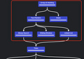

# NLP finetuning

Черновая выгрузка из Miro. Номера и время сохранены как на доске; повторные номера не исправлены.
Порядок модулей: номер, затем положение сверху вниз и слева направо. Внутри модуля: сверху вниз, слева направо; развилки смотрите по связям.
Таблицы, рисунки и изображения без текста требуют просмотра в Miro. Полнота визуально не подтверждена: нужны крупные PNG.

[Все объекты и Miro ID](objects.csv) · [Связи между блоками](structure.md)

Содержание:

- 1. Математика — ~1-5 часов
- 2. Алгосекции — ~20 часов (номер повторяется на доске)
- 2. Python — ~50 часов (номер повторяется на доске)
- 3. Git + Terminal — ~2-3 часа
- 4. Classic ML — ~20-30 часов
- 5. Deep Learning DeepDive — ~35 часов (номер повторяется на доске)
- 5. Deep Learning основы — ~15 часов (номер повторяется на доске)
- 6. Deploy — ~6 часов
- 7. ML System Design — ~10 часов
- 8. Создание легенды, резюме и самопрезентации — 20-40 часов

## 1. Математика

Время: ~1-5 часов

Miro ID: модуль `3458764691140220732`, номер `3458764691140220906`, время `3458764691140220905`.

### Линейная алгебра и Мат. анализ (куратор скажет, что выбрать)

Miro ID: `3458764691140220734`.

**Линейная алгебра и Мат. анализ**

**(куратор скажет, что выбрать)**

[Оригинал в Miro](https://miro.com/app/board/uXjVHVS-s1M=/?moveToWidget=3458764691140220734)

### Если уже когда-то знал, но забыл и надо повторить: видео на 25 минут

Miro ID: `3458764691140220735`.

Если уже когда-то знал, но забыл и надо повторить:  
[видео](https://www.youtube.com/watch?v=Nrq74MRHHJs) на 25 минут

Проверка ссылок:

- <https://www.youtube.com/watch?v=Nrq74MRHHJs> — Страница отвечает (HTTP 200); воспроизведение видео и ограничения входа не проверены

[Оригинал в Miro](https://miro.com/app/board/uXjVHVS-s1M=/?moveToWidget=3458764691140220735)

### Если если нужно учить с нуля: 1. видео на 25 минут 2. первые 6 глав этого плейлиста (линал) 3. и первые 6 глав этого плейлиста (матан)

Miro ID: `3458764691140220736`.

Если если нужно учить с нуля:  
1. [видео](https://www.youtube.com/watch?v=Nrq74MRHHJs) на 25 минут

2. первые 6 глав [этого плейлиста](https://www.youtube.com/playlist?list=PLZHQObOWTQDPD3MizzM2xVFitgF8hE_ab) (линал)

3. и первые 6 глав [этого плейлиста](https://www.youtube.com/playlist?list=PLZHQObOWTQDMsr9K-rj53DwVRMYO3t5Yr) (матан)

Проверка ссылок:

- <https://www.youtube.com/watch?v=Nrq74MRHHJs> — Страница отвечает (HTTP 200); воспроизведение видео и ограничения входа не проверены
- <https://www.youtube.com/playlist?list=PLZHQObOWTQDPD3MizzM2xVFitgF8hE_ab> — Страница отвечает (HTTP 200); воспроизведение видео и ограничения входа не проверены
- <https://www.youtube.com/playlist?list=PLZHQObOWTQDMsr9K-rj53DwVRMYO3t5Yr> — Страница отвечает (HTTP 200); воспроизведение видео и ограничения входа не проверены

[Оригинал в Miro](https://miro.com/app/board/uXjVHVS-s1M=/?moveToWidget=3458764691140220736)

## 2. Алгосекции

Время: ~20 часов

Miro ID: модуль `3458764691140220730`, номер `3458764691140220908`, время `3458764691140220907`.

### Прочитать статью с хабра по сложности алгоритмов Ещё одна статья про сложности алгоритмов

Miro ID: `3458764691140220742`.

Прочитать [статью с хабра](https://habr.com/ru/articles/782608/) по сложности алгоритмов

Ещё одна [статья](https://proglib.io/p/slozhnost-algoritmov-i-operaciy-na-primere-python-2020-11-03) про сложности алгоритмов

Проверка ссылок:

- <https://habr.com/ru/articles/782608/> — URL отвечает (HTTP 200); доступ к платному содержимому не проверялся
- <https://proglib.io/p/slozhnost-algoritmov-i-operaciy-na-primere-python-2020-11-03> — URL отвечает (HTTP 200); доступ к платному содержимому не проверялся

[Оригинал в Miro](https://miro.com/app/board/uXjVHVS-s1M=/?moveToWidget=3458764691140220742)

### PYTHON

Miro ID: `3458764691140220739`.

**PYTHON**

[Оригинал в Miro](https://miro.com/app/board/uXjVHVS-s1M=/?moveToWidget=3458764691140220739)

### Основные ML и DL алгосы

Miro ID: `3458764691140220771`.

**Основные ML и DL алгосы**

[Оригинал в Miro](https://miro.com/app/board/uXjVHVS-s1M=/?moveToWidget=3458764691140220771)

### Также в RoadMap от NeetCode есть секция core skills. Если пролистать в самый низ, то там вы сможете найти секцию с Machine Learning с задачами, где нужно написать код для реализаци

Miro ID: `3458764691140220777`.

Также в [RoadMap от NeetCode](https://neetcode.io/practice) есть секция core skills. Если пролистать в самый низ, то там вы сможете найти секцию с Machine Learning с задачами, где нужно написать код для реализации ML моделей. Стоит прорешать их все до секции Multi Headed Self Attention включительно. Начать их решать стоит во время прохождения курса от ШАД

Проверка ссылок:

- <https://neetcode.io/practice> — URL отвечает (HTTP 200); доступ к платному содержимому не проверялся

[Оригинал в Miro](https://miro.com/app/board/uXjVHVS-s1M=/?moveToWidget=3458764691140220777)

### RoadMap от NeedCode`a - необходимая и нерушимая база каждого лайвкодера, на начальном этапе необходимо убить easy задачи тех тем, которые помечены на картинке красным

Miro ID: `3458764691140220740`.

[RoadMap от NeedCode`a](https://neetcode.io/roadmap) - необходимая и нерушимая база каждого лайвкодера, на начальном этапе необходимо убить easy задачи тех тем, которые помечены на картинке красным

Проверка ссылок:

- <https://neetcode.io/roadmap> — URL отвечает (HTTP 200); доступ к платному содержимому не проверялся

[Оригинал в Miro](https://miro.com/app/board/uXjVHVS-s1M=/?moveToWidget=3458764691140220740)

### image

Miro ID: `3458764691140220745`.

Материал доступен на исходной доске Miro.

[Открыть объект в Miro](https://miro.com/app/board/uXjVHVS-s1M=/?moveToWidget=3458764691140220745)

[Оригинал в Miro](https://miro.com/app/board/uXjVHVS-s1M=/?moveToWidget=3458764691140220745)

### image

Miro ID: `3458764691140220778`.

Материал доступен на исходной доске Miro.

[Открыть объект в Miro](https://miro.com/app/board/uXjVHVS-s1M=/?moveToWidget=3458764691140220778)

[Оригинал в Miro](https://miro.com/app/board/uXjVHVS-s1M=/?moveToWidget=3458764691140220778)

### КАК РЕШАТЬ АЛГОРИТМЫ

Miro ID: `3458764691140220744`.

**КАК РЕШАТЬ АЛГОРИТМЫ**

[Оригинал в Miro](https://miro.com/app/board/uXjVHVS-s1M=/?moveToWidget=3458764691140220744)

### Когда прорешаете все примеры уровня easy, middle В RoadMap'е от NeetCode, то прорешайте наиболее часто встречаемые вопросы с Яндекса . Зачастую эти вопросы встречаются и в других к

Miro ID: `3458764691140220746`.

Когда прорешаете все примеры уровня easy, middle В RoadMap'е от NeetCode, то прорешайте [наиболее часто встречаемые вопросы с Яндекса](https://disk.yandex.ru/i/J4p8RRNRQh9mKQ). Зачастую эти вопросы встречаются и в других компаниях

Также пользуйтесь [классными шаблонами](https://www.notion.so/1daf48226be780a4962fd5d25f575f4f) для всех основных алгоритмов

Проверка ссылок:

- <https://disk.yandex.ru/i/J4p8RRNRQh9mKQ> — URL отвечает (HTTP 200); доступ к платному содержимому не проверялся
- <https://www.notion.so/1daf48226be780a4962fd5d25f575f4f> — URL отвечает (HTTP 200); доступ к платному содержимому не проверялся

[Оригинал в Miro](https://miro.com/app/board/uXjVHVS-s1M=/?moveToWidget=3458764691140220746)

### 0) Общий алгоритм для прорешивания алгоритмов выглядит следующим образом: - Идёте на neetcode - Открываете задачу - Пытаетесь решить её за 10-15 минут сами - Если вы за это время н

Miro ID: `3458764691140220846`.

0) Общий алгоритм для прорешивания алгоритмов выглядит следующим образом:

- Идёте на neetcode

- Открываете задачу

- Пытаетесь решить её за 10-15 минут сами

- Если вы за это время не смогли написать решение - идёте и изучает его

- Если вы за это время решили его - супер, всё круто

1) Вам не нужно фокусироваться ТОЛЬКО на алгоритмах, вы должны решать их понемногу, параллельно последующим блокам, размазать этот блок на весь оставшийся путь до начала первых собесов

2) Это надо для того, чтобы вы не забывали как их решать, потому что если прорешать всё за неделю, а потом месяц изучать ML, то вы напрочь забудете о том как решать те или иные алгосы

3) Для простоты понимания, просто решайте:

- Python (1-2 задачи в неделю уровня easy, middle)

[Оригинал в Miro](https://miro.com/app/board/uXjVHVS-s1M=/?moveToWidget=3458764691140220846)

## 2. Python

Время: ~50 часов

Miro ID: модуль `3458764691140220838`, номер `3458764691140220904`, время `3458764691140220840`.

### Бесплатный курс со степика . В данном курсе вас познакомят с базой питона, дадут много практики и задач для понимания: переменные, списки, словари, циклы, условия, функции Смотрим 

Miro ID: `3458764691140220839`.

Бесплатный [курс со степика](https://stepik.org/course/100707/promo). В данном курсе вас познакомят с базой питона, дадут много практики и задач для понимания: переменные, списки, словари, циклы, условия, функции

Смотрим всё, кроме:

- Булевы подвиги

- Треугольник Паскаля

- Весь блок "Движемся дальше, вглубь"

Проверка ссылок:

- <https://stepik.org/course/100707/promo> — URL отвечает (HTTP 200); доступ к платному содержимому не проверялся

[Оригинал в Miro](https://miro.com/app/board/uXjVHVS-s1M=/?moveToWidget=3458764691140220839)

### PYTHON ООП

Miro ID: `3458764691140220841`.

**PYTHON ООП**

[Оригинал в Miro](https://miro.com/app/board/uXjVHVS-s1M=/?moveToWidget=3458764691140220841)

### Если есть лишние 3000р, то покупаем продолжение базового курса , где разбирается ООП Если нет, то смотрим весь этот плейлист и ручками переписываем весь код, который там дается, чт

Miro ID: `3458764691140220843`.

Если есть лишние 3000р, то покупаем [продолжение базового курса](https://stepik.org/course/116336/promo?referral=WzExNjMzNiw0OTEzNTQwMTUsMTc0MjQ3Nzk4Mi44MDQ5OTQ4XQ%3A1tvG7a%3AK3rMecG2wXD7AncXYbF_lBMGcbg), где разбирается ООП

Если нет, то смотрим весь [этот плейлист](https://www.youtube.com/playlist?list=PLA0M1Bcd0w8zPwP7t-FgwONhZOHt9rz9E) и ручками переписываем весь код, который там дается, чтобы восполнить практику (это все лекции с платного курса, отличие только в том, что вы не получите дополнительных задач со степика)

Смотрим:

1. Весь модуль "Первые шаги ООП"

2. Весь модуль "Режимы доступа, свойства, дескрипторы"

3. Модуль магически методы классов. Уроки: 1,2,3,8,9  
4. Наследование и полиморфизм. Уроки: 1-4

5. Исключения и менеджеры контекста. Весь модуль

Проверка ссылок:

- <https://stepik.org/course/116336/promo?referral=WzExNjMzNiw0OTEzNTQwMTUsMTc0MjQ3Nzk4Mi44MDQ5OTQ4XQ%3A1tvG7a%3AK3rMecG2wXD7AncXYbF_lBMGcbg> — URL отвечает (HTTP 200); доступ к платному содержимому не проверялся
- <https://www.youtube.com/playlist?list=PLA0M1Bcd0w8zPwP7t-FgwONhZOHt9rz9E> — Страница отвечает (HTTP 200); воспроизведение видео и ограничения входа не проверены

[Оригинал в Miro](https://miro.com/app/board/uXjVHVS-s1M=/?moveToWidget=3458764691140220843)

### NUMPY

Miro ID: `3458764691140220888`.

**NUMPY**

[Оригинал в Miro](https://miro.com/app/board/uXjVHVS-s1M=/?moveToWidget=3458764691140220888)

### Смотрим видео на 1 час и переписываем весь код ручками

Miro ID: `3458764691140220887`.

Смотрим [видео](https://www.youtube.com/watch?v=GB9ByFAIAH4&t=2759s) на 1 час и переписываем весь код ручками

Проверка ссылок:

- <https://www.youtube.com/watch?v=GB9ByFAIAH4&t=2759s> — Страница отвечает (HTTP 200); воспроизведение видео и ограничения входа не проверены

[Оригинал в Miro](https://miro.com/app/board/uXjVHVS-s1M=/?moveToWidget=3458764691140220887)

## 3. Git + Terminal

Время: ~2-3 часа

Miro ID: модуль `3458764691140220728`, номер `3458764691140220910`, время `3458764691140220909`.

### Док с основными командами в терминале Linux и как с ними взаимодействовать

Miro ID: `3458764691140220865`.

[Док с основными командами](https://docs.google.com/document/d/1nj3aLp-AmdfJgqb09wrRu24qKDTaTJ6EPkUWnXdvlXg/edit?tab=t.0#heading=h.jgxs2s7g8e6i) в терминале Linux и как с ними взаимодействовать

Проверка ссылок:

- <https://docs.google.com/document/d/1nj3aLp-AmdfJgqb09wrRu24qKDTaTJ6EPkUWnXdvlXg/edit?tab=t.0#heading=h.jgxs2s7g8e6i> — Нужна авторизация (HTTP 401)

[Оригинал в Miro](https://miro.com/app/board/uXjVHVS-s1M=/?moveToWidget=3458764691140220865)

### 1. Статья про git 2. Полезные материалы по работе с ним 3. Игра с практикой 1 4. Игра с практикой 2 Которые дадут понимание того, как он работает и какие первые шаги нужно будет сд

Miro ID: `3458764691140220864`.

1. [Статья про git](https://habr.com/ru/articles/588801/)

2. [Полезные материалы по работе с ним](https://drive.google.com/file/d/1FCLBMVea5Kf2BclV4GDQ2BHP5PpncGhC/view?usp=sharing)

3. [Игра с практикой 1](https://learngitbranching.js.org/)

4. [Игра с практикой 2](https://ohmygit.org/)

Которые дадут понимание того, как он работает и какие первые шаги нужно будет сделать, когда начнёшь использовать его в работе

Проверка ссылок:

- <https://habr.com/ru/articles/588801/> — URL отвечает (HTTP 200); доступ к платному содержимому не проверялся
- <https://drive.google.com/file/d/1FCLBMVea5Kf2BclV4GDQ2BHP5PpncGhC/view?usp=sharing> — Нужна авторизация (HTTP 401)
- <https://learngitbranching.js.org/> — URL отвечает (HTTP 200); доступ к платному содержимому не проверялся
- <https://ohmygit.org/> — URL отвечает (HTTP 200); доступ к платному содержимому не проверялся

[Оригинал в Miro](https://miro.com/app/board/uXjVHVS-s1M=/?moveToWidget=3458764691140220864)

### Или можно выполнить практическое задание: - Зарегистрироваться на гитхабе - Создай репозиторий - Создать там несколько python файлов - Сделать коммит - Сделать изменения в файлах -

Miro ID: `3458764691140220879`.

Или можно выполнить практическое задание:

- Зарегистрироваться на гитхабе

- Создай репозиторий

- Создать там несколько python файлов

- Сделать коммит

- Сделать изменения в файлах

- Сделать новый коммит

- Создать новую ветку

- Сделать изменения в новой ветке

- Влить изменения в метку main

[Оригинал в Miro](https://miro.com/app/board/uXjVHVS-s1M=/?moveToWidget=3458764691140220879)

## 4. Classic ML

Время: ~20-30 часов

Miro ID: модуль `3458764691140220729`, номер `3458764691140220911`, время `3458764691140220836`.

### Обучение с учителем Линейная Регрессия

Miro ID: `3458764691140220792`.

**Обучение с учителем**

**Линейная Регрессия**

[Оригинал в Miro](https://miro.com/app/board/uXjVHVS-s1M=/?moveToWidget=3458764691140220792)

### Конкретный алгоритм для изучения Classic ML

Miro ID: `3458764691140220814`.

**Конкретный алгоритм для изучения Classic ML**

[Оригинал в Miro](https://miro.com/app/board/uXjVHVS-s1M=/?moveToWidget=3458764691140220814)

### Вводная часть

Miro ID: `3458764691140220800`.

**Вводная часть**

[Оригинал в Miro](https://miro.com/app/board/uXjVHVS-s1M=/?moveToWidget=3458764691140220800)

### Весь Classic ML разделён на темы. Каждая тема - это карточка Если что-то не понимаете, то попробуйте попытать GPT, чтобы она объяснила тему, попросите eё дать пару примеров или пои

Miro ID: `3458764691140220821`.

1. Весь Classic ML разделён на темы. Каждая тема - это карточка

1. Если что-то не понимаете, то попробуйте попытать GPT, чтобы она объяснила тему, попросите eё дать пару примеров или поизучать в дополнительных материалах. Если всё равно не понимаете, то не стоит много времени тратить на это, потом до вас дойдёт. Переходите к следующей теме

1. Также там есть ссылка на MLHandbook, используйте эту книжку, чтобы ещё текстом у вас воспринималась информация. Книжка тяжело даётся именно для того, чтобы её понять с первого раза, поэтому её нужно изучать послойно

1. Если вы застряли на одной теме больше, чем указано на карточке, но точно поняли суть задачи, то переходите на другую карточку. Не стоит терять время! Потом рано или поздно поймёте!

[Оригинал в Miro](https://miro.com/app/board/uXjVHVS-s1M=/?moveToWidget=3458764691140220821)

### 1. Конкретно в карточки изучаете простой материал. Например, градиентный бустинг. По карточке смотрите все простые ролики. Можете конспектировать при необходимости. Также для визуа

Miro ID: `3458764691140220815`.

1. Конкретно в карточки изучаете простой материал. Например, градиентный бустинг. По карточке смотрите все простые ролики. Можете конспектировать при необходимости. Также для визуального понимания работы алгоритма можете использовать [mlu-explain](https://mlu-explain.github.io/).

2. Приступаете к тяжёлой части, параллельно идёте в [ML Handbook](https://education.yandex.ru/handbook/ml/article/gradientnyj-busting) и изучаете более подробно, если не понимаете матана, то не страшно, потом поймёте. Главное - это картинка в голове, как оно всё работает. Опять же для визуального понимания работы алгоритма можете использовать [mlu-explain](https://mlu-explain.github.io/).

3. Идёте в GPT и мучаете его с запросом "gradient boosting from scratch, напиши на русском"

4. Стараетесь сами обучить градиентный бустинг, а если получится, то написать с нуля с каким-нибудь челом из ютуба или из статьи с помощью запроса from scratch, например: Coding gradient boosting from scratch

Проверка ссылок:

- <https://mlu-explain.github.io/> — URL отвечает (HTTP 200); доступ к платному содержимому не проверялся
- <https://education.yandex.ru/handbook/ml/article/gradientnyj-busting> — URL отвечает (HTTP 200); доступ к платному содержимому не проверялся

[Оригинал в Miro](https://miro.com/app/board/uXjVHVS-s1M=/?moveToWidget=3458764691140220815)

### Линейная/полиномиальная  регрессия (1-2 дня) Теория: 1. РЕАЛИЗАЦИЯ ЛИНЕЙНОЙ РЕГРЕССИИ | Линейная регрессия | LinearRegression | МАШИННОЕ ОБУЧЕНИЕ 2. mlu-explain Чтиво для закреплен

Miro ID: `3458764691140220787`.

**Линейная/полиномиальная регрессия (1-2 дня)**

Теория:

1. [РЕАЛИЗАЦИЯ ЛИНЕЙНОЙ РЕГРЕССИИ | Линейная регрессия | LinearRegression | МАШИННОЕ ОБУЧЕНИЕ](https://www.youtube.com/watch?v=KJA9A1q9l7E&ab_channel=machinelearrrning)

2. [mlu-explain](https://mlu-explain.github.io/linear-regression/)

**Чтиво для закрепления:**

1. [ML Handbook 2.1. Линейные модели](https://education.yandex.ru/handbook/ml/article/linear-models)

[Практика](https://drive.google.com/drive/folders/1InNNnSGyz1yjl9B8VzSsyQSfc4HCl6-M?usp=sharing)

[Ссылка на данные](https://disk.yandex.ru/d/guhN1YgFKT41qQ) для практики

Проверка ссылок:

- <https://www.youtube.com/watch?v=KJA9A1q9l7E&ab_channel=machinelearrrning> — Страница отвечает (HTTP 200); воспроизведение видео и ограничения входа не проверены
- <https://mlu-explain.github.io/linear-regression/> — URL отвечает (HTTP 200); доступ к платному содержимому не проверялся
- <https://education.yandex.ru/handbook/ml/article/linear-models> — URL отвечает (HTTP 200); доступ к платному содержимому не проверялся
- <https://drive.google.com/drive/folders/1InNNnSGyz1yjl9B8VzSsyQSfc4HCl6-M?usp=sharing> — URL отвечает (HTTP 200); доступ к платному содержимому не проверялся
- <https://disk.yandex.ru/d/guhN1YgFKT41qQ> — Недоступна при проверке (HTTP 404)

[Оригинал в Miro](https://miro.com/app/board/uXjVHVS-s1M=/?moveToWidget=3458764691140220787)

### Градиентный спуск (1-2 дня) Теория: 1. Градиентный спуск 2. Машинное обучение: градиентный спуск для новичков с практикой в Python 3. mlu-explain Чтиво для закрепления: 1. ML Handb

Miro ID: `3458764691140220788`.

**Градиентный спуск (1-2 дня)**

Теория:

1. [Градиентный спуск](https://www.youtube.com/watch?v=BO5TKBr_uUc&ab_channel=%D0%A6%D0%B5%D0%BD%D1%82%D1%80digital%D0%BF%D1%80%D0%BE%D1%84%D0%B5%D1%81%D1%81%D0%B8%D0%B9ITtensive)

2. [Машинное обучение: градиентный спуск для новичков с практикой в Python](https://www.youtube.com/watch?v=e7Ic4zLWYxc&ab_channel=%D0%94%D0%B0%D1%82%D0%B0%D0%91%D0%BE%D0%B9)

3. [mlu-explain](https://mlu-explain.github.io/linear-regression/)

**Чтиво для закрепления:**

1. [ML Handbook 2.1. Линейные модели](https://education.yandex.ru/handbook/ml/article/linear-models)

[Практика](https://drive.google.com/drive/folders/1_7hy_lSz93OL_3_p4IsDB-cgLxPGmyR9?usp=sharing)

Проверка ссылок:

- <https://www.youtube.com/watch?v=BO5TKBr_uUc&ab_channel=%D0%A6%D0%B5%D0%BD%D1%82%D1%80digital%D0%BF%D1%80%D0%BE%D1%84%D0%B5%D1%81%D1%81%D0%B8%D0%B9ITtensive> — Страница отвечает (HTTP 200); воспроизведение видео и ограничения входа не проверены
- <https://www.youtube.com/watch?v=e7Ic4zLWYxc&ab_channel=%D0%94%D0%B0%D1%82%D0%B0%D0%91%D0%BE%D0%B9> — Страница отвечает (HTTP 200); воспроизведение видео и ограничения входа не проверены
- <https://mlu-explain.github.io/linear-regression/> — URL отвечает (HTTP 200); доступ к платному содержимому не проверялся
- <https://education.yandex.ru/handbook/ml/article/linear-models> — URL отвечает (HTTP 200); доступ к платному содержимому не проверялся
- <https://drive.google.com/drive/folders/1_7hy_lSz93OL_3_p4IsDB-cgLxPGmyR9?usp=sharing> — URL отвечает (HTTP 200); доступ к платному содержимому не проверялся

[Оригинал в Miro](https://miro.com/app/board/uXjVHVS-s1M=/?moveToWidget=3458764691140220788)

### Регуляризации. L1, L2, Elastic Net, Уменьшение кол-ва параметров (1-2 дня) Теория: 1. ПЕРЕОБУЧЕНИЕ И НЕДООБУЧЕНИЕ В МАШИННОМ ОБУЧЕНИИ | overfitting, underfitting для регрессии 2. Ч

Miro ID: `3458764691140220856`.

**Регуляризации. L1, L2, Elastic Net, Уменьшение кол-ва параметров (1-2 дня)**

Теория:

1. [ПЕРЕОБУЧЕНИЕ И НЕДООБУЧЕНИЕ В МАШИННОМ ОБУЧЕНИИ | overfitting, underfitting для регрессии](https://www.youtube.com/watch?v=m7P7bnLxIc4&ab_channel=machinelearrrning)

2. [Что делать с переобучением | Методы борьбы с переобучением | МАШИННОЕ ОБУЧЕНИЕ](https://www.youtube.com/watch?v=tqhsbEYKJRI&ab_channel=machinelearrrning)

3. [Регуляризация простыми словами | L1, L2, Elastic Net | Lasso, Ridge | Машинное обучение](https://www.youtube.com/watch?v=4WcHxtYy3_8&ab_channel=machinelearrrning)

4. [Почему L1 регуляризация отбирает признаки? Понятное объяснение](https://www.youtube.com/watch?v=vACmNV1xPDA&ab_channel=%D0%9B%D1%91%D1%88%D0%B0%D0%91%D1%83%D1%85%D1%82%D0%B8%D1%8F%D1%80%D0%BE%D0%B2)

5. [StandardScaler| MinMaxScaler | МАСШТАБИРОВАНИЕ ДАННЫХ | МАШИННОЕ ОБУЧЕНИЕ](https://www.youtube.com/watch?v=XsuCOfpf8Ic&ab_channel=machinelearrrning)

**Чтиво для закрепления:**

1. [ML Handbook 2.1. Линейные модели](https://education.yandex.ru/handbook/ml/article/linear-models)

[Практика](https://drive.google.com/drive/folders/1YEGLEVUOOMGzcDSenpAzXWT9DZI3uHHP?usp=sharing)

Проверка ссылок:

- <https://www.youtube.com/watch?v=m7P7bnLxIc4&ab_channel=machinelearrrning> — Страница отвечает (HTTP 200); воспроизведение видео и ограничения входа не проверены
- <https://www.youtube.com/watch?v=tqhsbEYKJRI&ab_channel=machinelearrrning> — Страница отвечает (HTTP 200); воспроизведение видео и ограничения входа не проверены
- <https://www.youtube.com/watch?v=4WcHxtYy3_8&ab_channel=machinelearrrning> — Страница отвечает (HTTP 200); воспроизведение видео и ограничения входа не проверены
- <https://www.youtube.com/watch?v=vACmNV1xPDA&ab_channel=%D0%9B%D1%91%D1%88%D0%B0%D0%91%D1%83%D1%85%D1%82%D0%B8%D1%8F%D1%80%D0%BE%D0%B2> — Страница отвечает (HTTP 200); воспроизведение видео и ограничения входа не проверены
- <https://www.youtube.com/watch?v=XsuCOfpf8Ic&ab_channel=machinelearrrning> — Страница отвечает (HTTP 200); воспроизведение видео и ограничения входа не проверены
- <https://education.yandex.ru/handbook/ml/article/linear-models> — URL отвечает (HTTP 200); доступ к платному содержимому не проверялся
- <https://drive.google.com/drive/folders/1YEGLEVUOOMGzcDSenpAzXWT9DZI3uHHP?usp=sharing> — URL отвечает (HTTP 200); доступ к платному содержимому не проверялся

[Оригинал в Miro](https://miro.com/app/board/uXjVHVS-s1M=/?moveToWidget=3458764691140220856)

### Виды задач в машинном обучении (1-2 дня) Теория: 1. Тренировки по ML. Лекция 1: Вводная по ML + knn 2. Функционалы потерь и метрики регрессии. Простым языком! 3. Метрики в задачах 

Miro ID: `3458764691140220786`.

**Виды задач в машинном обучении (1-2 дня)**

Теория:

1. [Тренировки по ML. Лекция 1: Вводная по ML + knn](https://www.youtube.com/watch?v=k3UJOG-DKHE&list=PLXtiZNKIobF5wGW0ExSn47db1I8uYnfIC&index=1&ab_channel=Young%26%26Yandex)

2. [Функционалы потерь и метрики регрессии. Простым языком!](https://www.youtube.com/watch?v=EyxcTnHl1wk&ab_channel=StartCareerinDS)

3. [Метрики в задачах регрессии. MSE, MAE, MSLE. Машинное обучение](https://www.youtube.com/watch?v=io_3ZEfGE_E&ab_channel=Lex)

4. [МЕТРИКИ РЕГРЕССИИ В МАШИННОМ ОБУЧЕНИИ | MAE, MSE, RMSE, R2, коэффициент детерминации.](https://www.youtube.com/watch?v=vh2smjQyhp8&ab_channel=machinelearrrning)

**Чтиво для закрепления:**

1. [ML Handbook 1.3. Машинное обучение](https://education.yandex.ru/handbook/ml/article/mashinnoye-obucheniye)

[Практика](https://drive.google.com/drive/folders/1XQyc7ddb40pueR7wrPIjP_qhDHjPCbvy?usp=sharing)

Проверка ссылок:

- <https://www.youtube.com/watch?v=k3UJOG-DKHE&list=PLXtiZNKIobF5wGW0ExSn47db1I8uYnfIC&index=1&ab_channel=Young%26%26Yandex> — Страница отвечает (HTTP 200); воспроизведение видео и ограничения входа не проверены
- <https://www.youtube.com/watch?v=EyxcTnHl1wk&ab_channel=StartCareerinDS> — Страница отвечает (HTTP 200); воспроизведение видео и ограничения входа не проверены
- <https://www.youtube.com/watch?v=io_3ZEfGE_E&ab_channel=Lex> — Страница отвечает (HTTP 200); воспроизведение видео и ограничения входа не проверены
- <https://www.youtube.com/watch?v=vh2smjQyhp8&ab_channel=machinelearrrning> — Страница отвечает (HTTP 200); воспроизведение видео и ограничения входа не проверены
- <https://education.yandex.ru/handbook/ml/article/mashinnoye-obucheniye> — URL отвечает (HTTP 200); доступ к платному содержимому не проверялся
- <https://drive.google.com/drive/folders/1XQyc7ddb40pueR7wrPIjP_qhDHjPCbvy?usp=sharing> — URL отвечает (HTTP 200); доступ к платному содержимому не проверялся

[Оригинал в Miro](https://miro.com/app/board/uXjVHVS-s1M=/?moveToWidget=3458764691140220786)

### В шапке карточки есть рекомендуемое время прохождения темы Карточка состоит из двух частей

Miro ID: `3458764691140220819`.

В шапке карточки есть рекомендуемое время прохождения темы

Карточка состоит из двух частей

[Оригинал в Miro](https://miro.com/app/board/uXjVHVS-s1M=/?moveToWidget=3458764691140220819)

### Дополнительные материалы

Miro ID: `3458764691140220827`.

**Дополнительные**

**материалы**

[Оригинал в Miro](https://miro.com/app/board/uXjVHVS-s1M=/?moveToWidget=3458764691140220827)

### Первая часть - это "простая" часть карточки

Miro ID: `3458764691140220820`.

Первая часть - это "простая"

часть карточки

[Оригинал в Miro](https://miro.com/app/board/uXjVHVS-s1M=/?moveToWidget=3458764691140220820)

### Логистическая регрессия (1-3 дня) Теория: 1. Логистическая регрессия, самое простое объяснение! 2. Логистическая Регрессия | Logistic Regression | Линейная модель для классификации

Miro ID: `3458764691140220817`.

**Логистическая регрессия (1-3 дня)**

**Теория:**

1. [Логистическая регрессия, самое простое объяснение!](https://www.youtube.com/watch?v=8sp5aqyH6Oc&ab_channel=StartCareerinDS)

2. [Логистическая Регрессия | Logistic Regression | Линейная модель для классификации |МАШИННОЕ ОБУЧЕНИЕ](https://www.youtube.com/watch?v=9BoVCdedvW8&ab_channel=machinelearrrning)

3. [Реализация модели Логистическая Регрессия | Logistic Regression | Линейная модель для классификации](https://www.youtube.com/watch?v=ruVK07YF-RU&ab_channel=machinelearrrning)

4. [mlu-explain](https://mlu-explain.github.io/logistic-regression/)

5. [Логистическая Регрессия для Дата Саентиста](https://www.youtube.com/watch?v=49ck7kCyxr4&t=6347s&ab_channel=%D0%93%D0%BB%D0%B5%D0%B1%D0%9C%D0%B8%D1%85%D0%B0%D0%B9%D0%BB%D0%BE%D0%B2)

**Чтиво для закрепления:**

**1.** [ML Handbook 11.2. Логистическая регрессия](https://education.yandex.ru/handbook/data-analysis/article/logisticheskaya-regressiya)

[Практика](https://drive.google.com/drive/folders/1PMfImDAXGxPIXNjyGRN0c7aNPeC-WsjS?usp=sharing)

Проверка ссылок:

- <https://www.youtube.com/watch?v=8sp5aqyH6Oc&ab_channel=StartCareerinDS> — Страница отвечает (HTTP 200); воспроизведение видео и ограничения входа не проверены
- <https://www.youtube.com/watch?v=9BoVCdedvW8&ab_channel=machinelearrrning> — Страница отвечает (HTTP 200); воспроизведение видео и ограничения входа не проверены
- <https://www.youtube.com/watch?v=ruVK07YF-RU&ab_channel=machinelearrrning> — Страница отвечает (HTTP 200); воспроизведение видео и ограничения входа не проверены
- <https://mlu-explain.github.io/logistic-regression/> — URL отвечает (HTTP 200); доступ к платному содержимому не проверялся
- <https://www.youtube.com/watch?v=49ck7kCyxr4&t=6347s&ab_channel=%D0%93%D0%BB%D0%B5%D0%B1%D0%9C%D0%B8%D1%85%D0%B0%D0%B9%D0%BB%D0%BE%D0%B2> — Страница отвечает (HTTP 200); воспроизведение видео и ограничения входа не проверены
- <https://education.yandex.ru/handbook/data-analysis/article/logisticheskaya-regressiya> — URL отвечает (HTTP 200); доступ к платному содержимому не проверялся
- <https://drive.google.com/drive/folders/1PMfImDAXGxPIXNjyGRN0c7aNPeC-WsjS?usp=sharing> — URL отвечает (HTTP 200); доступ к платному содержимому не проверялся

[Оригинал в Miro](https://miro.com/app/board/uXjVHVS-s1M=/?moveToWidget=3458764691140220817)

### Если не хватило понимания или практики

Miro ID: `3458764691140220790`.

Если не хватило понимания или практики

[Оригинал в Miro](https://miro.com/app/board/uXjVHVS-s1M=/?moveToWidget=3458764691140220790)

### Вопросы

Miro ID: `3458764691140220828`.

Вопросы

[Оригинал в Miro](https://miro.com/app/board/uXjVHVS-s1M=/?moveToWidget=3458764691140220828)

### StatQuest - рассказывает про МЛ алгоритмы с формулами и в подробностях, что может стать отличным дополнением в понимание какой-либо теме.

Miro ID: `3458764691140220826`.

[StatQuest](https://www.youtube.com/@statquest/playlists) - рассказывает про МЛ алгоритмы с формулами и в подробностях, что может стать отличным дополнением в понимание какой-либо теме.

Проверка ссылок:

- <https://www.youtube.com/@statquest/playlists> — Страница отвечает (HTTP 200); воспроизведение видео и ограничения входа не проверены

[Оригинал в Miro](https://miro.com/app/board/uXjVHVS-s1M=/?moveToWidget=3458764691140220826)

### Алгоритмы Машинного обучения с нуля - Линейная регрессия

Miro ID: `3458764691140220791`.

Алгоритмы Машинного обучения с нуля -

[Линейная регрессия](https://stepik.org/lesson/329366/step/1?unit=312669)

Проверка ссылок:

- <https://stepik.org/lesson/329366/step/1?unit=312669> — URL отвечает (HTTP 200); доступ к платному содержимому не проверялся

[Оригинал в Miro](https://miro.com/app/board/uXjVHVS-s1M=/?moveToWidget=3458764691140220791)

### Вторая часть - это практика и книжка для текстового закрепления материала

Miro ID: `3458764691140220822`.

Вторая часть - это практика и книжка для текстового закрепления материала

[Оригинал в Miro](https://miro.com/app/board/uXjVHVS-s1M=/?moveToWidget=3458764691140220822)

### Вопросы про линейная регрессию Вопросы про градиентный спуск Вопросы про регуляризацию Вопросы про метрики регрессии

Miro ID: `3458764691140220829`.

Вопросы про [линейная регрессию](https://docs.google.com/document/d/1QoCSThAzu4NjG1AaPMjDWxhEzGttYzUTr5JuZYxTNvw/edit?tab=t.0#heading=h.qqn5lkf9qa3a)

Вопросы про [градиентный спуск](https://docs.google.com/document/d/1QoCSThAzu4NjG1AaPMjDWxhEzGttYzUTr5JuZYxTNvw/edit?tab=t.0#heading=h.t8qmyugrx9ky)

Вопросы про [регуляризацию](https://docs.google.com/document/d/1QoCSThAzu4NjG1AaPMjDWxhEzGttYzUTr5JuZYxTNvw/edit?tab=t.0#heading=h.56m0o7s1qglk)

Вопросы про [метрики регрессии](https://docs.google.com/document/d/1QoCSThAzu4NjG1AaPMjDWxhEzGttYzUTr5JuZYxTNvw/edit?tab=t.0#heading=h.mscv2pfe6sk3)

Проверка ссылок:

- <https://docs.google.com/document/d/1QoCSThAzu4NjG1AaPMjDWxhEzGttYzUTr5JuZYxTNvw/edit?tab=t.0#heading=h.qqn5lkf9qa3a> — URL отвечает (HTTP 200); доступ к платному содержимому не проверялся
- <https://docs.google.com/document/d/1QoCSThAzu4NjG1AaPMjDWxhEzGttYzUTr5JuZYxTNvw/edit?tab=t.0#heading=h.t8qmyugrx9ky> — URL отвечает (HTTP 200); доступ к платному содержимому не проверялся
- <https://docs.google.com/document/d/1QoCSThAzu4NjG1AaPMjDWxhEzGttYzUTr5JuZYxTNvw/edit?tab=t.0#heading=h.56m0o7s1qglk> — URL отвечает (HTTP 200); доступ к платному содержимому не проверялся
- <https://docs.google.com/document/d/1QoCSThAzu4NjG1AaPMjDWxhEzGttYzUTr5JuZYxTNvw/edit?tab=t.0#heading=h.mscv2pfe6sk3> — URL отвечает (HTTP 200); доступ к платному содержимому не проверялся

[Оригинал в Miro](https://miro.com/app/board/uXjVHVS-s1M=/?moveToWidget=3458764691140220829)

### Курс по ML Евгения Соколова - полный курс по машинному обучению. Можно выбрать его и смотреть соответствующие темы, если вам он кажется более понятным

Miro ID: `3458764691140220876`.

[Курс по ML Евгения Соколова](https://www.youtube.com/playlist?list=PLEqoHzpnmTfChItexxg2ZfxCsm-8QPsdS) - полный курс по машинному обучению. Можно выбрать его и смотреть соответствующие темы, если вам он кажется более понятным

Проверка ссылок:

- <https://www.youtube.com/playlist?list=PLEqoHzpnmTfChItexxg2ZfxCsm-8QPsdS> — Страница отвечает (HTTP 200); воспроизведение видео и ограничения входа не проверены

[Оригинал в Miro](https://miro.com/app/board/uXjVHVS-s1M=/?moveToWidget=3458764691140220876)

### Обучение с учителем Классификация

Miro ID: `3458764691140220801`.

**Обучение с учителем**

**Классификация**

[Оригинал в Miro](https://miro.com/app/board/uXjVHVS-s1M=/?moveToWidget=3458764691140220801)

### Обучение с учителем / Решающие Деревья / Ансамбли / Случайный лес / Градиентный бустинг

Miro ID: `3458764691140220810`.

**Обучение с учителем / Решающие Деревья / Ансамбли / Случайный лес / Градиентный бустинг**

[Оригинал в Miro](https://miro.com/app/board/uXjVHVS-s1M=/?moveToWidget=3458764691140220810)

### Работа с данными

Miro ID: `3458764691140220811`.

**Работа с данными**

[Оригинал в Miro](https://miro.com/app/board/uXjVHVS-s1M=/?moveToWidget=3458764691140220811)

### Деревья (1-2 дня) Теория: 1. ДЕРЕВО РЕШЕНИЙ (DecisionTreeClassifier) | МАШИННОЕ ОБУЧЕНИЕ 2. Как обучается дерево решений для регрессии. Decision Tree Regressor. 3. КАК НЕ ПЕРЕОБУЧИ

Miro ID: `3458764691140220797`.

**Деревья (1-2 дня)**

Теория:

1. [ДЕРЕВО РЕШЕНИЙ (DecisionTreeClassifier) | МАШИННОЕ ОБУЧЕНИЕ](https://www.youtube.com/watch?v=j8L07nuns2Y&ab_channel=machinelearrrning)

2. [Как обучается дерево решений для регрессии. Decision Tree Regressor.](https://www.youtube.com/watch?v=0mMeaC3gjNI&t=676s&ab_channel=machinelearrrning)

3. [КАК НЕ ПЕРЕОБУЧИТЬ ДЕРЕВО РЕШЕНИЙ Decision Tree | MAX DEPTH, MIN SAMPLES LEAF, MAX LEAF NODES](https://www.youtube.com/watch?v=aWEdaXAZ01M&ab_channel=machinelearrrning)

4. [mlu-explain](https://mlu-explain.github.io/decision-tree/)

5. [Лекция. Решающие деревья](https://www.youtube.com/watch?v=MJwAoWFTMWw&t=789s&ab_channel=DeepLearningSchool)

**Чтиво для закрепления:**

[ML Handbook 2.3. Решающие деревья](https://education.yandex.ru/handbook/ml/article/reshayushchiye-derevya)

[Практика 1](https://drive.google.com/drive/folders/14CfOML78M7sksfHdRnizjV8wqrDHibN_?usp=sharing)

[Практика 2](https://drive.google.com/drive/folders/1k9Z1Iz23E317uuUsMncvBl592-V20Mys?usp=sharing)

Проверка ссылок:

- <https://www.youtube.com/watch?v=j8L07nuns2Y&ab_channel=machinelearrrning> — Страница отвечает (HTTP 200); воспроизведение видео и ограничения входа не проверены
- <https://www.youtube.com/watch?v=0mMeaC3gjNI&t=676s&ab_channel=machinelearrrning> — Страница отвечает (HTTP 200); воспроизведение видео и ограничения входа не проверены
- <https://www.youtube.com/watch?v=aWEdaXAZ01M&ab_channel=machinelearrrning> — Страница отвечает (HTTP 200); воспроизведение видео и ограничения входа не проверены
- <https://mlu-explain.github.io/decision-tree/> — URL отвечает (HTTP 200); доступ к платному содержимому не проверялся
- <https://www.youtube.com/watch?v=MJwAoWFTMWw&t=789s&ab_channel=DeepLearningSchool> — Страница отвечает (HTTP 200); воспроизведение видео и ограничения входа не проверены
- <https://education.yandex.ru/handbook/ml/article/reshayushchiye-derevya> — URL отвечает (HTTP 200); доступ к платному содержимому не проверялся
- <https://drive.google.com/drive/folders/14CfOML78M7sksfHdRnizjV8wqrDHibN_?usp=sharing> — URL отвечает (HTTP 200); доступ к платному содержимому не проверялся
- <https://drive.google.com/drive/folders/1k9Z1Iz23E317uuUsMncvBl592-V20Mys?usp=sharing> — URL отвечает (HTTP 200); доступ к платному содержимому не проверялся

[Оригинал в Miro](https://miro.com/app/board/uXjVHVS-s1M=/?moveToWidget=3458764691140220797)

### Случайный лес (1-2 дня) Теория: 1. StatQuest: Случайные леса Часть 1 - Создание, использование и оценка 2. BAGGING, СЛУЧАЙНЫЙ ЛЕС, РАЗЛОЖЕНИЕ ОШИБКИ НА СМЕЩЕНИЕ (BIAS) И РАЗБРОС (V

Miro ID: `3458764691140220798`.

**Случайный лес (1-2 дня)**

Теория:

1. [StatQuest: Случайные леса Часть 1 - Создание, использование и оценка](https://www.youtube.com/watch?v=J4Wdy0Wc_xQ&ab_channel=StatQuestwithJoshStarmer)

2. [BAGGING, СЛУЧАЙНЫЙ ЛЕС, РАЗЛОЖЕНИЕ ОШИБКИ НА СМЕЩЕНИЕ (BIAS) И РАЗБРОС (VARIANCE). полная лекция](https://www.youtube.com/watch?v=rawnIo_XtYY&ab_channel=machinelearrrning)

3. [mlu-explain](https://mlu-explain.github.io/random-forest/)

**Чтиво для закрепления:**

1. [ML Handbook 2.4. Ансамбли в машинном обучении](https://education.yandex.ru/handbook/ml/article/ansambli-v-mashinnom-obuchenii)

[Практика](https://drive.google.com/drive/folders/1e4EEHT5dol3bB6hbn_9uBZfRNKJSpTan?usp=sharing)

Проверка ссылок:

- <https://www.youtube.com/watch?v=J4Wdy0Wc_xQ&ab_channel=StatQuestwithJoshStarmer> — Страница отвечает (HTTP 200); воспроизведение видео и ограничения входа не проверены
- <https://www.youtube.com/watch?v=rawnIo_XtYY&ab_channel=machinelearrrning> — Страница отвечает (HTTP 200); воспроизведение видео и ограничения входа не проверены
- <https://mlu-explain.github.io/random-forest/> — URL отвечает (HTTP 200); доступ к платному содержимому не проверялся
- <https://education.yandex.ru/handbook/ml/article/ansambli-v-mashinnom-obuchenii> — URL отвечает (HTTP 200); доступ к платному содержимому не проверялся
- <https://drive.google.com/drive/folders/1e4EEHT5dol3bB6hbn_9uBZfRNKJSpTan?usp=sharing> — URL отвечает (HTTP 200); доступ к платному содержимому не проверялся

[Оригинал в Miro](https://miro.com/app/board/uXjVHVS-s1M=/?moveToWidget=3458764691140220798)

### Градиентный бустинг (1-3 дня) Теория: 1. Лекция. Градиентный бустинг 2. Градиентный Бустинг: самый частый вопрос на собеседовании на дата саентиста Чтиво для закрепления: 1. ML Han

Miro ID: `3458764691140220799`.

**Градиентный бустинг (1-3 дня)**

Теория:

1. [Лекция. Градиентный бустинг](https://www.youtube.com/watch?v=JElfEE1OrSU&ab_channel=DeepLearningSchool)

2. [Градиентный Бустинг: самый частый вопрос на собеседовании на дата саентиста](https://www.youtube.com/watch?v=ZNJ3lKyI-EY&t=1s&ab_channel=%D0%93%D0%BB%D0%B5%D0%B1%D0%9C%D0%B8%D1%85%D0%B0%D0%B9%D0%BB%D0%BE%D0%B2)

**Чтиво для закрепления:**

1. [ML Handbook 2.4. Ансамбли в машинном обучении](https://education.yandex.ru/handbook/ml/article/ansambli-v-mashinnom-obuchenii)

[Практика](https://drive.google.com/drive/folders/1b5CvB1foeW1h5K8OtIZbmRxEOcjtqMsu?usp=sharing)

Проверка ссылок:

- <https://www.youtube.com/watch?v=JElfEE1OrSU&ab_channel=DeepLearningSchool> — Страница отвечает (HTTP 200); воспроизведение видео и ограничения входа не проверены
- <https://www.youtube.com/watch?v=ZNJ3lKyI-EY&t=1s&ab_channel=%D0%93%D0%BB%D0%B5%D0%B1%D0%9C%D0%B8%D1%85%D0%B0%D0%B9%D0%BB%D0%BE%D0%B2> — Страница отвечает (HTTP 200); воспроизведение видео и ограничения входа не проверены
- <https://education.yandex.ru/handbook/ml/article/ansambli-v-mashinnom-obuchenii> — URL отвечает (HTTP 200); доступ к платному содержимому не проверялся
- <https://drive.google.com/drive/folders/1b5CvB1foeW1h5K8OtIZbmRxEOcjtqMsu?usp=sharing> — URL отвечает (HTTP 200); доступ к платному содержимому не проверялся

[Оригинал в Miro](https://miro.com/app/board/uXjVHVS-s1M=/?moveToWidget=3458764691140220799)

### Логистическая регрессия (1-3 дня) Теория: 1. Логистическая регрессия, самое простое объяснение! 2. Логистическая Регрессия | Logistic Regression | Линейная модель для классификации

Miro ID: `3458764691140220793`.

**Логистическая регрессия (1-3 дня)**

Теория:

1. [Логистическая регрессия, самое простое объяснение!](https://www.youtube.com/watch?v=8sp5aqyH6Oc&ab_channel=StartCareerinDS)

2. [Логистическая Регрессия | Logistic Regression | Линейная модель для классификации |МАШИННОЕ ОБУЧЕНИЕ](https://www.youtube.com/watch?v=9BoVCdedvW8&ab_channel=machinelearrrning)

3. [Реализация модели Логистическая Регрессия | Logistic Regression | Линейная модель для классификации](https://www.youtube.com/watch?v=ruVK07YF-RU&ab_channel=machinelearrrning)

4. [mlu-explain](https://mlu-explain.github.io/logistic-regression/)

5. [Логистическая Регрессия для Дата Саентиста](https://www.youtube.com/watch?v=49ck7kCyxr4&t=6347s&ab_channel=%D0%93%D0%BB%D0%B5%D0%B1%D0%9C%D0%B8%D1%85%D0%B0%D0%B9%D0%BB%D0%BE%D0%B2)

**Чтиво для закрепления:**

1. [ML Handbook 11.2. Логистическая регрессия](https://education.yandex.ru/handbook/data-analysis/article/logisticheskaya-regressiya)

[Практика](https://drive.google.com/drive/folders/1PMfImDAXGxPIXNjyGRN0c7aNPeC-WsjS?usp=sharing)

Проверка ссылок:

- <https://www.youtube.com/watch?v=8sp5aqyH6Oc&ab_channel=StartCareerinDS> — Страница отвечает (HTTP 200); воспроизведение видео и ограничения входа не проверены
- <https://www.youtube.com/watch?v=9BoVCdedvW8&ab_channel=machinelearrrning> — Страница отвечает (HTTP 200); воспроизведение видео и ограничения входа не проверены
- <https://www.youtube.com/watch?v=ruVK07YF-RU&ab_channel=machinelearrrning> — Страница отвечает (HTTP 200); воспроизведение видео и ограничения входа не проверены
- <https://mlu-explain.github.io/logistic-regression/> — URL отвечает (HTTP 200); доступ к платному содержимому не проверялся
- <https://www.youtube.com/watch?v=49ck7kCyxr4&t=6347s&ab_channel=%D0%93%D0%BB%D0%B5%D0%B1%D0%9C%D0%B8%D1%85%D0%B0%D0%B9%D0%BB%D0%BE%D0%B2> — Страница отвечает (HTTP 200); воспроизведение видео и ограничения входа не проверены
- <https://education.yandex.ru/handbook/data-analysis/article/logisticheskaya-regressiya> — URL отвечает (HTTP 200); доступ к платному содержимому не проверялся
- <https://drive.google.com/drive/folders/1PMfImDAXGxPIXNjyGRN0c7aNPeC-WsjS?usp=sharing> — URL отвечает (HTTP 200); доступ к платному содержимому не проверялся

[Оригинал в Miro](https://miro.com/app/board/uXjVHVS-s1M=/?moveToWidget=3458764691140220793)

### Матрица ошибок и основные метрики бинарной классификации. Accuracy, Precision, Recall, F1 (1-2 дня) Теория: 1. PRECISION, RECALL, CONFUSION MATRIX, ТОЧНОСТЬ, ПОЛНОТА, МАТРИЦА ОШИБО

Miro ID: `3458764691140220794`.

**Матрица ошибок и основные метрики бинарной классификации. Accuracy, Precision, Recall, F1 (1-2 дня)**

Теория:

1. [PRECISION, RECALL, CONFUSION MATRIX, ТОЧНОСТЬ, ПОЛНОТА, МАТРИЦА ОШИБОК | МЕТРИКИ КЛАССИФИКАЦИИ](https://www.youtube.com/watch?v=AfnBHL832Eg&ab_channel=machinelearrrning)

2. [mlu-explain Precision & Recall](https://mlu-explain.github.io/precision-recall/)

**Чтиво для закрепления:**

1. [MLHandbook - 3.1. Метрики классификации и регрессии](https://education.yandex.ru/handbook/ml/article/metriki-klassifikacii-i-regressii)

2. Мой [конспект](https://publish.obsidian.md/mentoring/tochka/%D0%B3%D1%80%D0%B5%D0%B9%D0%B4%D0%B8%D1%80%D0%BE%D0%B2%D0%B0%D0%BD%D0%B8%D0%B5/%D0%9C%D0%B5%D1%82%D1%80%D0%B8%D0%BA%D0%B8+%D0%9A%D0%BB%D0%B0%D1%81%D1%81%D0%B8%D1%84%D0%B8%D0%BA%D0%B0%D1%86%D0%B8%D0%B8) про метрики классификации

[Практика](https://drive.google.com/drive/folders/1AFV45OU0rwi-1UZpAyi7JxVftrFOn2V8?usp=sharing)

Проверка ссылок:

- <https://www.youtube.com/watch?v=AfnBHL832Eg&ab_channel=machinelearrrning> — Страница отвечает (HTTP 200); воспроизведение видео и ограничения входа не проверены
- <https://mlu-explain.github.io/precision-recall/> — URL отвечает (HTTP 200); доступ к платному содержимому не проверялся
- <https://education.yandex.ru/handbook/ml/article/metriki-klassifikacii-i-regressii> — URL отвечает (HTTP 200); доступ к платному содержимому не проверялся
- <https://publish.obsidian.md/mentoring/tochka/%D0%B3%D1%80%D0%B5%D0%B9%D0%B4%D0%B8%D1%80%D0%BE%D0%B2%D0%B0%D0%BD%D0%B8%D0%B5/%D0%9C%D0%B5%D1%82%D1%80%D0%B8%D0%BA%D0%B8+%D0%9A%D0%BB%D0%B0%D1%81%D1%81%D0%B8%D1%84%D0%B8%D0%BA%D0%B0%D1%86%D0%B8%D0%B8> — Недоступна при проверке (HTTP 404)
- <https://drive.google.com/drive/folders/1AFV45OU0rwi-1UZpAyi7JxVftrFOn2V8?usp=sharing> — URL отвечает (HTTP 200); доступ к платному содержимому не проверялся

[Оригинал в Miro](https://miro.com/app/board/uXjVHVS-s1M=/?moveToWidget=3458764691140220794)

### ROC, PR-кривые. AUC-ROC, AUC-PR. Калибровка (1-2 дня) Теория: 1. ROC-AUC, ROC-CURVE, ROC-КРИВАЯ | МЕТРИКИ КЛАССИФИКАЦИИ 2. PR-AUC, PR-CURVE, PR-КРИВАЯ, PRECISION RECALL КРИВАЯ | МЕ

Miro ID: `3458764691140220795`.

**ROC, PR-кривые. AUC-ROC, AUC-PR. Калибровка (1-2 дня)**

Теория:

1. [ROC-AUC, ROC-CURVE, ROC-КРИВАЯ | МЕТРИКИ КЛАССИФИКАЦИИ](https://www.youtube.com/watch?v=v6PPG8J_Egs&ab_channel=machinelearrrning)

2. [PR-AUC, PR-CURVE, PR-КРИВАЯ, PRECISION RECALL КРИВАЯ | МЕТРИКИ КЛАССИФИКАЦИИ](https://www.youtube.com/watch?v=QW-09jHQH-w&ab_channel=machinelearrrning)

3. [mlu-explain ROC & AUC](https://mlu-explain.github.io/roc-auc/)

4. [ROC 🤘 для Дата Саентиста](https://www.youtube.com/watch?v=vtSgGDbkAq0&ab_channel=%D0%93%D0%BB%D0%B5%D0%B1%D0%9C%D0%B8%D1%85%D0%B0%D0%B9%D0%BB%D0%BE%D0%B2)

**Чтиво для закрепления:**

1. [MLHandbook - 3.1. Метрики классификации и регрессии](https://education.yandex.ru/handbook/ml/article/metriki-klassifikacii-i-regressii)

2. Мой [конспект](https://publish.obsidian.md/mentoring/tochka/%D0%B3%D1%80%D0%B5%D0%B9%D0%B4%D0%B8%D1%80%D0%BE%D0%B2%D0%B0%D0%BD%D0%B8%D0%B5/%D0%9C%D0%B5%D1%82%D1%80%D0%B8%D0%BA%D0%B8+%D0%9A%D0%BB%D0%B0%D1%81%D1%81%D0%B8%D1%84%D0%B8%D0%BA%D0%B0%D1%86%D0%B8%D0%B8) про метрики классификации

[Практика](https://drive.google.com/drive/folders/1Pcvm4WlsoUb8xGpw317A_5NHPyMs5uQ7?usp=sharing)

Проверка ссылок:

- <https://www.youtube.com/watch?v=v6PPG8J_Egs&ab_channel=machinelearrrning> — Страница отвечает (HTTP 200); воспроизведение видео и ограничения входа не проверены
- <https://www.youtube.com/watch?v=QW-09jHQH-w&ab_channel=machinelearrrning> — Страница отвечает (HTTP 200); воспроизведение видео и ограничения входа не проверены
- <https://mlu-explain.github.io/roc-auc/> — URL отвечает (HTTP 200); доступ к платному содержимому не проверялся
- <https://www.youtube.com/watch?v=vtSgGDbkAq0&ab_channel=%D0%93%D0%BB%D0%B5%D0%B1%D0%9C%D0%B8%D1%85%D0%B0%D0%B9%D0%BB%D0%BE%D0%B2> — Страница отвечает (HTTP 200); воспроизведение видео и ограничения входа не проверены
- <https://education.yandex.ru/handbook/ml/article/metriki-klassifikacii-i-regressii> — URL отвечает (HTTP 200); доступ к платному содержимому не проверялся
- <https://publish.obsidian.md/mentoring/tochka/%D0%B3%D1%80%D0%B5%D0%B9%D0%B4%D0%B8%D1%80%D0%BE%D0%B2%D0%B0%D0%BD%D0%B8%D0%B5/%D0%9C%D0%B5%D1%82%D1%80%D0%B8%D0%BA%D0%B8+%D0%9A%D0%BB%D0%B0%D1%81%D1%81%D0%B8%D1%84%D0%B8%D0%BA%D0%B0%D1%86%D0%B8%D0%B8> — Недоступна при проверке (HTTP 404)
- <https://drive.google.com/drive/folders/1Pcvm4WlsoUb8xGpw317A_5NHPyMs5uQ7?usp=sharing> — URL отвечает (HTTP 200); доступ к платному содержимому не проверялся

[Оригинал в Miro](https://miro.com/app/board/uXjVHVS-s1M=/?moveToWidget=3458764691140220795)

### Многоклассовая классификация: one vs rest, one vs one (1-2 дня) Теория: 1. #28. Многоклассовая классификация. Методы one-vs-all и all-vs-all | Машинное обучение 2. 3.3.1 Multiclass

Miro ID: `3458764691140220796`.

**Многоклассовая классификация: one vs rest, one vs one (1-2 дня)**

Теория:

1. [#28. Многоклассовая классификация. Методы one-vs-all и all-vs-all | Машинное обучение](https://www.youtube.com/watch?v=_TxH-bodeKk&ab_channel=selfedu)

2. [3.3.1 Multiclass Classification One vs all by Andrew Ng](https://www.youtube.com/watch?v=ZvaELFv5IpM&ab_channel=ComputerScienceEngineering)

**Чтиво для закрепления:**

1. [MLHandbook - 3.1. Метрики классификации и регрессии](https://education.yandex.ru/handbook/ml/article/metriki-klassifikacii-i-regressii)

[Практика](https://drive.google.com/drive/folders/1765rX7VOX_v5Rf4nJpGgKsoUvwewBD0j?usp=sharing)

Проверка ссылок:

- <https://www.youtube.com/watch?v=_TxH-bodeKk&ab_channel=selfedu> — Страница отвечает (HTTP 200); воспроизведение видео и ограничения входа не проверены
- <https://www.youtube.com/watch?v=ZvaELFv5IpM&ab_channel=ComputerScienceEngineering> — Страница отвечает (HTTP 200); воспроизведение видео и ограничения входа не проверены
- <https://education.yandex.ru/handbook/ml/article/metriki-klassifikacii-i-regressii> — URL отвечает (HTTP 200); доступ к платному содержимому не проверялся
- <https://drive.google.com/drive/folders/1765rX7VOX_v5Rf4nJpGgKsoUvwewBD0j?usp=sharing> — URL отвечает (HTTP 200); доступ к платному содержимому не проверялся

[Оригинал в Miro](https://miro.com/app/board/uXjVHVS-s1M=/?moveToWidget=3458764691140220796)

### EDA (1-2 дня) Теория: 1. EDA, РАЗВЕДОЧНЫЙ И ПЕРВИЧНЫЙ АНАЛИЗ ДАННЫХ | MATPLOTLIB, SEABORN 2. КОД. EDA, РАЗВЕДОЧНЫЙ И ПЕРВИЧНЫЙ АНАЛИЗ ДАННЫХ | MATPLOTLIB, SEABORN Практика Можете в

Miro ID: `3458764691140220812`.

**EDA (1-2 дня)**

Теория:

1. [EDA, РАЗВЕДОЧНЫЙ И ПЕРВИЧНЫЙ АНАЛИЗ ДАННЫХ | MATPLOTLIB, SEABORN](https://www.youtube.com/watch?v=uJpDzHGUamg&ab_channel=machinelearrrning)

2. [КОД. EDA, РАЗВЕДОЧНЫЙ И ПЕРВИЧНЫЙ АНАЛИЗ ДАННЫХ | MATPLOTLIB, SEABORN](https://www.youtube.com/watch?v=28XZf0Fv9-0&t=1s&ab_channel=machinelearrrning)

Практика

Можете взять какой-нибудь датасет из каггла и построить на нём графики

Проверка ссылок:

- <https://www.youtube.com/watch?v=uJpDzHGUamg&ab_channel=machinelearrrning> — Страница отвечает (HTTP 200); воспроизведение видео и ограничения входа не проверены
- <https://www.youtube.com/watch?v=28XZf0Fv9-0&t=1s&ab_channel=machinelearrrning> — Страница отвечает (HTTP 200); воспроизведение видео и ограничения входа не проверены

[Оригинал в Miro](https://miro.com/app/board/uXjVHVS-s1M=/?moveToWidget=3458764691140220812)

### Если не хватило понимания или практики

Miro ID: `3458764691140220805`.

Если не хватило понимания или практики

[Оригинал в Miro](https://miro.com/app/board/uXjVHVS-s1M=/?moveToWidget=3458764691140220805)

### Вопросы

Miro ID: `3458764691140220832`.

Вопросы

[Оригинал в Miro](https://miro.com/app/board/uXjVHVS-s1M=/?moveToWidget=3458764691140220832)

### Вопросы про работу с данными

Miro ID: `3458764691140220833`.

Вопросы про [работу с данными](https://docs.google.com/document/d/1QoCSThAzu4NjG1AaPMjDWxhEzGttYzUTr5JuZYxTNvw/edit?tab=t.0#heading=h.yr6diym0hscf)

Проверка ссылок:

- <https://docs.google.com/document/d/1QoCSThAzu4NjG1AaPMjDWxhEzGttYzUTr5JuZYxTNvw/edit?tab=t.0#heading=h.yr6diym0hscf> — URL отвечает (HTTP 200); доступ к платному содержимому не проверялся

[Оригинал в Miro](https://miro.com/app/board/uXjVHVS-s1M=/?moveToWidget=3458764691140220833)

### Алгоритмы Машинного обучения с нуля - Дерево решений - классификация Дерево решений - регрессия

Miro ID: `3458764691140220806`.

Алгоритмы Машинного обучения с нуля -

[Дерево решений](https://stepik.org/lesson/333977/step/1?unit=317388) - классификация

[Дерево решений](https://stepik.org/lesson/333978/step/1?unit=317389) - регрессия

Проверка ссылок:

- <https://stepik.org/lesson/333977/step/1?unit=317388> — URL отвечает (HTTP 200); доступ к платному содержимому не проверялся
- <https://stepik.org/lesson/333978/step/1?unit=317389> — URL отвечает (HTTP 200); доступ к платному содержимому не проверялся

[Оригинал в Miro](https://miro.com/app/board/uXjVHVS-s1M=/?moveToWidget=3458764691140220806)

### Алгоритмы Машинного обучения с нуля - Случайный лес - регрессия Случайный лес - классификация Бэггинг - регрессия Бэггинг - классификация

Miro ID: `3458764691140220808`.

Алгоритмы Машинного обучения с нуля -

[Случайный лес](https://stepik.org/lesson/329906/step/1?unit=313246) - регрессия

[Случайный лес](https://stepik.org/lesson/869376/step/1?unit=873538) - классификация

[Бэггинг](https://stepik.org/lesson/917945/step/1?unit=923739) - регрессия

[Бэггинг](https://stepik.org/lesson/329905/step/1?unit=313245) - классификация

Проверка ссылок:

- <https://stepik.org/lesson/329906/step/1?unit=313246> — URL отвечает (HTTP 200); доступ к платному содержимому не проверялся
- <https://stepik.org/lesson/869376/step/1?unit=873538> — URL отвечает (HTTP 200); доступ к платному содержимому не проверялся
- <https://stepik.org/lesson/917945/step/1?unit=923739> — URL отвечает (HTTP 200); доступ к платному содержимому не проверялся
- <https://stepik.org/lesson/329905/step/1?unit=313245> — Доступ не подтверждён: ошибка сети/TLS

[Оригинал в Miro](https://miro.com/app/board/uXjVHVS-s1M=/?moveToWidget=3458764691140220808)

### Алгоритмы Машинного обучения с нуля - Градиентный бустинг - регрессия Градиентный бустинг - классификация

Miro ID: `3458764691140220809`.

Алгоритмы Машинного обучения с нуля -

[Градиентный бустинг](https://stepik.org/lesson/329907/step/1?unit=313247) - регрессия

[Градиентный бустинг](https://stepik.org/lesson/869375/step/1?unit=873537) - классификация

Проверка ссылок:

- <https://stepik.org/lesson/329907/step/1?unit=313247> — URL отвечает (HTTP 200); доступ к платному содержимому не проверялся
- <https://stepik.org/lesson/869375/step/1?unit=873537> — URL отвечает (HTTP 200); доступ к платному содержимому не проверялся

[Оригинал в Miro](https://miro.com/app/board/uXjVHVS-s1M=/?moveToWidget=3458764691140220809)

### Если не хватило понимания или практики

Miro ID: `3458764691140220802`.

Если не хватило понимания или практики

[Оригинал в Miro](https://miro.com/app/board/uXjVHVS-s1M=/?moveToWidget=3458764691140220802)

### Вопросы

Miro ID: `3458764691140220830`.

Вопросы

[Оригинал в Miro](https://miro.com/app/board/uXjVHVS-s1M=/?moveToWidget=3458764691140220830)

### Вопросы

Miro ID: `3458764691140220834`.

Вопросы

[Оригинал в Miro](https://miro.com/app/board/uXjVHVS-s1M=/?moveToWidget=3458764691140220834)

### Алгоритмы Машинного обучения с нуля - Логистическая регрессия

Miro ID: `3458764691140220803`.

Алгоритмы Машинного обучения с нуля -

[Логистическая регрессия](https://stepik.org/lesson/329367/step/1?unit=312670)

Проверка ссылок:

- <https://stepik.org/lesson/329367/step/1?unit=312670> — URL отвечает (HTTP 200); доступ к платному содержимому не проверялся

[Оригинал в Miro](https://miro.com/app/board/uXjVHVS-s1M=/?moveToWidget=3458764691140220803)

### Вопросы про логистическую регрессию Вопросы про метрики классификации

Miro ID: `3458764691140220831`.

Вопросы про [логистическую регрессию](https://docs.google.com/document/d/1QoCSThAzu4NjG1AaPMjDWxhEzGttYzUTr5JuZYxTNvw/edit?tab=t.0#heading=h.xvq4ipii7118)

Вопросы про [метрики классификации](https://docs.google.com/document/d/1QoCSThAzu4NjG1AaPMjDWxhEzGttYzUTr5JuZYxTNvw/edit?tab=t.0#heading=h.qw34w2xeh98l)

Проверка ссылок:

- <https://docs.google.com/document/d/1QoCSThAzu4NjG1AaPMjDWxhEzGttYzUTr5JuZYxTNvw/edit?tab=t.0#heading=h.xvq4ipii7118> — URL отвечает (HTTP 200); доступ к платному содержимому не проверялся
- <https://docs.google.com/document/d/1QoCSThAzu4NjG1AaPMjDWxhEzGttYzUTr5JuZYxTNvw/edit?tab=t.0#heading=h.qw34w2xeh98l> — URL отвечает (HTTP 200); доступ к платному содержимому не проверялся

[Оригинал в Miro](https://miro.com/app/board/uXjVHVS-s1M=/?moveToWidget=3458764691140220831)

### Вопросы про деревья Вопросы про ансамбли

Miro ID: `3458764691140220835`.

Вопросы про [деревья](https://docs.google.com/document/d/1QoCSThAzu4NjG1AaPMjDWxhEzGttYzUTr5JuZYxTNvw/edit?tab=t.0#heading=h.hiyar5tdn510)

Вопросы про [ансамбли](https://docs.google.com/document/d/1QoCSThAzu4NjG1AaPMjDWxhEzGttYzUTr5JuZYxTNvw/edit?tab=t.0#heading=h.xbsa89kk6ufn)

Проверка ссылок:

- <https://docs.google.com/document/d/1QoCSThAzu4NjG1AaPMjDWxhEzGttYzUTr5JuZYxTNvw/edit?tab=t.0#heading=h.hiyar5tdn510> — URL отвечает (HTTP 200); доступ к платному содержимому не проверялся
- <https://docs.google.com/document/d/1QoCSThAzu4NjG1AaPMjDWxhEzGttYzUTr5JuZYxTNvw/edit?tab=t.0#heading=h.xbsa89kk6ufn> — URL отвечает (HTTP 200); доступ к платному содержимому не проверялся

[Оригинал в Miro](https://miro.com/app/board/uXjVHVS-s1M=/?moveToWidget=3458764691140220835)

## 5. Deep Learning DeepDive

Время: ~35 часов

Miro ID: модуль `3458764691140220727`, номер `3458764691140220913`, время `3458764691140220901`.

### Core материал курс от ШАДа После базового понимания DL, вам нужно получить плотную базу в NLP. В этом вам может помочь YSDA Natural Language Processing course

Miro ID: `3458764691140220891`.

**Core материал курс от ШАДа**

После базового понимания DL, вам нужно получить плотную базу в NLP. В этом вам может помочь [YSDA Natural Language Processing course](https://github.com/yandexdataschool/nlp_course)

Проверка ссылок:

- <https://github.com/yandexdataschool/nlp_course> — URL отвечает (HTTP 200); доступ к платному содержимому не проверялся

[Оригинал в Miro](https://miro.com/app/board/uXjVHVS-s1M=/?moveToWidget=3458764691140220891)

### Затем нам нужно познакомиться с основными методами файнтюна и алаймента - Что такое Lora - Полезный гайд по тюну моделей

Miro ID: `3458764691140220893`.

Затем нам нужно познакомиться с основными методами файнтюна и алаймента  
- [Что такое Lora](https://habr.com/ru/articles/747534/)  
- [Полезный гайд по тюну моделей](https://unsloth.ai/docs/get-started/fine-tuning-llms-guide)

- <https://habr.com/ru/articles/1002298/>

Проверка ссылок:

- <https://habr.com/ru/articles/747534/> — URL отвечает (HTTP 200); доступ к платному содержимому не проверялся
- <https://habr.com/ru/articles/1002298/> — URL отвечает (HTTP 200); доступ к платному содержимому не проверялся
- <https://unsloth.ai/docs/get-started/fine-tuning-llms-guide> — URL отвечает (HTTP 200); доступ к платному содержимому не проверялся

[Оригинал в Miro](https://miro.com/app/board/uXjVHVS-s1M=/?moveToWidget=3458764691140220893)

### Как оценить качество моделей - Классические метрики - LLM as Judge - G-Eval

Miro ID: `3458764691140220892`.

Как оценить качество моделей

- [Классические метрики](https://habr.com/ru/articles/1002218/)

- [LLM as Judge](https://habr.com/ru/articles/905728/)

- [G-Eval](https://arxiv.org/pdf/2303.16634)

Проверка ссылок:

- <https://habr.com/ru/articles/1002218/> — URL отвечает (HTTP 200); доступ к платному содержимому не проверялся
- <https://habr.com/ru/articles/905728/> — URL отвечает (HTTP 200); доступ к платному содержимому не проверялся
- <https://arxiv.org/pdf/2303.16634> — URL отвечает (HTTP 200); доступ к платному содержимому не проверялся

[Оригинал в Miro](https://miro.com/app/board/uXjVHVS-s1M=/?moveToWidget=3458764691140220892)

### Виды распределённого обучения нейросетей Тут важно понять основные принципы: - FSDP - DDP - DeepSpeed

Miro ID: `3458764691140220899`.

[Виды распределённого обучения нейросетей](https://huggingface.co/docs/transformers/v4.28.1/perf_train_gpu_many)Тут важно понять основные принципы:

- FSDP

- DDP

- DeepSpeed

Проверка ссылок:

- <https://huggingface.co/docs/transformers/v4.28.1/perf_train_gpu_many> — URL отвечает (HTTP 200); доступ к платному содержимому не проверялся

[Оригинал в Miro](https://miro.com/app/board/uXjVHVS-s1M=/?moveToWidget=3458764691140220899)

## 5. Deep Learning основы

Время: ~15 часов

Miro ID: модуль `3458764691140220883`, номер `3458764691140220912`, время `3458764691140220884`.

### Так как твоё направление - это NLP, то тебе нужно  углубляться в Deep Learning. Поэтому вы должны пройти с 9 до 14 главы DLS . Там вам дадут базу про DeepLearning.

Miro ID: `3458764691140220894`.

Так как твоё направление - это NLP, то тебе нужно углубляться в Deep Learning. Поэтому вы должны пройти с 9 до 14 главы [DLS](https://stepik.org/course/135003/syllabus?search=5759062668). Там вам дадут базу про DeepLearning.

Проверка ссылок:

- <https://stepik.org/course/135003/syllabus?search=5759062668> — URL отвечает (HTTP 200); доступ к платному содержимому не проверялся

[Оригинал в Miro](https://miro.com/app/board/uXjVHVS-s1M=/?moveToWidget=3458764691140220894)

### Смотрим лекцию Котенкова , которая даст представление о том, что такое трансформеры, как они работают и зачем нужны Важно понять: - Механизм attention - Что такое токены - Разницу 

Miro ID: `3458764691140220885`.

Смотрим [лекцию Котенкова](https://www.youtube.com/watch?v=iOrNbK2T92M), которая даст представление о том, что такое трансформеры, как они работают и зачем нужны

Важно понять:

- Механизм attention

- Что такое токены

- Разницу между энкодекодер моделями и декодерами

- context window

- temperature/top-p/top-k

Проверка ссылок:

- <https://www.youtube.com/watch?v=iOrNbK2T92M> — Страница отвечает (HTTP 200); воспроизведение видео и ограничения входа не проверены

[Оригинал в Miro](https://miro.com/app/board/uXjVHVS-s1M=/?moveToWidget=3458764691140220885)

### Знакомимся с PyTorch Смотрим из этого плейлиста уроки с 1 по 17

Miro ID: `3458764691140220886`.

**Знакомимся с PyTorch**

Смотрим из этого [плейлиста](https://youtu.be/EMXfZB8FVUA?list=PLqnslRFeH2UrcDBWF5mfPGpqQDSta6VK4) уроки с 1 по 17

Проверка ссылок:

- <https://youtu.be/EMXfZB8FVUA?list=PLqnslRFeH2UrcDBWF5mfPGpqQDSta6VK4> — Страница отвечает (HTTP 200); воспроизведение видео и ограничения входа не проверены

[Оригинал в Miro](https://miro.com/app/board/uXjVHVS-s1M=/?moveToWidget=3458764691140220886)

## 6. Deploy

Время: ~6 часов

Miro ID: модуль `3458764691140250962`, номер `3458764691140250968`, время `3458764691140250966`.

### Наша лекция про весь Deploy от и до . В ней: - Разберём, как выглядит готовый для деплоя сервис - Смотрим на инфру, как это выглядит с обратной сторны, как поднять свой сервер - Чт

Miro ID: `3458764691140250971`.

[Наша лекция про весь Deploy от и до](https://t.me/c/2482111540/10525/11206). В ней:

- Разберём, как выглядит готовый для деплоя сервис  
- Смотрим на инфру, как это выглядит с обратной сторны, как поднять свой сервер  
- Что такое CI/CD, зачем он нужен  
- Что такое хуки, тесты и почему они постоянно падают  
- Что такое докер, зачем он нужен, как его собрать и поднять  
- Кто такие креды и почему их страшно терять

Проверка ссылок:

- <https://t.me/c/2482111540/10525/11206> — URL отвечает (HTTP 200); доступ к платному содержимому не проверялся

[Оригинал в Miro](https://miro.com/app/board/uXjVHVS-s1M=/?moveToWidget=3458764691140250971)

### Небольшое практическое задание по Docker

Miro ID: `3458764691140250973`.

[Небольшое практическое задание по Docker](https://drive.google.com/drive/folders/1lu8-f9gGcHiP8MMou1_3C-_8_LQ2YXB6?usp=sharing)

Проверка ссылок:

- <https://drive.google.com/drive/folders/1lu8-f9gGcHiP8MMou1_3C-_8_LQ2YXB6?usp=sharing> — URL отвечает (HTTP 200); доступ к платному содержимому не проверялся

[Оригинал в Miro](https://miro.com/app/board/uXjVHVS-s1M=/?moveToWidget=3458764691140250973)

### Небольшое практическое задание по Docker

Miro ID: `3458764691140250969`.

[Небольшое практическое задание по Docker](https://drive.google.com/drive/folders/1lu8-f9gGcHiP8MMou1_3C-_8_LQ2YXB6?usp=sharing)

Проверка ссылок:

- <https://drive.google.com/drive/folders/1lu8-f9gGcHiP8MMou1_3C-_8_LQ2YXB6?usp=sharing> — URL отвечает (HTTP 200); доступ к платному содержимому не проверялся

[Оригинал в Miro](https://miro.com/app/board/uXjVHVS-s1M=/?moveToWidget=3458764691140250969)

### Статья про mlflow . В ней ты узнаешь, как удобно хранить и версионировать свои модели

Miro ID: `3458764691140250963`.

[Статья про mlflow](https://habr.com/ru/companies/X5Tech/articles/593263/). В ней ты узнаешь, как удобно хранить и версионировать свои модели

Проверка ссылок:

- <https://habr.com/ru/companies/X5Tech/articles/593263/> — URL отвечает (HTTP 200); доступ к платному содержимому не проверялся

[Оригинал в Miro](https://miro.com/app/board/uXjVHVS-s1M=/?moveToWidget=3458764691140250963)

### Статья про prometheus + grafana . Поможет тебе понять, как отслеживать работу своего ML-сервиса

Miro ID: `3458764691140250964`.

[Статья про prometheus + grafana](https://habr.com/ru/companies/doubletapp/articles/736602/). Поможет тебе понять, как отслеживать работу своего ML-сервиса

Проверка ссылок:

- <https://habr.com/ru/companies/doubletapp/articles/736602/> — URL отвечает (HTTP 200); доступ к платному содержимому не проверялся

[Оригинал в Miro](https://miro.com/app/board/uXjVHVS-s1M=/?moveToWidget=3458764691140250964)

## 7. ML System Design

Время: ~10 часов

Miro ID: модуль `3458764691140220857`, номер `3458764691140220914`, время `3458764691140220862`.

### ML System Design определяет ваш уровень мидловости или сеньорности. Цель данного этапа - это построить систему, которая будет решать какую-то мл задачу. Например, разработай систем

Miro ID: `3458764691140220859`.

ML System Design определяет ваш уровень мидловости или сеньорности. Цель данного этапа - это построить систему, которая будет решать какую-то мл задачу. Например, разработай систему для рекомендации карточки товара, и ты должен с нуля разработать систему  
Начинаем с краткого вката в MLSD через эти два поста:

[Первый пост про MLSD](https://t.me/tatiwonderland/61)  
[Второй пост про MLSD](https://t.me/tatiwonderland/62)

Проверка ссылок:

- <https://t.me/tatiwonderland/61> — URL отвечает (HTTP 200); доступ к платному содержимому не проверялся
- <https://t.me/tatiwonderland/62> — URL отвечает (HTTP 200); доступ к платному содержимому не проверялся

[Оригинал в Miro](https://miro.com/app/board/uXjVHVS-s1M=/?moveToWidget=3458764691140220859)

### Также вам необходимо прочитать первую главу из " System Design. Машинное обучение. Подготовка к сложному интервью ". Она полна примеров и практик, которые помогут вам в ML System D

Miro ID: `3458764691140220860`.

Также вам необходимо прочитать первую главу из "[System Design. Машинное обучение. Подготовка к сложному интервью](https://drive.google.com/file/d/1maKyHc-axXFK3A6Hgg4EDK5SPPq3qcTF/view?usp=sharing)". Она полна примеров и практик, которые помогут вам в ML System Design.

Проверка ссылок:

- <https://drive.google.com/file/d/1maKyHc-axXFK3A6Hgg4EDK5SPPq3qcTF/view?usp=sharing> — URL отвечает (HTTP 200); доступ к платному содержимому не проверялся

[Оригинал в Miro](https://miro.com/app/board/uXjVHVS-s1M=/?moveToWidget=3458764691140220860)

### Курс по cursor с mlsd и создание легенды (лучше смотреть на этапе создания легенды, пока просто попросить доступ) Для получения доступа к курсу по Cursor пишите @olga_karau1ova

Miro ID: `3458764691140250958`.

Курс по cursor с mlsd и создание легенды (лучше смотреть на этапе создания легенды, пока просто попросить доступ)

Для получения доступа к курсу по Cursor пишите [@olga\_karau1ova](https://olga_karau1ova/)

Проверка ссылок:

- <https://olga_karau1ova/> — Некорректный адрес в оригинале; сохранён без исправлений

[Оригинал в Miro](https://miro.com/app/board/uXjVHVS-s1M=/?moveToWidget=3458764691140250958)

### И завершаем мы этот блок прочтением того, как происходят процессы в любой компании . Это нужно, чтобы вы могли лучше понять, как устроен любой рабочий процесс и было проще составля

Miro ID: `3458764691140220863`.

И завершаем мы этот блок прочтением того, [как происходят процессы в любой компании](https://docs.google.com/document/d/1O-QO5iY5S_zU7tzv2blglfxOZZq4CzdBLpBB6W3qio4/edit?tab=t.0#heading=h.rtx5i12nmqpp). Это нужно, чтобы вы могли лучше понять, как устроен любой рабочий процесс и было проще составлять легенду

Проверка ссылок:

- <https://docs.google.com/document/d/1O-QO5iY5S_zU7tzv2blglfxOZZq4CzdBLpBB6W3qio4/edit?tab=t.0#heading=h.rtx5i12nmqpp> — Нужна авторизация (HTTP 401)

[Оригинал в Miro](https://miro.com/app/board/uXjVHVS-s1M=/?moveToWidget=3458764691140220863)

## 8. Создание легенды, резюме и самопрезентации

Время: 20-40 часов

Miro ID: модуль `3458764691140250947`, номер `3458764691140250952`, время `3458764691140250951`.

### Теперь вам пришло время создать легенду! Если у вас уже есть рабочий опыт, вы решали какие-то хакатоны или делали пет-проекты, то вам нужно обсудить с куратором, как лучше поступит

Miro ID: `3458764691140250948`.

**Теперь вам пришло время создать легенду!**

Если у вас уже есть рабочий опыт, вы решали какие-то хакатоны или делали пет-проекты, то вам нужно обсудить с куратором, как лучше поступить. Скорее всего его придётся дополировать

Если у вас всего этого нет, то переходим к

**1.** **[Гайд по оптимизации резюме...](https://docs.google.com/document/d/1qcU66XOq7hGPUFfedSIpmls__f55owROX9NlbhWnpbQ/edit?tab=t.0)**

**2. [Гайд по созданию легенды](https://docs.google.com/document/d/1ZcbmPRW7H7QxTxoIrDMqzWjGzRqIsYB4rhkxP4hQ2h4/edit?tab=t.0)**

Проверка ссылок:

- <https://docs.google.com/document/d/1qcU66XOq7hGPUFfedSIpmls__f55owROX9NlbhWnpbQ/edit?tab=t.0> — Нужна авторизация (HTTP 401)
- <https://docs.google.com/document/d/1ZcbmPRW7H7QxTxoIrDMqzWjGzRqIsYB4rhkxP4hQ2h4/edit?tab=t.0> — Нужна авторизация (HTTP 401)

[Оригинал в Miro](https://miro.com/app/board/uXjVHVS-s1M=/?moveToWidget=3458764691140250948)

### После составления легенды вам необходимо оформить это всё в резюме Гайд по составлению и оформлению резюме…

Miro ID: `3458764691140250953`.

После составления легенды вам необходимо оформить это всё в резюме

[Гайд по составлению и оформлению резюме…](https://docs.google.com/document/d/1qZwRtmXFP51EaFkhOCE4U7J_XTwoDp6AadtpqriqNw8/edit?tab=t.0)

Проверка ссылок:

- <https://docs.google.com/document/d/1qZwRtmXFP51EaFkhOCE4U7J_XTwoDp6AadtpqriqNw8/edit?tab=t.0> — Нужна авторизация (HTTP 401)

[Оригинал в Miro](https://miro.com/app/board/uXjVHVS-s1M=/?moveToWidget=3458764691140250953)

### Это очень важный этап в собеседованиях, который позволит вам крайне качественно выделиться на фоне остальных кандидатов. Поэтому после создания легенды вам необходимо подготовить с

Miro ID: `3458764691140250950`.

Это очень важный этап в собеседованиях, который позволит вам крайне качественно выделиться на фоне остальных кандидатов. Поэтому после создания легенды вам необходимо подготовить самопрезентацию о себе

[Самопрезентация…](https://docs.google.com/document/d/1aazxkBAbK1JLBERZnkIv78gSTk_lXWZDLe5Fp8lt1Ek/edit?usp=sharing)

Проверка ссылок:

- <https://docs.google.com/document/d/1aazxkBAbK1JLBERZnkIv78gSTk_lXWZDLe5Fp8lt1Ek/edit?usp=sharing> — Нужна авторизация (HTTP 401)

[Оригинал в Miro](https://miro.com/app/board/uXjVHVS-s1M=/?moveToWidget=3458764691140250950)

### Все последующие материалы связанные с собеседованиями находятся в карте менторства, как и всё другие доки Карта менторства...

Miro ID: `3458764691140250956`.

Все последующие материалы связанные с собеседованиями находятся в карте менторства, как и всё другие доки

[Карта менторства...](https://docs.google.com/document/d/1XLR0lzrDR9TIIEn459UT4JOR-XUHg6xSrhbAFeCQM-I/edit?tab=t.0#heading=h.w2g6ytklwtv4)

Проверка ссылок:

- <https://docs.google.com/document/d/1XLR0lzrDR9TIIEn459UT4JOR-XUHg6xSrhbAFeCQM-I/edit?tab=t.0#heading=h.w2g6ytklwtv4> — Нужна авторизация (HTTP 401)

[Оригинал в Miro](https://miro.com/app/board/uXjVHVS-s1M=/?moveToWidget=3458764691140250956)

## Материалы вне нумерованных модулей

### NLP finetuning

Miro ID: `3458764691140220750`.

**NLP**

**finetuning**

[Оригинал в Miro](https://miro.com/app/board/uXjVHVS-s1M=/?moveToWidget=3458764691140220750)

### Входной мок Сначала вы должны пройти входной мок, он будет по базе: - Python - ClassicML - Математика Его цель понять ваш уровень знаний и скорректировать путь обучения под вас Мат

Miro ID: `3458764691140250942`.

**Входной мок**

Сначала вы должны пройти входной мок, он будет по базе:

- Python

- ClassicML

- Математика

Его цель понять ваш уровень знаний и скорректировать путь обучения под вас

**Математика**

Если вы с нуля в DS, то скорее всего вы не знаете математики. Вам нужно выучить совсем немного:

База: умножение матриц, понимание производной и градиента - учим сразу, так как это используется в изучении ClassicML

**Python**

Если вы знаете питон, то в целом этот блок можно пропустить, тут изучаются основы от переменных до классов и декораторов.

**Алгоритмы**

В то время как вы подойдёте к изучению ООП, то вам стоит ПАРАЛЛЕЛЬНО доизучению питона начать решать алгосы. Сначала прорешайте задачи, выделенные красным, там вы прорешаете задачи уровня easy. Срок: 1-2 недели

**Git + Terminal**

Этот блок даст вам понимание о том, как правильно хранить код, чтобы можно было вернуться к старым версиям, а также заниматься разработкой в несколько человек. А также, как работать с консолью, что является неотъемлемой частью работы MLщика

[Оригинал в Miro](https://miro.com/app/board/uXjVHVS-s1M=/?moveToWidget=3458764691140250942)

### Мок по Python, базовым алгоритмам После того как вы полностью изучите Python и порешаете easy задачи с NeetCode, то вам предстоит МОК-интервью с куратором, обязательно напишите ему

Miro ID: `3458764691140250943`.

**Мок по Python, базовым алгоритмам**

После того как вы полностью изучите Python и порешаете easy задачи с NeetCode, то вам предстоит МОК-интервью с куратором, обязательно напишите ему!

**Classic ML**

Как только вы чуть-чуть попрактикуетесь в алгоритмах, приступайте к ClassicML. Внимательно почитайте, как его нужно правильно изучать, так у вас получится эффективнее! Его нужно плотно поботать около месяца, чтобы понять азы

**МОК по Classic ML**

После того как вы полностью изучите блок Classic ML, то вам предстоит МОК-интервью с куратором, обязательно напишите ему!

**Deep Learning**

В этом блоке заключён основной и самый важный материал, который вам потом понадобится в работе. Внимательно изучайте его, информация оттуда самая важная и полезная

**МОК по DL NLP**

После того как вы полностью изучите блок **Deep Learning** , то вам предстоит МОК-интервью с куратором, обязательно напишите ему!

**Решаем алгоритмы по Python | LeetCode**

Во время изучения Classic ML + DL, вы решаете задачи по:

- Python (1-2 задачи в неделю уровня easy, middle)

[Оригинал в Miro](https://miro.com/app/board/uXjVHVS-s1M=/?moveToWidget=3458764691140250943)

### Deploy В этом блоке рассказано и показано,  что это такое, как он устроен. Вы поймёте, каким именно образом происходит выкатка сервисов в продакшене ML System Design и создание лег

Miro ID: `3458764691140250945`.

**Deploy**

В этом блоке рассказано и показано, что это такое, как он устроен. Вы поймёте, каким именно образом происходит выкатка сервисов в продакшене

**ML System Design и создание легенды**

Сначала читаете про ML System Design (около недельки), затем начинаете делать легенду и допроходите ML System Design. А дальше делаете легенду по гайду создания легенды, спрашивайте у GPT, в чате, у куратора, Серёги и у меня

**МОК по резюме и легенде**

После того как сделали себе легенду, резюме и самопрезентацию, то нужно провести МОК по резюме и легенде. Напиши куратору об этом!

**Ходим на тестовые ноунейм собесы**

У тебя есть ВСЁ, чтобы начать ходить на собесы! Начинаете ходить на ноунейм собеседования по *[алгоритму хождения на собеседования](https://docs.google.com/document/d/13w5BOcmQ0JhM7xFhVFWLKH3DBNoEgwKzFscgzalFVww/edit?tab=t.0#heading=h.cf64dds9cql)*, чтобы понять "что такое собеседование" и перестать бояться собесов. Также ноунейм собесы - это хороший способ затестить вашу легенду. Вы должны ходить по алгоритму хождения на собеседования.  Ваша задача на данных "тестовых" собесах - это понять ваши ошибки и научиться их исправлять!

~5 собеседований будет достаточно

Проверка ссылок:

- <https://docs.google.com/document/d/13w5BOcmQ0JhM7xFhVFWLKH3DBNoEgwKzFscgzalFVww/edit?tab=t.0#heading=h.cf64dds9cql> — Нужна авторизация (HTTP 401)

[Оригинал в Miro](https://miro.com/app/board/uXjVHVS-s1M=/?moveToWidget=3458764691140250945)

### Ходим на норм собесы После того, как вы поняли, что такое “собеседование” и убрали часть своих страхов, стоит ходить на нормальные собеседования, не ноунейм компаний и получать офф

Miro ID: `3458764691140250944`.

**Ходим на норм собесы**

После того, как вы поняли, что такое “собеседование” и убрали часть своих страхов, стоит ходить на нормальные собеседования, не ноунейм компаний и получать оффер.

**Между собеседованиями вы:**

- Отслеживаете свои ошибки, анализируйте их и исправляете

- Улучшаете дизайн системы вашей легенды

- Если вы не справляетесь с техникой, то учите техничку, если проблема с легендой, то учите легенду!

- Ходите на созвоны, спрашивайте у GPT, в чате, у куратора, у Серёги и у меня любой вопрос

[Оригинал в Miro](https://miro.com/app/board/uXjVHVS-s1M=/?moveToWidget=3458764691140250944)

### Алгоритм для изучения материалов

Miro ID: `3458764691140220751`.

**Алгоритм для изучения материалов**

[Оригинал в Miro](https://miro.com/app/board/uXjVHVS-s1M=/?moveToWidget=3458764691140220751)

### Многие люди часто могут зарыться в одном материале и концентрироваться на ненужных вещах. А процесс учёбы итеративный, то есть если ты не понял информацию, то ничего страшного, поч

Miro ID: `3458764691140220749`.

Многие люди часто могут зарыться в одном материале и концентрироваться на ненужных вещах. А процесс учёбы итеративный, то есть если ты не понял информацию, то ничего страшного, почитай другие материалы, потыкай статьи или видео, через неделю вернись и поймёшь. Если опять не понял, то по всё по кругу

Алгоритм изучения материалов в Data Science может выглядеть следующим образом:

1. Проходите тему в курсе / видео на ютубе - берёте что-то ясное и понятное, то есть такой материал, который вводит вас в курс дела, дает некое представление. Так как один автор может преподнести информацию с одной стороны, а другой автор совершенно с иной стороны, то можете попробовать посмотреть другие видео или курсы с других каналов/источников, чтобы максимально залатать дыры в знаниях.

2. Идёте в более специализированный источник, который более подробно вам опишет тему. Например, для Classic ML - ML Handbook, для NLP - это технические статьи

3. Если что-то не понимаете, то идите в ChatGPT/Gemini/Claude и попросите дать пример на пальцах, объяснить разными способами - всячески его пытать, чтобы вы закрыли дырки в знаниях

4. И вишенка на торте - это практика. Попробовать самому всё написать, потыкать, потрогать. Если есть возможность, то с дебагером пробежать по реализации данной темы.

5. После этого можете взять пару вопросов из базы вопросов и поотвечать на них по вашей пройденной теме.

6. Также ОЧЕНЬ СИЛЬНО рекомендую вести свои лекции в каком-нибудь notion/obsidian

7. Если что-то заёбывает, то учите что-то другое, чтобы ваша мотивация не ушла ко дну от изучения одного и того же материала

[Оригинал в Miro](https://miro.com/app/board/uXjVHVS-s1M=/?moveToWidget=3458764691140220749)

### table

Miro ID: `3458764691140220752`.

Материал доступен на исходной доске Miro.

[Открыть объект в Miro](https://miro.com/app/board/uXjVHVS-s1M=/?moveToWidget=3458764691140220752)

[Оригинал в Miro](https://miro.com/app/board/uXjVHVS-s1M=/?moveToWidget=3458764691140220752)

### До собеседований

Miro ID: `3458764691140220748`.

**До собеседований**

[Оригинал в Miro](https://miro.com/app/board/uXjVHVS-s1M=/?moveToWidget=3458764691140220748)

### MLSD продолжение

Miro ID: `3458764691140220924`.

**MLSD продолжение**

[Оригинал в Miro](https://miro.com/app/board/uXjVHVS-s1M=/?moveToWidget=3458764691140220924)

### Дополнительные материалы по DL

Miro ID: `3458764691140220928`.

**Дополнительные материалы по DL**

[Оригинал в Miro](https://miro.com/app/board/uXjVHVS-s1M=/?moveToWidget=3458764691140220928)

### ML SYSTEM DESIGN

Miro ID: `3458764691140220918`.

**ML SYSTEM DESIGN**

[Оригинал в Miro](https://miro.com/app/board/uXjVHVS-s1M=/?moveToWidget=3458764691140220918)

### Данные материалы могут помочь вам, чтобы залатать дыры в знаниях LLM, если вас гасят на собесе: - На просторах интернета нашёл курс “Finetuning Large Language Models” ,  он вам пом

Miro ID: `3458764691140250929`.

Данные материалы могут помочь вам, чтобы залатать дыры в знаниях LLM, если вас гасят на собесе:

- На просторах интернета нашёл [курс “Finetuning Large Language Models”](https://www.deeplearning.ai/short-courses/finetuning-large-language-models/),  он вам поможет понять, как на практике обучать LLMки. Там всё расписано от А до Я. Они предоставляют платформу, поэтому можно сразу у них на сайте запустить код

- Плейлист [Large Language Models (LLMs)](https://www.youtube.com/playlist?list=PLz-ep5RbHosU2hnz5ejezwaYpdMutMVB0), где рассказываются основные новороты в LLM, а в частности видео [Fine-tuning Large Language Models (LLMs) | w/ Example Code](https://www.youtube.com/watch?v=eC6Hd1hFvos&list=PLz-ep5RbHosU2hnz5ejezwaYpdMutMVB0&index=5&ab_channel=ShawTalebi)

- [Тренировки по ML 2.0](https://www.youtube.com/playlist?list=PLXtiZNKIobF66_000vMesvQcKvrSQopMw) - Плейлист с лекциями про LLMки и всякие новые модные штуки

- [LoRA видос](https://www.youtube.com/watch?v=dA-NhCtrrVE&ab_channel=ChrisAlexiuk), [LoRA видос 2](https://www.youtube.com/watch?v=t509sv5MT0w&ab_channel=DeepFindr), [LoRA хабр](https://habr.com/ru/articles/747534/), [LoRA статья](https://arxiv.org/pdf/2106.09685) - LoRA это метод, который помогает обучить LLM, обучая маленькое количество параметров

- [P-tuning](https://habr.com/ru/companies/yandex/articles/588214/) - есть множество путаницы в названиях, но p-tuning это просто обучение токенов, аля как CLS токена в BERT

- [G-Eval](https://arxiv.org/pdf/2303.16634) - метод оценки ответа LLM с помощью другой LLM

- [Casual Language Modeling from scratch](https://huggingface.co/learn/nlp-course/chapter7/6) - про то как обучаются GPT-like модели предсказывать следующий токен

Проверка ссылок:

- <https://www.deeplearning.ai/short-courses/finetuning-large-language-models/> — URL отвечает (HTTP 200); доступ к платному содержимому не проверялся
- <https://www.youtube.com/playlist?list=PLz-ep5RbHosU2hnz5ejezwaYpdMutMVB0> — Страница отвечает (HTTP 200); воспроизведение видео и ограничения входа не проверены
- <https://www.youtube.com/watch?v=eC6Hd1hFvos&list=PLz-ep5RbHosU2hnz5ejezwaYpdMutMVB0&index=5&ab_channel=ShawTalebi> — Страница отвечает (HTTP 200); воспроизведение видео и ограничения входа не проверены
- <https://www.youtube.com/playlist?list=PLXtiZNKIobF66_000vMesvQcKvrSQopMw> — Страница отвечает (HTTP 200); воспроизведение видео и ограничения входа не проверены
- <https://www.youtube.com/watch?v=dA-NhCtrrVE&ab_channel=ChrisAlexiuk> — Страница отвечает (HTTP 200); воспроизведение видео и ограничения входа не проверены
- <https://www.youtube.com/watch?v=t509sv5MT0w&ab_channel=DeepFindr> — Страница отвечает (HTTP 200); воспроизведение видео и ограничения входа не проверены
- <https://habr.com/ru/articles/747534/> — URL отвечает (HTTP 200); доступ к платному содержимому не проверялся
- <https://arxiv.org/pdf/2106.09685> — URL отвечает (HTTP 200); доступ к платному содержимому не проверялся
- <https://habr.com/ru/companies/yandex/articles/588214/> — URL отвечает (HTTP 200); доступ к платному содержимому не проверялся
- <https://arxiv.org/pdf/2303.16634> — URL отвечает (HTTP 200); доступ к платному содержимому не проверялся
- <https://huggingface.co/learn/nlp-course/chapter7/6> — URL отвечает (HTTP 200); доступ к платному содержимому не проверялся

[Оригинал в Miro](https://miro.com/app/board/uXjVHVS-s1M=/?moveToWidget=3458764691140250929)

### Large Language Model Course - Авторы собрали лучшие материалы по теме: Fine-Tune, RAG, RLHF, LoRA и тд У курса три части: — LLM Fundamentals : вся база для новичка, основы Python, 

Miro ID: `3458764691140250930`.

[Large Language Model Course](https://github.com/mlabonne/llm-course?tab=readme-ov-file) - Авторы собрали лучшие материалы по теме: Fine-Tune, RAG, RLHF, LoRA и тд

У курса три части:

— **LLM Fundamentals**: вся база для новичка, основы Python, математики и построения нейросетей;

— **LLM Scientist**: тут вы научитесь тренировать свои нейросети, познаете файнтюн, квантизацию и другие страшные слова;

— **LLM Engineer**: вершина, где вы научитесь создавать полноценные ИИ-сервисы и интегрировать их в бизнес-процесы.

[LLM Resources Hub](https://llmresourceshub.vercel.app/) - Сборник видео-тутуриолов, курсов, гитхабов, чтобы вы могли разобраться в тех темах, которые вам непонятны

Проверка ссылок:

- <https://github.com/mlabonne/llm-course?tab=readme-ov-file> — URL отвечает (HTTP 200); доступ к платному содержимому не проверялся
- <https://llmresourceshub.vercel.app/> — URL отвечает (HTTP 200); доступ к платному содержимому не проверялся

[Оригинал в Miro](https://miro.com/app/board/uXjVHVS-s1M=/?moveToWidget=3458764691140250930)

### Примеры собеседований по MLSD Собес Павла Филонов у OTUS Собес Павла Филонова у ODS ML System Design от Бабушкина Выпуск 1 ML System Design от Бабушкина Выпуск 2 ML System Design о

Miro ID: `3458764691140220919`.

Примеры собеседований по MLSD[Собес Павла Филонов у OTUS](https://www.youtube.com/watch?v=JvrlZIc0ObE&t=3290s)[Собес Павла Филонова у ODS](https://www.youtube.com/watch?v=sK_7v3mEQJU)

[ML System Design от Бабушкина Выпуск 1](https://www.youtube.com/watch?v=VPg2Uu1MYgI&list=PLBRXq5LaddfzDBjg6soIwJJA2klXXs6ni&index=19&ab_channel=karpov.courses)

[ML System Design от Бабушкина Выпуск 2](https://www.youtube.com/watch?v=WKYPQtqE-m0&list=PLBRXq5LaddfzDBjg6soIwJJA2klXXs6ni&index=16&ab_channel=karpov.courses)

[ML System Design от Бабушкина Выпуск 3](https://www.youtube.com/watch?v=WKYPQtqE-m0&list=PLBRXq5LaddfzDBjg6soIwJJA2klXXs6ni&index=16&ab_channel=karpov.courses)

- <https://xn--%20-5cddbedrjadrwf6dllej8bddn/>

Проверка ссылок:

- <https://xn--%20-5cddbedrjadrwf6dllej8bddn/> — Некорректный адрес в оригинале; сохранён без исправлений
- <https://www.youtube.com/watch?v=JvrlZIc0ObE&t=3290s> — Страница отвечает (HTTP 200); воспроизведение видео и ограничения входа не проверены
- <https://www.youtube.com/watch?v=sK_7v3mEQJU> — Страница отвечает (HTTP 200); воспроизведение видео и ограничения входа не проверены
- <https://www.youtube.com/watch?v=VPg2Uu1MYgI&list=PLBRXq5LaddfzDBjg6soIwJJA2klXXs6ni&index=19&ab_channel=karpov.courses> — Страница отвечает (HTTP 200); воспроизведение видео и ограничения входа не проверены
- <https://www.youtube.com/watch?v=WKYPQtqE-m0&list=PLBRXq5LaddfzDBjg6soIwJJA2klXXs6ni&index=16&ab_channel=karpov.courses> — Страница отвечает (HTTP 200); воспроизведение видео и ограничения входа не проверены
- <https://www.youtube.com/watch?v=WKYPQtqE-m0&list=PLBRXq5LaddfzDBjg6soIwJJA2klXXs6ni&index=16&ab_channel=karpov.courses> — Страница отвечает (HTTP 200); воспроизведение видео и ограничения входа не проверены

[Оригинал в Miro](https://miro.com/app/board/uXjVHVS-s1M=/?moveToWidget=3458764691140220919)

### Репа alirezadir - короткий markdown файл с описанием основных вопросов, на которые вы должны можете при построении ML системы + порядка 20-30 решений популярных задач с ml sysdes и

Miro ID: `3458764691140220922`.

Репа [alirezadir](https://github.com/alirezadir/Machine-Learning-Interviews/blob/main/src/MLSD/ml-system-design.md) - короткий markdown файл с описанием основных вопросов, на которые вы должны можете при построении ML системы + порядка 20-30 решений популярных задач с ml sysdes интервью

[EvidentlyAI](https://www.evidentlyai.com/ml-system-design) - база данных 450 кейсов по проектированию ML систем в 100+ компаниях мира. Изучить все сразу сложно, но теперь вы знаете что можно читать в метро/на выходных/на парах

Проверка ссылок:

- <https://github.com/alirezadir/Machine-Learning-Interviews/blob/main/src/MLSD/ml-system-design.md> — URL отвечает (HTTP 200); доступ к платному содержимому не проверялся
- <https://www.evidentlyai.com/ml-system-design> — URL отвечает (HTTP 200); доступ к платному содержимому не проверялся

[Оригинал в Miro](https://miro.com/app/board/uXjVHVS-s1M=/?moveToWidget=3458764691140220922)

### Во время собеседований/ после оффера

Miro ID: `3458764691140220926`.

**Во время собеседований/**

**после оффера**

[Оригинал в Miro](https://miro.com/app/board/uXjVHVS-s1M=/?moveToWidget=3458764691140220926)

### Классный сайт с подсказками по обучению LLM

Miro ID: `3458764691140250933`.

[Классный сайт с подсказками по обучению LLM](https://djdumpling.github.io/2026/01/31/frontier_training.html)

Проверка ссылок:

- <https://djdumpling.github.io/2026/01/31/frontier_training.html> — URL отвечает (HTTP 200); доступ к платному содержимому не проверялся

[Оригинал в Miro](https://miro.com/app/board/uXjVHVS-s1M=/?moveToWidget=3458764691140250933)

### Крутой канал с подборкой видео по LLM

Miro ID: `3458764691140250946`.

[Крутой канал с подборкой видео по LLM](https://www.youtube.com/@TrelisResearch/videos)

Проверка ссылок:

- <https://www.youtube.com/@TrelisResearch/videos> — Страница отвечает (HTTP 200); воспроизведение видео и ограничения входа не проверены

[Оригинал в Miro](https://miro.com/app/board/uXjVHVS-s1M=/?moveToWidget=3458764691140250946)

### Если хочешь очень сильно углубиться в MLSD. Курс по MLSD от ODS

Miro ID: `3458764691140220921`.

Если хочешь очень сильно углубиться в MLSD. [Курс по MLSD от ODS](https://ods.ai/tracks/ml-system-design-23)

Проверка ссылок:

- <https://ods.ai/tracks/ml-system-design-23> — URL отвечает (HTTP 200); доступ к платному содержимому не проверялся

[Оригинал в Miro](https://miro.com/app/board/uXjVHVS-s1M=/?moveToWidget=3458764691140220921)

### Наш курс по работе Cursor

Miro ID: `3458764691140250934`.

**Наш курс по работе**

**Cursor**

[Оригинал в Miro](https://miro.com/app/board/uXjVHVS-s1M=/?moveToWidget=3458764691140250934)

### Рабочие процессы

Miro ID: `3458764691140250931`.

**Рабочие процессы**

[Оригинал в Miro](https://miro.com/app/board/uXjVHVS-s1M=/?moveToWidget=3458764691140250931)

### Async

Miro ID: `3458764691140250932`.

**Async**

[Оригинал в Miro](https://miro.com/app/board/uXjVHVS-s1M=/?moveToWidget=3458764691140250932)

### Для получения доступа к курсу по Cursor пишите @olga_karau1ova

Miro ID: `3458764691140250961`.

Для получения доступа к курсу по Cursor пишите [@olga\_karau1ova](https://olga_karau1ova/)

Проверка ссылок:

- <https://olga_karau1ova/> — Некорректный адрес в оригинале; сохранён без исправлений

[Оригинал в Miro](https://miro.com/app/board/uXjVHVS-s1M=/?moveToWidget=3458764691140250961)

### Полезные материалы по ИИ Лекции ИТМО

Miro ID: `3458764691140250937`.

Полезные материалы по ИИ

[Лекции ИТМО](https://disk.yandex.ru/d/UJdmF8ZynegF1w)

Проверка ссылок:

- <https://disk.yandex.ru/d/UJdmF8ZynegF1w> — URL отвечает (HTTP 200); доступ к платному содержимому не проверялся

[Оригинал в Miro](https://miro.com/app/board/uXjVHVS-s1M=/?moveToWidget=3458764691140250937)

### Статья по async 1 Статья по async 2 Статья по async 3

Miro ID: `3458764691140250939`.

[Статья по async 1](https://habr.com/ru/articles/667630/)

[Статья по async 2](https://habr.com/ru/articles/671798/)

[Статья по async 3](https://habr.com/ru/articles/774582/)

Проверка ссылок:

- <https://habr.com/ru/articles/667630/> — URL отвечает (HTTP 200); доступ к платному содержимому не проверялся
- <https://habr.com/ru/articles/671798/> — URL отвечает (HTTP 200); доступ к платному содержимому не проверялся
- <https://habr.com/ru/articles/774582/> — URL отвечает (HTTP 200); доступ к платному содержимому не проверялся

[Оригинал в Miro](https://miro.com/app/board/uXjVHVS-s1M=/?moveToWidget=3458764691140250939)
